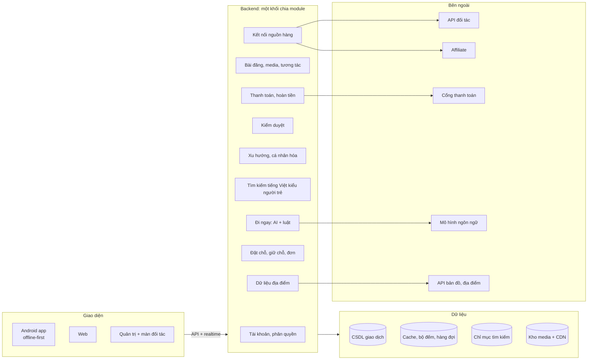
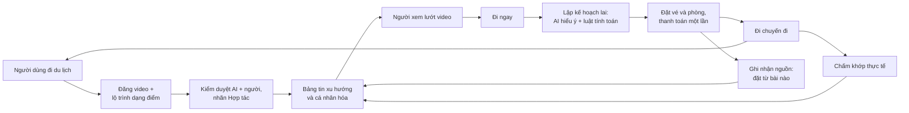
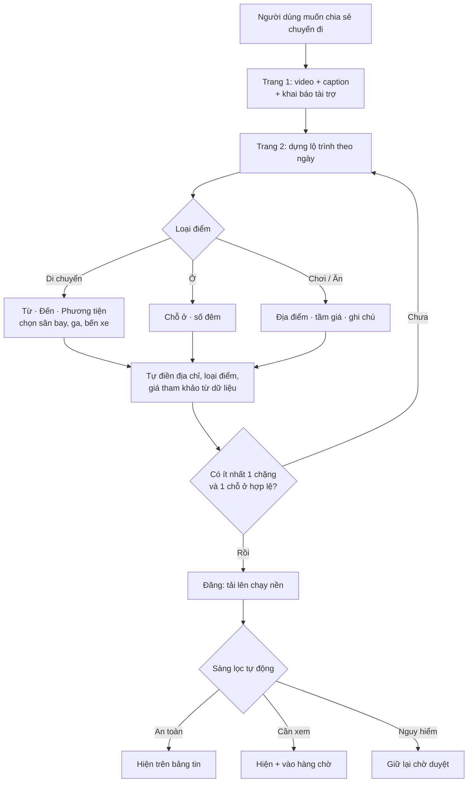
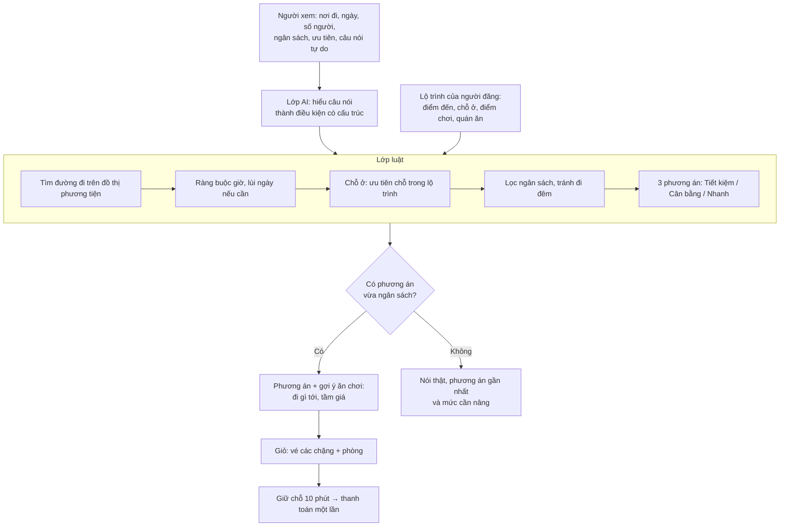
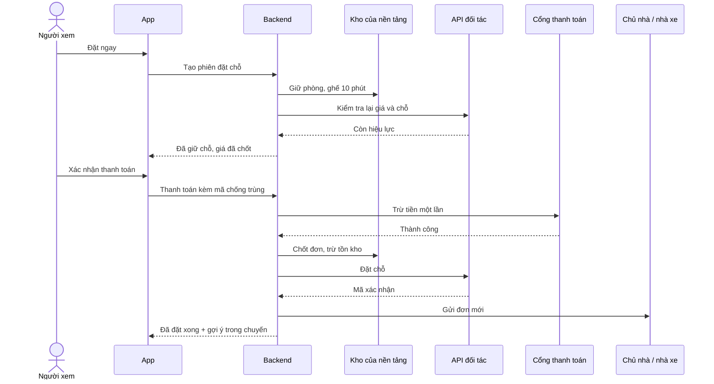
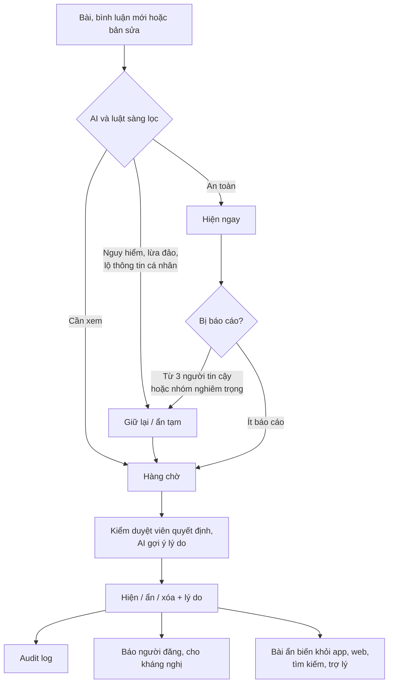

# 03. Ý tưởng triển khai (bản chốt sơ khai)

> **Tên làm việc**: *Đi Ngay*: nền tảng video du lịch "xem là đi được".
> **Bối cảnh**: đề tài mở, nền tảng của riêng đội, không làm cho một tập đoàn nào. [02 – Đề bài](02-de-bai-vinpearl-cho-nguoi-tre.md) dùng làm **tham chiếu yêu cầu** (persona, nghiệm thu, cách đo, quy tắc trung thực). [01 – Kiến thức ngành OTA](01-kien-thuc-nganh-OTA.md) là nền lý thuyết.
> **Bản mô phỏng kèm theo**: [demo/mo-phong-di-ngay.html](../demo/mo-phong-di-ngay.html) (giao diện điện thoại) · [demo/workflow-diagram.html](../demo/workflow-diagram.html) (sơ đồ để trình bày).
> Mọi con số (ngưỡng, trọng số, giá) là **giá trị khởi điểm**, sẽ hiệu chỉnh bằng đo đạc. Số liệu thị trường lấy từ báo chí và trang giới thiệu, cần kiểm chứng trước khi trích dẫn.

---

## 0. Các quyết định đã chốt

| # | Quyết định | Thay cho |
|---|---|---|
| Q1 | Nền tảng độc lập, nguồn hàng **lai**: hàng tự cung cấp + API đối tác + link affiliate | "Chỉ bán dịch vụ Vinpearl" |
| Q2 | **Không bắt buộc xác minh "đã đi thật"** khi đăng bài. Niềm tin dựa vào nhãn Hợp tác, đánh giá "khớp thực tế" sau chuyến, điểm uy tín, kiểm duyệt | Xác minh bằng đơn, email ký số, thẻ lên máy bay, QR, vị trí |
| Q3 | Người đăng dựng **lộ trình bằng các điểm có cấu trúc**, chọn từ dữ liệu địa điểm sẵn có | Lộ trình lấy từ đơn đặt chỗ |
| Q4 | Nút **"Đi ngay"**: bộ lập kế hoạch **lai (AI + luật)** tự lên phương án đi lại và chỗ ở theo nơi đi, ngày, số người, **ngân sách** của người xem rồi đặt luôn | "Đi y chang" sao chép đúng các mục người đăng đã đặt |
| Q5 | Quán ăn, điểm chơi là **gợi ý** (đi gì tới, bao lâu, tầm giá), không đặt trong app | — |
| Q6 | Đăng bài gọn: **một trang** video + caption + khai tài trợ; bỏ bước che mặt người lạ (riêng tư xử lý qua kiểm duyệt, báo cáo) | Nhiều bước, có che mặt |

---

## 1. Ý tưởng

### 1.1. Một câu
> **Ứng dụng video ngắn về du lịch: mỗi video kèm một lộ trình gồm các điểm (đi từ đâu, ở đâu, chơi gì, ăn gì). Người xem bấm "Đi ngay", hệ thống tự lên phương án đi lại và chỗ ở vừa ngân sách, tính từ thành phố của họ, và đặt luôn trong một màn hình.**

### 1.2. Vấn đề
- Người trẻ tìm cảm hứng du lịch qua video ngắn, nhưng giữa "thấy video" và "đặt xong" là một chuỗi việc thủ công: đoán chỗ trong video, tự tìm vé xe hoặc máy bay, tự tìm phòng, tự ghép giờ giấc, tự cân ngân sách.
- Nhiều nội dung là seeding, ảnh "quá đẹp", khó biết có đáng tin không.
- Ngân sách hạn chế; ngại quy trình đặt dài.

### 1.3. Người dùng (theo đề bài)

| Persona | Nhu cầu | Sản phẩm đáp ứng |
|---|---|---|
| **Vy, 21**, ngân sách ít | "Chỗ chill dưới 2 củ" | Ngân sách là đầu vào chính của Đi ngay; tìm bằng lời hiểu tiếng lóng |
| **Khang, 25**, quyết sát ngày | Thấy chuyến hay là muốn đi ngay | Đi ngay ra 3 phương án trong vài giây, đặt trong một màn hình |
| **Linh, 22**, thích kể chuyện | Đăng video kèm lộ trình | Đăng một trang + dựng lộ trình bằng ô chọn địa điểm |
| **Hà, 23**, không tin bài quá đẹp | Muốn biết nội dung thật hay giả | Nhãn Hợp tác, "X người đã đi theo · điểm khớp thực tế", tóm tắt ý kiến |
| **Bạn 17 tuổi** | Muốn đặt phòng | Không được tự đặt; vẫn xem, lưu, lên kế hoạch |
| **Người mới tải app** | Chưa biết đi đâu | Bảng tin xu hướng không cần đăng nhập; trợ lý |
| **Nhân viên kiểm duyệt** | Hàng trăm mục mỗi ngày | Hàng chờ ưu tiên, AI gợi ý, audit log |

---

## 2. Đối chiếu với đề bài

| Yêu cầu đề bài | Trạng thái | Ghi chú |
|---|---|---|
| A1 Bảng tin xu hướng | ✅ | Video dọc kiểu TikTok, lý do ngắn bằng số thật |
| A2 Đăng bài kèm lộ trình | ⚠️ **Điều chỉnh** | Giữ: chữ, ảnh, video, lộ trình, nháp không mất khi rớt mạng. **Bỏ** điều kiện "chỉ người đã đặt và đã đi" (Q2). Lộ trình dựng bằng ô chọn địa điểm thay vì lấy từ đơn (Q3) |
| A3, A6 Tìm bằng lời | ✅ | Chuẩn hóa không dấu, teencode, emoji; tìm theo ý; không có thì nói thật |
| A4, A8 Đặt chỗ, giá thật, không trừ tiền hai lần, chỗ cuối, dưới 18 | ✅ | Giữ chỗ 10 phút, mã chống trùng, trừ tồn kho nguyên tử |
| A5 Chuyến đi của tôi, đồng bộ | ✅ | |
| A7 Gợi ý dành cho bạn | ✅ | |
| A9 Gợi ý phần còn thiếu | ✅ | Gợi ý ăn chơi trong chuyến lưu kèm đơn |
| A10 Tương tác | ✅ | Realtime, đếm đúng, deep link |
| A11 Đặt theo lộ trình | ✅ **Mở rộng** | Thành "Đi ngay": không sao chép mà **lập phương án mới** theo người xem |
| A12 Trợ lý | ✅ | Cùng lớp AI với Đi ngay; không bịa, không tự đặt |
| A13–A16 Quản trị | ✅ | Thêm màn đối tác cho chủ homestay |
| Mục 5 "Không bài đăng giả" | ⚠️ **Thay cơ chế** | Thay xác minh bằng nhãn Hợp tác bắt buộc + đánh giá khớp thực tế + kiểm duyệt (mục 9) |
| Mục 8 "Chỉ dịch vụ Vinpearl" | ❌ Không áp dụng | Đề tài mở (Q1) |

---

## 3. Sản phẩm & danh mục tính năng

**Bốn sản phẩm, một backend**: Android app · Web · Trợ lý (trong app và web) · Trang quản trị (kèm màn đối tác).

Ưu tiên: **P0** bắt buộc cho demo · **P1** nên có · **P2** nếu còn thời gian · **V** tầm nhìn sau dự án.

| Nhóm | Tính năng | Ưu tiên |
|---|---|---|
| **Bảng tin** | Video dọc tự phát, chương theo điểm lộ trình, lý do hot bằng số thật, không lặp bài, mượt trên máy yếu và mạng yếu | P0 |
| | Thả cảm xúc, bình luận, lưu, chia sẻ, báo cáo; realtime giữa app và web | P0 |
| | Bảng lộ trình trượt lên từ video | P0 |
| **Đăng bài** | Một trang: video + caption + khai tài trợ | P0 |
| | Dựng lộ trình bằng ô chọn địa điểm (di chuyển, ở, chơi, ăn), có địa chỉ và tầm giá | P0 |
| | Nháp không mất khi rớt mạng; tải video lên theo từng phần | P0 |
| **Đi ngay** | Chọn nơi đi, ngày, số người, ngân sách, ưu tiên (rẻ / cân bằng / nhanh), tránh đi đêm | P0 |
| | Gõ tự do ("2 đứa, 3 củ mỗi người, không đi xe đêm") → AI hiểu | P0 |
| | 3 phương án, đổi chỗ ở, gợi ý ăn chơi kèm cách đi và tầm giá | P0 |
| | Nói thật khi không có phương án vừa ngân sách, gợi ý mức cần nâng | P0 |
| **Đặt & thanh toán** | Giỏ vé các chặng + phòng, giữ chỗ 10 phút, thanh toán giả lập chống trùng, chỗ cuối cùng, chặn dưới 18 | P0 |
| | Trả trước trong app hoặc trả tại homestay (với hàng tự cung cấp) | P1 |
| **Chuyến đi** | Danh sách chuyến, gợi ý đã lưu, bài đã lưu; đồng bộ đa thiết bị | P0 |
| **Tìm kiếm & trợ lý** | Tìm theo ý, hiểu tiếng Việt kiểu người trẻ; trợ lý gợi ý chỗ và bài có thật | P0 |
| **Quản trị** | Phân quyền, kiểm duyệt, xu hướng và phát hiện đẩy ảo, tra cứu đơn và đơn bất thường | P0 |
| | Màn đối tác: lịch phòng, ngừng bán, giá, đơn mới | P1 |
| | Theo dõi trợ lý: câu hỏi, gợi ý, chi phí (B7) | P1 |
| **Niềm tin** | Nhãn Hợp tác, đánh giá khớp thực tế sau chuyến, điểm uy tín tài khoản | P0 / P1 |
| **Mở rộng** | Offline đọc lại bảng tin (B4), tóm tắt ý kiến (B1) | P2 |
| | Thưởng người đăng theo người đi theo hoàn thành chuyến; API đối tác thật; "Có X triệu đi đâu?"; trợ lý canh giá; định giá theo xu hướng cho homestay | V |

---

## 4. Đăng bài

### 4.1. Bước 1: một trang
Chọn video (gợi ý ≤ 60 giây) · caption · "Bài này có nhận tài trợ không?" (bắt buộc trả lời; "Có" thì gắn nhãn **Hợp tác**).

### 4.2. Bước 2: dựng lộ trình bằng ô có cấu trúc
Theo ngày, mỗi điểm chọn một loại; địa điểm **chọn từ dữ liệu sẵn có** (API bản đồ, danh mục sân bay, ga, bến xe, dữ liệu đối tác, địa điểm tích lũy từ người dùng đã kiểm duyệt).

| Loại | Ô nhập | Tự điền khi chọn từ gợi ý | Dùng cho Đi ngay |
|---|---|---|---|
| **Di chuyển** | Từ · Đến · Phương tiện | Loại điểm + **địa chỉ chi tiết** (ví dụ "Bến xe Mỹ Đình · 20 Phạm Hùng, Nam Từ Liêm, Hà Nội") | Xác định điểm trung chuyển của điểm đến |
| **Ở** | Chỗ ở · Số đêm | Loại chỗ, địa chỉ, giá tham khảo | Ưu tiên chỗ này nếu còn phòng, vừa ngân sách |
| **Chơi / Ăn** | Địa điểm · Tầm giá · Ghi chú | Loại, địa chỉ, giá, khoảng cách tới chỗ ở | Gợi ý kèm "đi gì tới, bao lâu, bao nhiêu" |

- Gõ tên chưa có trong dữ liệu → cảnh báo, khuyên chọn từ gợi ý.
- **Điều kiện đăng**: ít nhất một chặng di chuyển và một chỗ ở chọn từ dữ liệu.

### 4.3. Hệ thống xử lý sau khi đăng
Chuyển mã video (nhiều mức chất lượng, ảnh bìa) → sàng lọc AI (xúc phạm, quảng cáo ẩn, lừa đảo, số điện thoại, link lạ, thông tin cá nhân) → chép lời và đọc chữ để lập chỉ mục tìm kiếm theo ý → đưa vào bảng tin và bắt đầu tính xu hướng.

---

## 5. "Đi ngay": bộ lập kế hoạch lai

### 5.1. Kiến trúc hai lớp

| Lớp | Làm gì | Không được làm |
|---|---|---|
| **AI (agent)** | Hiểu câu nói thành điều kiện có cấu trúc `{origin, ppl, budget/người, noNight, pref}`; hỏi lại 1 câu nếu thiếu; giải thích phương án; nhận yêu cầu sửa | Bịa giá, giờ, chuyến, chỗ; tự đặt chỗ |
| **Luật (rule engine)** | Tìm đường đi, ràng buộc giờ, kiểm tra phòng trống, tính tiền, lọc ngân sách, chọn phương án | — |

**Vì sao lai**: chỉ dùng luật thì không hiểu "3 củ", "đỡ mệt"; chỉ dùng AI thì có thể bịa và khó kiểm thử. Lai thì AI lo phần hiểu, luật lo mọi phép tính từ dữ liệu thật, đúng yêu cầu "không bịa" của đề bài.

### 5.2. Thuật toán (lớp luật)
1. **Đọc lộ trình**: điểm đến, điểm trung chuyển (Tà Xùa → Bến xe Bắc Yên; Phú Quốc → sân bay PQC), số đêm, chỗ ở người đăng chọn.
2. **Đường đi**: tìm trên đồ thị phương tiện (máy bay, tàu, xe giường nằm, limousine), tối đa 2 chặng đặt được + **chặng cuối** gợi ý (xe ôm, taxi) có giá ước tính.
3. **Ràng buộc giờ**: nối chuyến ≥ 1,5 giờ; tới chỗ ở trước 23h ngày 1; chặng quá dài thì **lùi ngày khởi hành** và báo rõ. Chiều về rời sau giờ đã chơi buổi sáng ngày cuối.
4. **Chỗ ở**: số phòng = số người / 2 làm tròn lên; ưu tiên **đúng chỗ trong lộ trình** nếu còn phòng và vừa ngân sách, không thì chỗ tương tự gần đó.
5. **Lọc**: ngân sách mỗi người (vé + phòng), "tránh đi đêm" (chỉ tính chặng dài ≥ 4 giờ phải ngủ trên xe hoặc tàu).
6. **Chọn 3 phương án**: Tiết kiệm (rẻ nhất), Nhanh (ít giờ di chuyển nhất), Cân bằng (tổng điểm chi phí và thời gian đã chuẩn hóa, trọng số theo ưu tiên). Bỏ phương án trùng.
7. **Không có gì vừa ngân sách**: nói thật, đưa phương án gần nhất và mức cần nâng.

### 5.3. Đầu ra cho người xem
- Chiều đi, chỗ ở (đổi được), chiều về: giờ, ngày, giá thật, nguồn hàng.
- **Gợi ý trong chuyến** từ lộ trình người đăng: tên, tầm giá, ghi chú, *"Từ chỗ ở: đi bộ 10 phút"* / *"xe ôm ~20 phút · ~60k"* / *"taxi ~50 phút · ~290k"*.
- Tổng **trả trong app**, **chi phí ngoài app dự kiến**, trạng thái **trong / vượt ngân sách**.

---

## 6. Đặt chỗ & thanh toán

| Vấn đề | Cách làm |
|---|---|
| Giá thật, giá đổi | Báo giá có hạn theo thời gian giữ chỗ; giá đổi thì báo chênh lệch trước khi trả |
| Giữ chỗ | 10 phút cho mọi mục; giờ hết hạn hiển thị là **thật**, không phải đếm ngược giả |
| Không trừ tiền hai lần | Mỗi lần thanh toán có **mã chống trùng (idempotency key)**; server và cổng giả lập chỉ xử lý một lần |
| Chỗ cuối cùng | Trừ tồn kho bằng câu lệnh có điều kiện trong giao dịch; hai người tranh chỗ cuối thì đúng một người được |
| Một mục lỗi | Giữ chỗ tất cả trước khi trả; vẫn lỗi sau khi trả thì áp chính sách người dùng chọn: giữ phần đặt được (hoàn mục lỗi, hủy miễn phí 30 phút) hoặc tất cả hoặc không |
| Dưới 18 tuổi | Ngày sinh khóa sửa; server chặn khi giữ chỗ và khi thanh toán; vẫn cho xem, lưu, lên kế hoạch |
| Đăng nhập giữa chừng | Lưu "ý định", đăng nhập xong quay lại đúng phương án |
| Máy trạng thái đơn | Giữ chỗ → Chờ thanh toán → Đã thanh toán → Đã xác nhận / Thất bại → Hoàn tiền |

---

## 7. Nguồn hàng

| Mô hình | Ví dụ | Cách hoạt động | Hiển thị |
|---|---|---|---|
| **Tự cung cấp** | Homestay, nhà xe đối tác | Kho phòng và ghế trong hệ thống; màn đối tác (lịch phòng, ngừng bán, giá, đơn); trả trước trong app (mua đi bán lại) hoặc trả tại chỗ (đại lý hưởng hoa hồng) | "Bán trực tiếp", số phòng còn thật |
| **API đối tác** | Khách sạn, vé máy bay, tàu | Tìm → kiểm tra lại trước khi trả → đặt. Ví dụ: Traveloka Atlas API (khách sạn), mô hình *Online Affiliates* của Agoda; cần đăng ký làm đối tác và thường đòi có pháp nhân | "Đặt qua đối tác", giá thật |
| **Affiliate** | Vé máy bay khi chưa có API | Giá tham khảo lưu tạm; mở trang đối tác đã điền sẵn, kèm mã theo dõi theo bài | "Liên kết", không hiện giờ và số ghế |

**Trong demo**: mọi nguồn là dữ liệu mô phỏng, không gọi đối tác thật.

**Pháp lý khi làm thật**: cần pháp nhân, đăng ký thương mại điện tử, cổng thanh toán được cấp phép. Bán vé + phòng thành **một gói giá** có thể bị coi là kinh doanh lữ hành (cần giấy phép và ký quỹ), nên giai đoạn đầu bán **từng mục riêng lẻ trong một giỏ**.

---

## 8. Bảng tin, xu hướng, cá nhân hóa

| Thành phần | Đề xuất |
|---|---|
| Tín hiệu và trọng số | Xem đủ lâu 1 · thả cảm xúc 2 · bình luận 3 · lưu/chia sẻ 4 · **đặt qua Đi ngay 10** · bỏ qua nhanh −1. Tính theo **người khác nhau** × **độ tin cậy tài khoản** |
| Thời gian | Tính lại mỗi 5 phút; bán rã 24 giờ (bài), 72 giờ (địa điểm); bài tăng vọt lên bảng tin trong 5–15 phút |
| Chống đẩy ảo | Một người một phiếu; điểm uy tín tài khoản; gom cụm thiết bị/mạng; tác giả tự tương tác không tính; phát hiện tăng vọt từ tài khoản mới → gắn cờ cho quản trị |
| Bảng tin | ~60% hợp gu, ~20% xu hướng chung, ~20% khám phá; người mới xem xu hướng chung, học nhanh từ hành vi, gộp khi đăng nhập |
| Lý do ngắn | Luôn là số thật: "32 người lưu trong 24h", "12 người đã đi theo · 4,6/5 khớp thực tế" |

---

## 9. Niềm tin & kiểm duyệt

Không còn xác minh "đã đi thật", nên chống seeding dựa vào:

| Lớp | Cách làm |
|---|---|
| **Minh bạch** | Nhãn **Hợp tác** bắt buộc với nội dung có tài trợ (nghĩa vụ theo Luật Quảng cáo sửa đổi 2025, hiệu lực 1/1/2026; cần đối chiếu văn bản gốc); khai sai thì nhãn hồi tố, hạ uy tín |
| **Phản hồi thật sau chuyến** | Người đặt qua Đi ngay được mời chấm **"khớp thực tế"** sau chuyến; bài hiện "X người đã đi theo · điểm khớp thực tế". Đây là tín hiệu tin cậy mạnh nhất |
| **Uy tín tài khoản** | Tuổi tài khoản, lịch sử vi phạm, độ chính xác báo cáo, hành vi đa dạng |
| **Kiểm duyệt 3 tầng** | AI sàng lọc khi đăng (an toàn / cần xem / giữ lại) → báo cáo theo độ tin cậy người báo (từ 3 người tin cậy hoặc nhóm nghiêm trọng thì ẩn tạm) → kiểm duyệt viên quyết định, bắt buộc lý do, audit log, người đăng được báo và kháng nghị |
| **Sửa bài** | Sửa chữ nhỏ thì hiện ngay; đổi video hoặc lộ trình thì duyệt lại, trong lúc chờ hiện bản cũ |
| **Riêng tư** | Ảnh có người lạ hoặc giấy tờ được xử lý qua sàng lọc AI và báo cáo; không hiện thông tin cá nhân của người dùng này cho người khác |

---

## 10. Trợ lý (A12)
- **Cùng lớp AI** với Đi ngay: hiểu câu hỏi kiểu người trẻ → gọi công cụ tìm chỗ, giá, bài đang hiển thị → trả lời **chỉ với ID có thật**, qua bộ kiểm chứng (ID tồn tại, giá khớp, trích dẫn bài là đoạn có thật).
- Không tự đặt (không có công cụ đặt). Từ chối ngoài phạm vi hoặc nguy hiểm một cách thân thiện.
- **Nhớ**: hội thoại 30 ngày; sở thích (ngân sách, gu) người dùng xem/sửa/xóa được; chưa đăng nhập thì lưu trên thiết bị 7 ngày, đăng nhập thì gộp; tiếp tục được giữa app và web.
- **Chi phí**: đo token mỗi lượt, quy ra VNĐ; giới hạn khởi điểm 20 tin/ngày (chưa đăng nhập), 50 tin/ngày (đã đăng nhập); mô hình nhỏ cho phân loại, mô hình lớn khi cần diễn đạt; cache câu phổ biến.

---

## 11. Trang quản trị
- **Phân quyền**: quản trị (toàn quyền) và kiểm duyệt (không xem thanh toán, kiểm tra ở server).
- **Kiểm duyệt**: hàng chờ ưu tiên, gợi ý AI, ẩn/hiện/xóa kèm lý do, xem khác biệt bản sửa, audit log; bài ẩn biến khỏi app, web, tìm kiếm, trợ lý trong thời gian ngắn.
- **Xu hướng**: bài và chỗ đang lên, phân rã lý do, biểu đồ theo thời gian, danh sách nghi đẩy ảo.
- **Đơn**: tra cứu, trạng thái đặt và thanh toán, đặt từ bài nào; phát hiện trừ tiền hai lần, đã trả không có chỗ, đặt được một phần.
- **Màn đối tác** (chủ homestay, nhà xe): lịch phòng/ghế, ngừng bán, giá, đơn mới.
- **Bảng số liệu chất lượng**: thời gian tải bảng tin, độ trễ đồng bộ, số lần trừ tiền hai lần (phải = 0), số lần bán vượt chỗ (phải = 0), chi phí trợ lý.

---

## 12. Kiến trúc & dữ liệu

### 12.1. Kiến trúc

**Nguyên tắc**:
1. Một backend, một CSDL cho mọi giao diện.
2. Server là nguồn sự thật cho tiền, chỗ, tuổi, quyền.
3. Offline-first cho thao tác viết trên app.
4. Nhẹ cho máy yếu và mạng yếu.
5. AI không phải nguồn sự thật.
6. Ghi sự kiện từ ngày đầu để đo đạc.

**Công nghệ gợi ý** (đội chốt theo kỹ năng): Android native Kotlin + Jetpack Compose (ưu tiên máy yếu); web có render phía server; CSDL quan hệ có giao dịch (ví dụ PostgreSQL) kèm tìm kiếm vector; Redis cho bộ đếm, hàng đợi; WebSocket hoặc SSE cho realtime.

### 12.2. Thực thể chính

| Nhóm | Thực thể |
|---|---|
| Người dùng | `User` (ngày sinh khóa sửa), `Profile` (gu, ngân sách), `AnonymousSession`, `StaffUser`, `Role` |
| Địa điểm | `Place` (loại: sân bay, ga, bến xe, điểm đến, chỗ ở, điểm chơi, quán ăn; địa chỉ; tọa độ; khu vực; giá tham khảo), `Destination` (điểm trung chuyển, chặng cuối) |
| Phương tiện | `TransportLeg` (từ, đến, phương tiện, giờ khởi hành, thời lượng, giá, nguồn) |
| Bài đăng | `Post` (caption, nhãn Hợp tác), `PostMedia`, `RoutePlan` → `RouteDay` → `RouteStop` (loại, place_ref, from/to, phương tiện, số đêm, tầm giá, ghi chú) |
| Đi ngay | `PlanRequest` (nơi đi, ngày, số người, ngân sách, ưu tiên, câu nói, điều kiện AI hiểu), `PlanOption` (các chặng, chỗ ở, tổng tiền, giờ di chuyển) |
| Đặt chỗ | `Inventory` (theo ngày), `Hold` (10 phút), `Booking`, `BookingItem`, `Payment` (idempotency key duy nhất), `Refund`; `Booking.source_post_id` |
| Tương tác | `Reaction` (duy nhất theo người × bài), `Comment`, `Save`, `Share`, `Report`, `FitRating` (khớp thực tế sau chuyến) |
| Kiểm duyệt, xu hướng | `ModerationItem`, `ModerationAction` (audit), `InteractionEvent`, `TrendScore`, `TrustScore`, `TrendFlag` |
| Trợ lý | `Conversation`, `Message`, `AssistantMemory`, `AssistantUsage` |

**Quy ước API**: có phiên bản `/v1`; tiền là số nguyên VNĐ; ngày giờ ISO 8601; phân trang bằng con trỏ; Idempotency-Key bắt buộc cho giữ chỗ, thanh toán, đăng bài, tương tác; mã lỗi dùng chung (`PRICE_CHANGED`, `SOLD_OUT`, `HOLD_EXPIRED`, `UNDER_18`, `OVER_BUDGET`, `RATE_LIMITED`); **chốt đặc tả API trong tuần 1**.

---

## 13. Sơ đồ workflow

### 13.1. Toàn cảnh

### 13.2. Đăng bài

### 13.3. Đi ngay

### 13.4. Trình tự hệ thống khi thanh toán

### 13.5. Kiểm duyệt

---

## 14. Cách đo (mục 9 đề bài)

**Môi trường chuẩn**: máy yếu (Android 9–10, RAM 2–3GB); mạng yếu (~400 kbps, ~400 ms); ≥ 500 bài mô phỏng có nhãn; mỗi phép đo ghi build, thiết bị, mạng, p50 và p95.

| Mục | Chỉ số & mục tiêu khởi điểm |
|---|---|
| Bảng tin nhanh, mượt | Thấy bài đầu p95 ≤ 4 giây (máy yếu, mạng yếu); khung hình giật ≤ 5%; 0 bài lặp trong 300 bài |
| Xu hướng đúng, khó đẩy ảo | Bài hot lên trong ≤ 15 phút; 50 tài khoản ảo xếp dưới 10 người thật; bấm 200 lần = 1 người |
| Tìm kiếm | Precision@5 ≥ 0,8 trên ≥ 150 câu (không dấu, teencode, tiếng lóng, emoji); nói thật khi không có ≥ 95% |
| **Đi ngay** | Ra phương án p95 ≤ 3 giây; **100% phương án nằm trong dữ liệu thật** (chặng, giờ, giá kiểm tra tự động); tôn trọng ngân sách và "tránh đi đêm" 100%; AI hiểu đúng điều kiện ≥ 90% trên bộ ≥ 100 câu |
| Trợ lý không bịa | 100% gợi ý có ID hợp lệ trên ≥ 200 câu; từ chối đúng ≥ 95%; báo cáo VNĐ/cuộc trò chuyện |
| Từ bài tới thanh toán | ≤ 6 chạm, trung vị ≤ 60 giây (thử với ≥ 5 người ngoài đội) |
| Tương tác đúng | 200 tài khoản cùng thả: sai số 0; lan sang thiết bị khác p95 ≤ 2 giây |
| Không trừ tiền hai lần, không bán trùng | 0 lần trên các tình huống: bấm hai lần, mất mạng rồi thử lại, xác nhận trùng, hai thiết bị cùng trả, tranh chỗ cuối (50 yêu cầu đồng thời), dưới 18 gọi thẳng API |
| Cùng dữ liệu | Đồng bộ app ↔ web ↔ quản trị p95 ≤ 3 giây; bài ẩn biến mất ≤ 60 giây |

---

## 15. Kế hoạch 4 tuần, 7 người

### 15.1. Phạm vi
- **Làm chắc**: phần bắt buộc của đề bài + Đi ngay (dữ liệu mô phỏng cho vài thành phố) + dựng lộ trình bằng ô chọn địa điểm.
- **Làm mỏng**: lớp AI dùng mô hình ngôn ngữ có bộ câu mẫu dự phòng; gợi ý "đi gì tới" theo khoảng cách đường chim bay; màn đối tác.
- **Không làm**: API đối tác thật, thưởng người đăng, các ý tưởng ở mục 18.

### 15.2. Phân vai

| Người | Phụ trách chính |
|---|---|
| 1 | Backend đặt chỗ: kho, giữ chỗ nhiều mục, đơn, thanh toán giả lập, đơn bất thường |
| 2 | Backend nội dung: bài đăng, dữ liệu địa điểm, tương tác realtime, kiểm duyệt, xu hướng |
| 3 | Android: bảng tin video, hiệu năng máy yếu, offline |
| 4 | Android: đăng bài, dựng lộ trình, Đi ngay, Chuyến đi |
| 5 | Web + trang quản trị + màn đối tác |
| 6 | Đi ngay (lớp luật + lớp AI), tìm kiếm, trợ lý, đo chi phí |
| 7 | Dữ liệu mô phỏng (địa điểm, phương tiện, bài mẫu có nhãn), xử lý video, kiểm thử và đo mục 9 |

Leader đổi sau mỗi buổi demo; có buổi giải thích chéo trước demo để mọi người trả lời được về phần của nhau.

### 15.3. Mốc

| Mốc | Mục tiêu | Nội dung chính |
|---|---|---|
| **Tuần 0** (đầu tuần 1) | Cùng một nền | Chốt API và mô hình dữ liệu; dữ liệu mô phỏng; thiết bị và mạng chuẩn; câu hỏi gửi người hướng dẫn |
| **Mốc 1 – Xem được** | Mở app là thấy bảng tin; tìm được chỗ; khung chạy xuyên suốt tới thanh toán giả lập | Bảng tin v1, trang chi tiết, tìm bằng lời v1, thử nghiệm lớp AI, đăng nhập quản trị |
| **Mốc 2 – Đăng được, đặt được** | Đăng bài có lộ trình; đặt chỗ an toàn tuyệt đối | Đăng bài 2 bước, tương tác, đặt chỗ đầy đủ, **lớp luật Đi ngay**, kiểm duyệt, đơn; test thanh toán và đồng thời chạy tự động |
| **Mốc 3 – Đi ngay** | Thấy video → 3 phương án → đặt trong một màn hình | Đi ngay hoàn chỉnh (AI + luật, gợi ý ăn chơi), Chuyến đi, trợ lý trên app và web, xu hướng quản trị, B7; đo đủ mục 9; **thứ Năm ngừng làm tính năng** |
| **Mốc 4 – Báo cáo** | Trình bày trung thực | Số đo so với mục tiêu, điều chưa đạt và vì sao, hướng tiếp theo |

**Đánh giá khả thi**: lõi (bảng tin video + đăng lộ trình + Đi ngay + đặt chỗ an toàn) **khả thi** với 7 người trong 4 tuần nếu giữ đúng phạm vi trên. Mình ước khoảng 70–80% đạt đủ nghiệm thu, tùy kỹ năng thực tế của đội.

---

## 16. Thị trường, khác biệt, khả thi

### 16.1. So sánh

| | Video là trung tâm | Lộ trình gắn video | Tự lên phương án theo ngân sách người xem | Đặt cả chuyến một lần |
|---|---|---|---|---|
| TikTok GO (Mỹ, Indonesia, Nhật; chưa thấy ở Việt Nam) | ✅ | ❌ | ❌ | ❌ đặt từng chỗ, chuyển sang đối tác |
| Trip.com (Trip Moments, Trip Community) | Một phần | Một phần | ❌ | Từng mục |
| Traveloka, Agoda, Booking | ❌ | ❌ | ❌ (tìm kiếm thường) | Combo vé + phòng, không theo nội dung |
| Mindtrip (AI lập lịch trình) | ❌ | ✅ (AI tạo) | Ước tính, không chắc giá thật | Qua đối tác, từng mục |
| Travly, ReelStay, Roomer, Tripbtoz | ✅ | ❌ | ❌ | Thường một khách sạn |
| **Đi Ngay** | ✅ | ✅ (người dùng dựng, có cấu trúc) | ✅ | ✅ |

### 16.2. Vì sao sự kết hợp này chưa xuất hiện (phân tích của đội)
1. Nền tảng video tối ưu thời gian xem, không có hạ tầng đặt chỗ nhiều mục; OTA giỏi bán phòng nhưng thiếu văn hóa cộng đồng video.
2. Phải khởi động ba phía cùng lúc: người đăng, người xem, nguồn hàng.
3. Lập kế hoạch nhiều chặng đúng giờ, đúng ngân sách, giá thật là bài toán khó; AI thuần dễ bịa, luật thuần khó hiểu người dùng.
4. Pháp lý: bán gói có thể là lữ hành; quảng cáo trá hình phải ghi nhãn.
5. Kinh tế đơn vị chưa rõ: biên mỏng, tần suất du lịch thấp.
6. Thời điểm vừa chín: TikTok GO và Trip Community mới ra 2025–2026, cho thấy thị trường đang đi theo hướng "nội dung → đặt chỗ".

### 16.3. Khả thi
| Chiều | Đội lớn, vốn lớn | Bản demo 4 tuần |
|---|---|---|
| Kỹ thuật | Cao | Cao (dữ liệu mô phỏng) |
| Nguồn hàng | Cao (API, bedbank, affiliate, ký trực tiếp homestay) | Mô phỏng |
| Pháp lý | Trung bình – cao | Không áp dụng |
| Người dùng chấp nhận | Trung bình | Thử với ≥ 5 người |
| Kinh tế | Trung bình – thấp | Không áp dụng |
| Cạnh tranh | Rủi ro cao (TikTok, OTA có thể làm tương tự) | — |

→ **Không viễn vông**. Rủi ro thật là **khởi động nội dung** và **khả năng có lãi**, không phải kỹ thuật.

**Thông điệp trình bày**: *"Người trẻ tìm chuyến đi trên video nhưng phải tự ghép vé, phòng, giờ giấc, ngân sách. Đi Ngay biến mỗi video thành một lộ trình, và một nút bấm thành một phương án đặt được vừa túi tiền, tính từ nơi bạn ở. AI hiểu bạn nói gì; còn giá, giờ, chỗ luôn lấy từ dữ liệu thật."*

---

## 17. Rủi ro

| Rủi ro | Mức | Giảm thiểu |
|---|---|---|
| Không có bài đăng mẫu nên bảng tin trống | Cao | Tuần 1 tạo bộ bài mô phỏng có nhãn, video có quyền sử dụng |
| Đi ngay phức tạp, rơi vào mốc 3 | Cao | Làm lớp luật và dữ liệu phương tiện từ mốc 2 |
| AI hiểu sai hoặc tốn chi phí | Cao | Lớp luật kiểm mọi kết quả; bộ câu thử tự động; giới hạn tần suất; đo chi phí từ đầu |
| Seeding khi không xác minh | Trung bình | Nhãn Hợp tác, khớp thực tế, uy tín, kiểm duyệt |
| Dữ liệu địa điểm thiếu, sai | Trung bình | Bắt buộc chọn từ dữ liệu; người dùng báo sai; quản trị sửa |
| Hiệu năng video trên máy yếu | Trung bình | Thử máy thật từ tuần 1; ảnh bìa trước, chất lượng thích ứng |
| Thừa ý tưởng, thiếu thời gian | Trung bình | Khóa danh sách tính năng sau mốc 1 |

---

## 18. Hướng mở rộng sau dự án
- **"Có X triệu, đi đâu?"**: tìm ngược theo ngân sách, dùng lại lớp luật của Đi ngay cho nhiều điểm đến.
- **Trợ lý canh giá**: canh giá giúp người dùng, chuẩn bị sẵn giỏ hàng, người dùng tự bấm đặt.
- **Chế độ "Đang đi"**: tự xử lý sự cố, ví dụ chuyến bay trễ thì báo chỗ ở nhận phòng muộn.
- **Định giá theo xu hướng video** cho homestay nhỏ.
- **Thưởng người đăng** theo người đi theo đã hoàn thành chuyến.
- **API đối tác thật**, giấy phép lữ hành để bán gói; iOS; tính năng nhóm.

---

## 19. Câu hỏi và giả định cần chốt với người hướng dẫn
1. Đội bỏ điều kiện "chỉ người đã đi mới đăng" (A2) và thay bằng nhãn Hợp tác + đánh giá khớp thực tế + kiểm duyệt. Cách này có chấp nhận được cho phần thi không?
2. Đề tài mở với nguồn hàng ngoài Vinpearl (homestay, nhà xe, chặng bay) dùng dữ liệu mô phỏng có nhãn: có được không?
3. Bài đăng mẫu và dữ liệu địa điểm, phương tiện đều là mô phỏng: nhãn "mô phỏng" có cần hiện cho người dùng cuối không?
4. Ban tổ chức có cấp khóa API hay ngân sách cho mô hình ngôn ngữ không?
5. "Máy cấu hình thấp" cụ thể là máy nào?

---

## Nguồn tham khảo (thị trường)
- TikTok GO: [Skift](https://skift.com/2026/05/12/tiktok-go-travel-booking-social-media/) · [TechNode](https://technode.com/2026/05/14/tiktok-launches-tiktok-go-lifestyle-services-brand-in-indonesia-us-and-japan/) · [Engadget](https://www.engadget.com/2170275/tiktok-adds-in-app-travel-booking-services/?rand=26687) · [Tubefilter](https://www.tubefilter.com/?p=187752)
- Trip.com: [Trip Community (PR Newswire)](https://tools.prnewswire.com/en-us/live/20813/release/20251218EN49637) · [Tripblazers](https://uk.trip.com/blog/tripblazers)
- Mindtrip: [App Store](https://apps.apple.com/us/app/mindtrip-ai-travel-companion/id6503107567) · [TechCrunch – Start Anywhere](https://techcrunch.com/?p=2816045) · [aitravel.tools – review](https://aitravel.tools/mindtrip-review/)
- Startup video du lịch: [TechCrunch – Travly](https://techcrunch.com/2024/08/25/travly-social-discovery-booking-platform-travel-influencers) · [ReelStay](https://apps.apple.com/app/id6751936146) · [Roomer](https://apps.apple.com/il/app/roomer-travel-save-earn/id877222676) · [Tripbtoz](https://apps.apple.com/app/id1206972376)
- API đối tác: [Traveloka Partners Network](https://www.travelokapartnersnetwork.com/) · [Traveloka Atlas API](https://atlas.traveloka.com/) · [Agoda Developer](https://developer.agoda.com/demand/docs) · [Travelpayouts – Aviasales Data API](https://support.travelpayouts.com/hc/en-us/articles/203956163-Aviasales-Data-API)
- Luật Quảng cáo 2025: [LuatVietnam](https://luatvietnam.vn/linh-vuc-khac/kols-quang-cao-san-pham-can-luu-y-04-quy-dinh-moi-tu-01-01-2026-883-106335-article.html)
