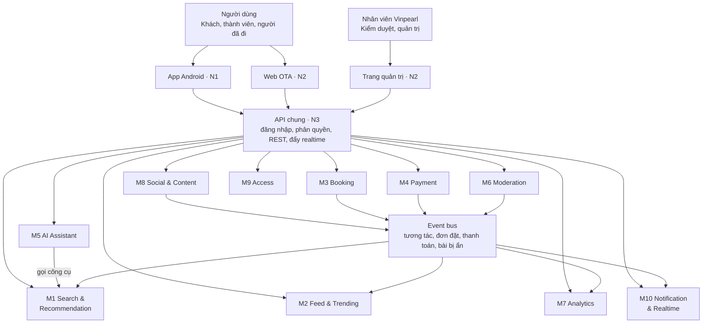
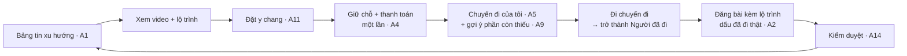
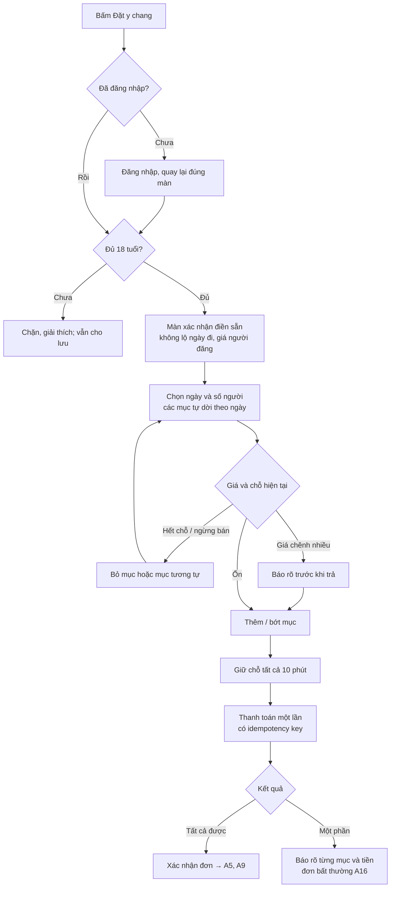
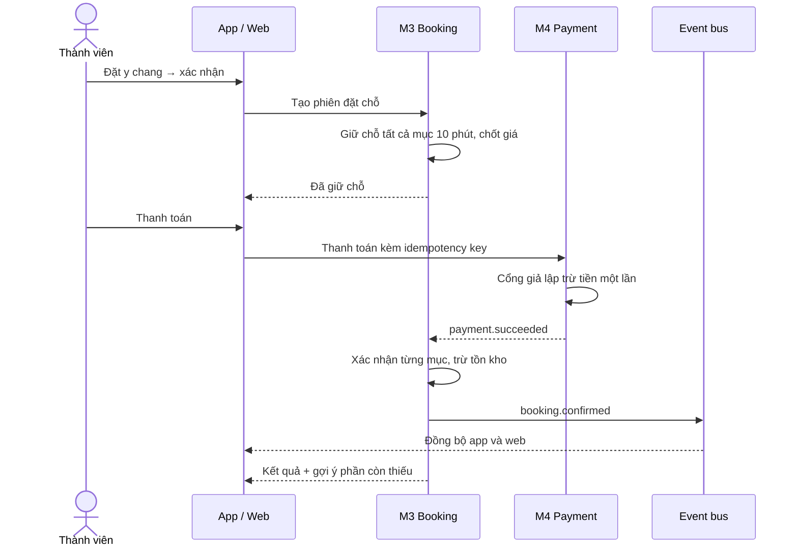
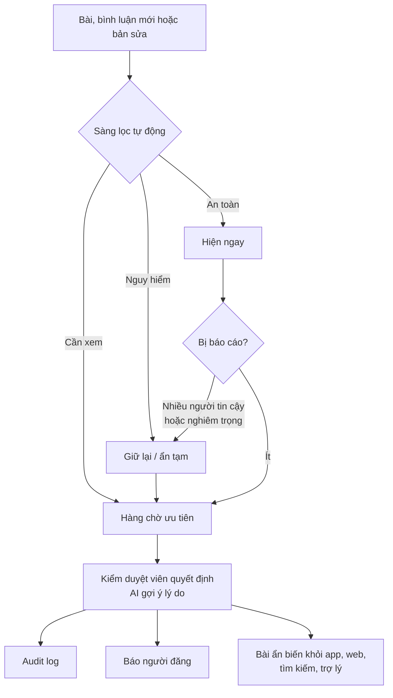

# 03. Tripflix – Ý tưởng triển khai (bản đã chốt)

> ⚠ **Scope đã được thu gọn ở [04 – Scope tinh gọn](04-scope-tinh-gon.md).** Chỗ nào khác nhau thì theo 04; tài liệu này giữ làm tham khảo chi tiết.
>
> **Dự án VSF · Vinpearl cho người trẻ.** Tài liệu này theo đúng hướng nhóm đã chốt (artifact "Bản đồ tính năng Tripflix" và [phân công module](../team/01-phan-cong-nghien-cuu-module.md)).
> Nguồn yêu cầu: [02 – Đề bài](02-de-bai-vinpearl-cho-nguoi-tre.md). Nền lý thuyết: [01 – Kiến thức ngành OTA](01-kien-thuc-nganh-OTA.md).
> Các con số (ngưỡng, thời gian, trọng số) là **giá trị khởi điểm**, chốt ở tuần 2 sau khi đo. Dấu **\*** là giả định của nhóm, cần hỏi lại mentor.

---

## 0. Các quyết định đã chốt

| # | Quyết định |
|---|---|
| Q1 | Tên sản phẩm **Tripflix**. Làm cho **Vinpearl**, dùng **bộ dữ liệu sản phẩm và khách hàng mô phỏng** được cấp; bài đăng mẫu do nhóm tạo, có nhãn "mô phỏng" |
| Q2 | Bốn sản phẩm dùng **một tài khoản, một nguồn dữ liệu**: app Android, web OTA, trợ lý gợi ý (trong app và web), trang quản trị |
| Q3 | Giao diện **mạng xã hội video dọc kiểu TikTok**. Mỗi video gắn **lộ trình thật** và nút **"Đặt y chang"** |
| Q4 | **Chỉ người đã đặt và đã đi mới được đăng bài** về chỗ đó. Bài có dấu **"đã đi thật"**. Lộ trình lấy từ "Chuyến đi của tôi", không gõ lại |
| Q5 | "Người đã đi" là **trạng thái** của thành viên, không phải loại tài khoản riêng |
| Q6 | Trợ lý là **tính năng**, không phải vai trò: chỉ dùng dữ liệu thật, không tự đặt chỗ |
| Q7 | Thanh toán **giả lập** nhưng luồng như thật |
| Q8 | Chia **10 module + 4 việc nền tảng** cho 7 người; module giữ nguyên cả 4 tuần, Leader đổi sau mỗi buổi demo |

---

## 1. Bài toán

**Bối cảnh:** Vinpearl có khách sạn, resort, VinWonders, sân golf, vé máy bay và combo ở Phú Quốc, Nha Trang, Hội An…, nhưng với người trẻ, Vinpearl là *"chỗ bố mẹ đi"*. Người trẻ tìm cảm hứng qua mạng xã hội, ngân sách hạn chế, ngại quy trình đặt dài. Thấy chuyến đi hay là muốn *"đi y chang vậy"*.

**Tripflix trong một câu:**
> Nơi người trẻ xem **video chuyến đi thật của người đã đi**, rồi **"Đặt y chang"** cả lộ trình (chỗ ở, vé vui chơi, vé máy bay, combo) chỉ bằng một chạm.

**Khác một OTA thông thường:**
- Nội dung do người đã đi viết là trung tâm, không phải danh mục sản phẩm.
- Lộ trình đặt lại được gần như một chạm, kèm dấu "đã đi thật".
- Có bảng tin xu hướng và tương tác kiểu mạng xã hội.
- Trợ lý gợi ý chỉ dựa trên dữ liệu có thật.

**Khác TikTok:** chỉ người đã đặt và đã đi mới đăng được, nên không có seeding kiểu "chưa đến mà quay"; mỗi video bấm vào là đặt được.

---

## 2. Người dùng và vai trò

### 2.1. Sáu vai trò

| Phía | Vai trò | Điều kiện | Được làm |
|---|---|---|---|
| Người dùng | **Khách** | Chưa đăng nhập | Xem bảng tin, bài đăng, tìm kiếm, hỏi trợ lý. Muốn tương tác hoặc đặt thì đăng nhập |
| | **Thành viên** | Đã đăng nhập, từ 18 tuổi | Tương tác, nhận gợi ý theo gu, đặt chỗ, Đặt y chang |
| | **Thành viên dưới 18** | Đã đăng nhập, chưa đủ 18 | Như thành viên nhưng **không tự đặt chỗ** |
| | **Người đã đi** | Thành viên có ít nhất một chuyến đã hoàn tất | Thêm quyền **đăng bài về đúng những chỗ đã đi**, kèm lộ trình, có dấu "đã đi thật" |
| Vinpearl | **Quản trị viên** | Nhân viên được cấp quyền | Toàn quyền: kiểm duyệt, xu hướng, đơn đặt chỗ và thanh toán |
| | **Kiểm duyệt viên** | Nhân viên được cấp quyền | Duyệt bài, bình luận, báo cáo; **không xem được thanh toán** |

### 2.2. Chân dung (theo đề bài)

| Chân dung | Nhu cầu | Tripflix đáp ứng |
|---|---|---|
| Vy, 21 | "Chỗ chill dưới 2 củ" | Tìm bằng lời hiểu tiếng lóng, ngân sách; gợi ý tôn trọng ngân sách |
| Khang, 25 | Thấy chuyến Phú Quốc 3 ngày là muốn đặt y chang, quyết sát ngày | Đặt y chang, ít thao tác |
| Linh, 22 | Kể chuyến đi bằng ảnh, video kèm lộ trình | Đăng bài, lộ trình lấy từ chuyến đã đi |
| Hà, 23 | Không tin bài "quá đẹp" | Dấu "đã đi thật", kiểm duyệt, tóm tắt ý kiến (B1) |
| Bạn 17 tuổi | Muốn đặt phòng | Chặn tự đặt, giải thích thân thiện; vẫn xem, lưu |
| Người mới tải app | Chưa tài khoản, chưa biết đi đâu | Bảng tin xu hướng không cần đăng nhập; trợ lý |
| Nhân viên kiểm duyệt | Hàng trăm mục mỗi ngày | Hàng chờ ưu tiên, AI gợi ý, audit log |

### 2.3. Ma trận phân quyền rút gọn

| Tính năng | Khách | Thành viên | Dưới 18 | Người đã đi | Kiểm duyệt | Quản trị |
|---|---|---|---|---|---|---|
| Xem bảng tin, bài, tìm kiếm, trợ lý | ✅ | ✅ | ✅ | ✅ | — | — |
| Thả cảm xúc, bình luận, lưu, báo cáo | Đăng nhập | ✅ | ✅ | ✅ | — | — |
| Đặt chỗ, Đặt y chang | Đăng nhập | ✅ | ❌ | ✅ | — | — |
| Đăng bài | ❌ | ❌ | ❌\* (trừ khi đã đi cùng chuyến) | ✅ (chỗ đã đi) | — | — |
| Kiểm duyệt nội dung | — | — | — | — | ✅ | ✅ |
| Xu hướng | — | — | — | — | ✅ | ✅ |
| Đơn đặt chỗ, thanh toán | Của mình | Của mình | Của mình | Của mình | ❌ | ✅ |

---

## 3. Sản phẩm và tính năng

### 3.1. Tính năng bắt buộc (A1–A16)

| Sản phẩm | Mã | Tính năng |
|---|---|---|
| **App Android** | A1 | Bảng tin xu hướng: video dọc, mở là thấy kể cả chưa đăng nhập, lý do ngắn vì sao đang hot, không lặp, mượt trên máy yếu và mạng yếu |
| | A2 | Đăng bài: chữ, ảnh, video ngắn; chỉ người đã đi; lộ trình lấy từ "Chuyến đi của tôi"; mất mạng không mất bài |
| | A3 | Tìm trong bài đăng bằng lời của mình |
| | A4 | Một chạm tới trang chi tiết, đặt nhanh; giá thật, chống trừ tiền hai lần, chỗ cuối |
| | A5 | Chuyến đi của tôi: chuyến đã đặt, chỗ đã lưu, bài đã lưu, bài đã đăng; đồng bộ đa thiết bị |
| **Web OTA** | A6 | Tìm bằng lời (ngân sách theo người hoặc cả nhóm, nới điều kiện) |
| | A7 | Gợi ý dành cho bạn, có lý do, tôn trọng ngân sách, dùng cả hành vi trên app |
| | A8 | Đặt chỗ đầy đủ: khách sạn, vé máy bay, vé vui chơi, combo; chặn dưới 18 |
| | A9 | Gợi ý phần còn thiếu sau khi đặt |
| **Dùng chung** | A10 | Tương tác: cảm xúc, bình luận, trả lời, lưu, chia sẻ (deep link), báo cáo; đếm đúng; realtime |
| | A11 | **Đặt y chang** theo lộ trình của bài đăng (mục 5) |
| | A12 | Trợ lý gợi ý địa điểm và bài đăng |
| **Quản trị** | A13 | Đăng nhập, phân quyền (quản trị, kiểm duyệt) |
| | A14 | Kiểm duyệt bài và bình luận, audit log, bài ẩn biến mất nhanh |
| | A15 | Theo dõi xu hướng, phát hiện đẩy ảo |
| | A16 | Đơn đặt chỗ, phát hiện đơn bất thường |

### 3.2. Phần mở rộng và đề xuất thêm
- **B1–B7**: nhóm tự chọn và giải thích, làm trong tuần 3. **Đề xuất ban đầu (chờ chốt)**:
  - **B7 Theo dõi trợ lý**: gần như có sẵn vì đề bài đã bắt đo chi phí trợ lý.
  - **B1 Tóm tắt bài đăng**: phục vụ Hà, dùng lại trợ lý.
  - **B4 Dùng khi mất mạng**: củng cố yêu cầu mạng yếu.
- **C1 Trang cá nhân và theo dõi** (nhóm đề xuất thêm): trang người đã đi, danh sách bài, theo dõi để bảng tin ưu tiên.

---

## 4. Giao diện dự kiến
- **App**: mở ra là video review dọc toàn màn hình, vuốt để xem tiếp; bài vlog ảnh + chữ hiện dạng trình chiếu.
- Trên mỗi video: tên người đăng, dấu **"đã đi thật"**, chương theo ngày của lộ trình, thẻ địa điểm (chạm tới trang chi tiết, A4), thanh bên (cảm xúc, bình luận, lưu, chia sẻ), nút **"Lộ trình"** và **"Đặt y chang"**.
- **Web**: tìm bằng lời, gợi ý, bài đăng, đặt chỗ đầy đủ.
- **Quản trị**: hàng chờ kiểm duyệt, xu hướng, đơn đặt chỗ.

---

## 5. Luồng quan trọng nhất: "Đặt y chang" (A11)

Mentor gần như chắc chắn sẽ tự thử luồng này.

| Bước | Màn hình / hành động | Nhánh ngoại lệ phải xử lý |
|---|---|---|
| 1 | Bấm **"Đặt y chang"** trên bài có lộ trình (app hoặc web) | Chưa đăng nhập: đăng nhập xong quay lại đúng màn này, không chọn lại · Dưới 18: chặn, giải thích |
| 2 | **Màn xác nhận điền sẵn** chỗ ở, vé vui chơi, vé máy bay, combo theo lộ trình gốc | Không hiện ngày đi hay số tiền người đăng đã trả |
| 3 | Chọn **ngày đi và số người** | Các mục tự dời theo ngày mới, giữ đúng thứ tự ngày; số phòng tính theo số người |
| 4 | Kiểm tra **giá và chỗ tại thời điểm này** | Giá chênh nhiều: báo rõ trước khi trả · Mục hết chỗ hoặc ngừng bán: báo rõ, cho bỏ hoặc gợi ý mục tương tự |
| 5 | **Thêm hoặc bớt mục** | — |
| 6 | **Giữ chỗ và thanh toán một lần** cho cả lộ trình | Bấm hai lần, mạng chập chờn: không trừ tiền hai lần · Hai người tranh chỗ cuối: chỉ một người được, người kia được báo ngay |
| 7 | **Kết quả**: chuyến vào "Chuyến đi của tôi" (A5), hiện gợi ý phần còn thiếu (A9) | Chỉ đặt được một phần: người dùng biết rõ mục nào được, mục nào không, tiền ra sao; đơn vào mục bất thường (A16) |

**Cách lưu lộ trình để làm được bước 2–3**: lộ trình lưu theo **ngày tương đối** (Ngày 1, 2, 3) và **khung giờ**, tham chiếu tới **loại sản phẩm** (loại phòng, loại vé, tuyến bay, combo). Không lưu ngày thật, giá đã trả, mã đặt chỗ, người đi cùng.

---

## 6. Đăng bài (A2) và dấu "đã đi thật"

1. Điểm bắt đầu: thẻ chuyến đã hoàn tất trong "Chuyến đi của tôi" → **"Kể lại chuyến đi"**. Chưa có chuyến hoàn tất thì giải thích cần đi một chuyến với Vinpearl.
2. Chọn video, ảnh; viết caption; khai báo **có nhận tài trợ không** (có thì gắn nhãn Hợp tác).
3. **Lộ trình tự dựng từ các đơn đã hoàn tất**: người đăng bật/tắt từng mục, thêm ghi chú; không thêm được mục mình không đặt.
4. Xem trước "người khác sẽ thấy gì": ngày đi, giá đã trả, mã đặt chỗ **không bao giờ hiện**.
5. Đăng: tải lên chạy nền, mất mạng vẫn tiếp tục; sàng lọc tự động (an toàn / cần xem / giữ lại).

**"Đã đi" xác định thế nào\***: đơn đã qua ngày trả phòng hoặc ngày sử dụng, không hủy, đã thanh toán. Trong demo có nút quản trị "giả lập check-in". Server kiểm tra lại khi đăng.

---

## 7. Quy tắc đăng nhập và thanh toán

| Cấp | Điều kiện | Được làm |
|---|---|---|
| Khách | Không cần | Xem, tìm, hỏi trợ lý, xem màn Đặt y chang |
| Thành viên | Đăng nhập bằng SĐT (OTP) hoặc Google | Tương tác, lưu, Chuyến đi của tôi |
| Sẵn sàng đặt | Họ tên đúng giấy tờ, ngày sinh (chặn dưới 18, khóa không sửa), email; **hồ sơ hành khách** lưu sẵn | Giữ chỗ |
| Thanh toán | Xác thực của cổng thanh toán (OTP, 3-D Secure, QR) trong luồng giả lập | Thanh toán |

**Cơ chế an toàn:**
- **Giữ chỗ 10 phút**, giờ hết hạn hiển thị là thật.
- **Báo giá có hạn**; giá đổi thì báo trước khi trả.
- **Idempotency key** cho mỗi lần thanh toán.
- **Trừ tồn kho có điều kiện** trong giao dịch, để chỗ cuối chỉ bán một lần.
- **Máy trạng thái đơn**: Giữ chỗ → Chờ thanh toán → Đã thanh toán → Đã xác nhận / Thất bại → Hoàn tiền.
- Lộ trình có một mục lỗi sau khi trả: áp chính sách người dùng chọn trước, **giữ phần đặt được** (hoàn mục lỗi, cho hủy miễn phí phần còn lại 30 phút) hoặc **tất cả hoặc không**.

---

## 8. Đề xuất cho các câu hỏi mở (mục 5 đề bài)

### 8.1. Xu hướng (M2 – Phong)
- **Tín hiệu và trọng số**: xem đủ lâu 1 · cảm xúc 2 · bình luận 3 · lưu/chia sẻ 4 · **đặt y chang 10** · bỏ qua −1. Tính theo **người khác nhau** × **độ tin cậy tài khoản**.
- **Thời gian**: tính lại mỗi 5 phút, phát hiện tăng tốc → bài hot lên bảng tin trong 5–15 phút; bán rã 24 giờ (bài), 72 giờ (địa điểm). Lý do: người trẻ quyết trước 1–2 ngày.
- **Chống nhiều tài khoản**: một người một phiếu; điểm uy tín (tài khoản mới, chưa đi chuyến nào thì trọng số thấp); gom cụm thiết bị/mạng; tác giả tự tương tác không tính; tăng vọt bất thường thì gắn cờ cho A15.
- **Người mới**: xu hướng chung có đa dạng điểm đến và mức giá; thẻ "Bạn thích kiểu nào?" có thể bỏ qua; ~20% bảng tin để khám phá.

### 8.2. Bài đăng và tương tác (M8 – Thanh, M6 – Trang)
- **Biết chắc đã đi**: bài gắn với đơn đã hoàn tất của chính người đăng (mục 6).
- **Bị báo cáo**: sàng lọc AI khi đăng; ẩn tạm khi có từ 3 người báo cáo tin cậy hoặc AI xác nhận nhóm nghiêm trọng; còn lại vào hàng chờ; **người quyết định cuối**, AI chỉ gợi ý.
- **Sửa bài**: sửa chữ nhỏ thì hiện ngay; đổi video hoặc lộ trình thì duyệt lại, trong lúc chờ hiện bản cũ.
- **Số cảm xúc**: kết quả cuối luôn đúng tuyệt đối; hiển thị giữa các thiết bị trễ ≤ 2 giây; người bấm thấy ngay trên máy mình.

### 8.3. Đặt theo lộ trình (M3, M4 – Thắng)
- **Lộ trình hiện gì**: điểm đến, chỗ ở, loại phòng/vé, thứ tự ngày, chặng bay, ghi chú. **Riêng tư**: ngày đi, giá đã trả, mã đặt chỗ, người đi cùng.
- **Xóa bài / mục ngừng bán**: người đã lưu thấy "Bài này đã được tác giả gỡ"; mục ngừng bán có nhãn, khi đặt thì gợi ý mục tương tự. Đơn đã đặt theo bài vẫn giữ nguyên.
- **Một mục thất bại**: giữ chỗ tất cả trước khi trả; chính sách do người dùng chọn (mục 7).

### 8.4. Trợ lý (M5 – Bảo)
- **Không bịa**: hiểu câu hỏi → gọi công cụ tìm chỗ, giá, bài đang hiển thị → chỉ trả lời bằng ID có thật → bộ kiểm chứng (ID tồn tại, giá khớp, trích dẫn là đoạn có thật). Không có công cụ đặt chỗ.
- **Nhớ**: hội thoại 30 ngày; sở thích (ngân sách, gu) người dùng xem/sửa/xóa được; chưa đăng nhập thì lưu trên thiết bị 7 ngày, đăng nhập thì gộp; tiếp tục được giữa app và web.
- **Dữ liệu được dùng**: gu, ngân sách, thích/lưu, điểm đến đã đặt. Không dùng thanh toán, giấy tờ, dữ liệu người khác.
- **Chi phí**: đo token mỗi lượt, quy ra VNĐ; giới hạn khởi điểm 20 tin/ngày (khách), 50 tin/ngày (thành viên).

### 8.5. Đặt chỗ và đồng bộ (M3 – Thắng, M10 – Dung)
- **Giữ chỗ**: 10 phút.
- **App và web mở cùng lúc**: đẩy realtime, p95 ≤ 2–3 giây; mở lại hoặc có mạng lại thì đồng bộ ngay.

---

## 9. Module và phân công

| Mã | Module | Phạm vi | Phụ trách |
|---|---|---|---|
| M1 | Search & Recommendation | A3, A6, A7, A9, B2 | Le Anh Duy |
| M2 | Feed & Trending | A1, điểm xu hướng cho A15 | Nguyen Thanh Phong |
| M3 | Booking | A4, A8, A11, dữ liệu A5, A16 | Nguyen Le Phuc Thang |
| M4 | Payment | Thanh toán giả lập, idempotency, hoàn tiền | Nguyen Le Phuc Thang |
| M5 | AI Assistant | A12, B1, B7 | Le Nguyen Quoc Bao |
| M6 | Moderation | A14, riêng tư ảnh | Le Thi Thuy Trang |
| M7 | Analytics | Màn hình A15, A16, B7; đo mục 9 | Le Thi Thuy Trang |
| M8 | Social & Content | A2, A10, B5, bài mô phỏng | Le Quang Thanh |
| M9 | Access | A13, quay lại đúng màn sau đăng nhập, dưới 18 | Hoang Duc Dung |
| M10 | Notification & Realtime | Đồng bộ app ↔ web, thông báo, B3, B6 | Hoang Duc Dung |
| N1 | Nền tảng App Android | Chọn công nghệ, máy yếu, mạng yếu | Nguyen Thanh Phong |
| N2 | Nền tảng Web và quản trị | Chọn công nghệ, khung trang | Le Quang Thanh |
| N3 | Nền tảng Backend | API Gateway, CSDL, Event bus, quy ước API | Hoang Duc Dung |
| N4 | Đo lường | Bản đề xuất cách đo mục 9 | Le Thi Thuy Trang (Leader tuần 1) |

Chi tiết việc từng người, khung báo cáo, các cặp phối hợp: xem [team/01](../team/01-phan-cong-nghien-cuu-module.md).

---

## 10. Kiến trúc và dữ liệu

### 10.1. Kiến trúc

**Nguyên tắc**:
1. Một backend chia module, một CSDL cho mọi giao diện.
2. Server là nguồn sự thật cho tiền, chỗ, tuổi, quyền.
3. Offline-first cho thao tác viết trên app.
4. Nhẹ cho máy yếu và mạng yếu (ảnh nhiều kích cỡ, video HLS tự hạ chất lượng, phân trang con trỏ).
5. AI không phải nguồn sự thật.
6. Ghi sự kiện từ ngày đầu để đo đạc.

### 10.2. Tám khối dữ liệu

| Khối | Nội dung | Tính năng | Module |
|---|---|---|---|
| Tài khoản và hồ sơ | Tuổi, ngân sách, gu, vai trò nhân viên, hồ sơ hành khách | A5, A7, A13 | M9 |
| Sản phẩm, giá, tồn kho | Khách sạn, vé bay, vé vui chơi, combo; giá theo ngày, còn chỗ | A4, A6, A8 | M3 |
| Đơn đặt chỗ và thanh toán | Giữ chỗ, thanh toán giả lập, trạng thái, đơn bất thường, bài nguồn | A4, A11, A16 | M3, M4 |
| Bài đăng và lộ trình | Chữ, ảnh, video; lộ trình (ngày tương đối, mục, ghi chú) gắn với đơn đã đi | A2, A3, A11 | M8 |
| Tương tác | Cảm xúc (duy nhất theo người × bài), bình luận, lưu, chia sẻ, báo cáo | A10 | M8 |
| Tín hiệu xu hướng và gu | Xem, thích, lưu, bỏ qua, đặt y chang; điểm xu hướng; điểm uy tín | A1, A7, A15 | M2, M1 |
| Kiểm duyệt và nhật ký | Hàng chờ, trạng thái ẩn/hiện, ai làm, lúc nào, vì sao | A14 | M6 |
| Hội thoại trợ lý | Lịch sử, bộ nhớ sở thích, chi phí mỗi cuộc | A12, B7 | M5 |

**Ràng buộc đồng bộ:**
- Thao tác trên web thì app thấy **ngay** và ngược lại (A10).
- Hai điện thoại và web của cùng tài khoản thấy **cùng dữ liệu** (A5).
- Bài bị ẩn biến mất khỏi app, web và trợ lý **trong thời gian ngắn** (A14).

**Quy ước API** (N3 soạn, chốt tuần 1):
- API có phiên bản `/v1`; tiền là số nguyên VNĐ; ngày giờ ISO 8601.
- Phân trang bằng con trỏ.
- Idempotency-Key cho giữ chỗ, thanh toán, đăng bài, tương tác.
- Mã lỗi dùng chung: `PRICE_CHANGED`, `SOLD_OUT`, `HOLD_EXPIRED`, `UNDER_18`, `NOT_TRAVELED`, `RATE_LIMITED`.
- Sự kiện đặt tên thống nhất, ví dụ `post.hidden`, `booking.confirmed`, `interaction.created`.

### 10.3. Công nghệ (chưa chốt, chờ buổi họp ghép và ý kiến mentor)

| Lớp | Phương án A | Phương án B |
|---|---|---|
| App Android | React Native (Expo) + FlashList + expo-video | **Kotlin + Jetpack Compose** + Media3/ExoPlayer, Room, WorkManager (mượt nhất trên máy yếu) |
| Web + quản trị | Next.js | Next.js |
| Backend | NestJS (TypeScript) | FastAPI (Python, mạnh cho AI) |
| Dữ liệu | PostgreSQL (giao dịch) + pgvector · Redis (cache, bộ đếm, hàng đợi) · kho đối tượng + CDN (video HLS) | Như A |

Tiêu chí chọn: người phụ trách giải thích được nguyên lý (mục 12 đề bài), hiệu năng trên máy yếu, và tốc độ làm trong 4 tuần.

---

## 11. Sơ đồ workflow

### 11.1. Vòng sản phẩm

### 11.2. Đặt y chang

### 11.3. Trình tự thanh toán

### 11.4. Kiểm duyệt

---

## 12. Cách đo (mục 9, N4 – Trang gom)

**Môi trường chuẩn\***: máy Android yếu (Android 9–10, RAM 2–3GB); mạng yếu (~400 kbps, ~400 ms); ≥ 500 bài mô phỏng có nhãn; mỗi phép đo ghi build, thiết bị, mạng, p50 và p95.

| Mục | Chỉ số & mục tiêu khởi điểm | Người đề xuất |
|---|---|---|
| Bảng tin nhanh, mượt | Thấy bài đầu p95 ≤ 4 giây (máy yếu, mạng yếu); khung hình giật ≤ 5%; 0 bài lặp trong 300 bài | Phong |
| Xu hướng đúng, khó đẩy ảo | Bài hot lên ≤ 15 phút; 50 tài khoản ảo xếp dưới 10 người thật; bấm 200 lần = 1 người | Phong |
| Tìm đúng kiểu người trẻ | Precision@5 ≥ 0,8 trên ≥ 150 câu (không dấu, teencode, tiếng lóng, emoji); nói thật khi không có ≥ 95% | Duy |
| Trợ lý không bịa | 100% gợi ý có ID hợp lệ trên ≥ 200 câu; từ chối đúng ≥ 95%; báo cáo VNĐ/cuộc | Bảo |
| Từ bài tới thanh toán | ≤ 6 chạm, trung vị ≤ 60 giây (≥ 5 người ngoài nhóm) | Thắng |
| Tương tác đúng | 200 tài khoản cùng thả: sai số 0; lan sang thiết bị khác p95 ≤ 2 giây | Thanh |
| Không trừ tiền hai lần, không bán trùng | 0 lần trên các tình huống: bấm hai lần, mất mạng rồi thử lại, xác nhận trùng, hai thiết bị cùng trả, 50 yêu cầu tranh chỗ cuối, dưới 18 gọi thẳng API | Thắng |
| Cùng dữ liệu | Đồng bộ p95 ≤ 3 giây; bài ẩn biến mất ≤ 60 giây | Dung, Trang |

---

## 13. Lộ trình 4 tuần

| Tuần | Chủ đề | App | Web | Trợ lý | Quản trị | Phải trả lời được |
|---|---|---|---|---|---|---|
| 1 | **Nền móng** | Bảng tin xu hướng, trang chi tiết | Tìm bằng lời, gợi ý, trang chi tiết | Thử nghiệm cách làm, bộ câu hỏi thử | Đăng nhập, phân quyền | Hiểu bài toán thế nào? Chọn cách làm từng sản phẩm, vì sao? Bản đề xuất cách đo |
| 2 | **Lõi giao dịch** | Đăng bài, tương tác, tìm trong bài, đặt nhanh | Xem và tương tác bài, đặt chỗ đầy đủ, gợi ý sau khi đặt | Gợi ý địa điểm | Kiểm duyệt, đơn đặt chỗ | Đề xuất cho câu hỏi mở về xu hướng, bài đăng, đặt chỗ, thể hiện trong sản phẩm. Cách đo đã chốt |
| 3 | **Nối mọi thứ** | Đặt y chang, Chuyến đi của tôi, phần mở rộng | Đặt y chang, Chuyến đi của tôi | Đề xuất bài đăng, chạy trên app và web | Theo dõi xu hướng | Câu hỏi mở về lộ trình và trợ lý; kết quả đo; vì sao chọn phần mở rộng. **Thứ Năm ngừng làm tính năng** |
| 4 | **Tổng kết** | Báo cáo và trình bày | | | | Nếu có thêm thời gian, nhóm làm gì tiếp? |

Mỗi tuần kết thúc bằng demo chiều thứ Sáu trên máy thật. Để giảm rủi ro cho tuần 3: mô hình lộ trình theo ngày tương đối và giữ chỗ nhiều mục phải xong từ tuần 2.

---

## 14. Rủi ro

| Rủi ro | Mức | Giảm thiểu |
|---|---|---|
| Bộ dữ liệu không có bài đăng nên bảng tin trống | Cao | Tuần 1 tạo bài mô phỏng có nhãn, gắn với đơn mô phỏng đã hoàn tất (Thanh) |
| Đặt y chang (A11) phức tạp, rơi vào tuần 3 | Cao | Làm lộ trình theo ngày tương đối và giữ chỗ nhiều mục từ tuần 2 |
| Trợ lý bịa hoặc tốn chi phí | Cao | Bộ kiểm chứng, bộ câu thử tự động, giới hạn tần suất, đo chi phí từ đầu |
| Video giật trên máy yếu | Trung bình | Thử máy thật từ tuần 1; HLS nhiều mức; ảnh bìa trước |
| Ranh giới module vỡ khi ghép | Trung bình | Chốt API, sự kiện, quyền trong tuần 1 (Dung chủ trì) |
| Thừa ý tưởng, thiếu thời gian | Trung bình | Khóa danh sách tính năng sau tuần 1 |

---

## 15. Câu hỏi và giả định cần hỏi mentor
1. **Bài đăng mẫu**: bộ dữ liệu không có bài đăng; nhóm tạo bài mô phỏng có nhãn, gắn với đơn mô phỏng đã hoàn tất. Nhãn "mô phỏng" có cần hiện cho người dùng cuối không?
2. **"Đã đi" xác định thế nào**: dữ liệu có trạng thái check-in không? Nếu không, coi đơn qua ngày trả phòng là đã đi và có nút quản trị giả lập check-in.
3. **Người đi cùng** (không phải người đặt) có được đăng bài "đã đi thật" nếu được chủ đơn mời vào chuyến không?
4. **Tuổi**: ngày sinh khai khi đăng ký, khóa sửa, kiểm tra ở server. Như vậy đã đủ chưa?
5. **Combo trong dữ liệu** là gói giá cố định hay ghép từ các mục lẻ? Dời ngày áp dụng thế nào?
6. **Công nghệ**: có bắt buộc app Android native (Kotlin) không, hay React Native/Flutter cũng được? "Máy cấu hình thấp" cụ thể là máy nào?
7. **Trợ lý**: ban tổ chức có cấp khóa API hay ngân sách cho mô hình ngôn ngữ không?

---

## 16. Hướng phát triển nếu có thêm thời gian
- **"Đi ngay" (lên phương án từ nơi tôi ở)**: bổ sung cho Đặt y chang. Người xem ở thành phố khác hoặc có ngân sách riêng thì hệ thống (AI hiểu yêu cầu + luật tính chặng đi, giờ, chỗ ở) lên 3 phương án Tiết kiệm / Cân bằng / Nhanh. Bản mô phỏng thử nghiệm: [demo/mo-phong-di-ngay.html](../demo/mo-phong-di-ngay.html).
- **"Có X triệu, đi đâu?"**: tìm ngược theo ngân sách.
- **Trợ lý canh giá**: chuẩn bị sẵn giỏ hàng khi giá giảm, người dùng tự bấm đặt (mở rộng B3).
- **Chế độ "Đang đi"**: lịch trình hôm nay, vé QR, tự xử lý sự cố khi chuyến bay trễ.
- **Thưởng người đã đi** theo số người đặt y chang đã hoàn thành chuyến (không thưởng theo lượt xem).
