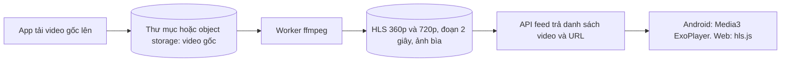
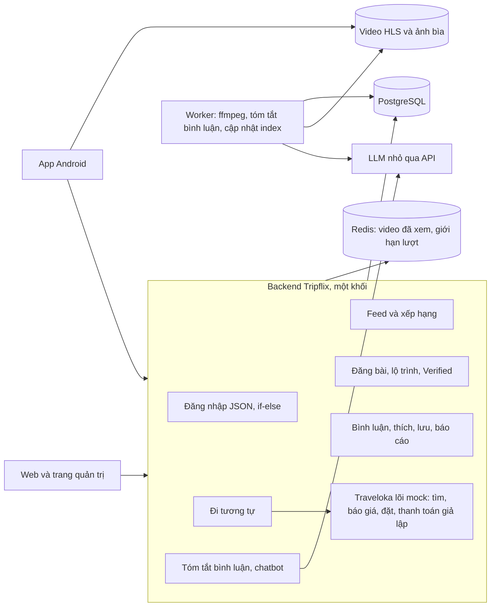

# 04. Tripflix – Scope tinh gọn (bản mới nhất)

> Tài liệu này **thay thế phần scope và ưu tiên** trong [03. Ý tưởng triển khai](03-y-tuong-trien-khai.md). Chỗ nào 03 và 04 khác nhau thì theo 04. Các báo cáo trong `reports/` giữ làm tài liệu tham khảo.
> [Đề bài](02-de-bai-vinpearl-cho-nguoi-tre.md) vẫn là bắt buộc. Mục 9 liệt kê chỗ nào scope mới đơn giản hóa hoặc **xung đột** với đề bài, kèm câu hỏi cần gửi mentor.

---

## 0. Thay đổi so với bản trước

| Chủ đề | Bản trước (03) | Bản này (04) |
|---|---|---|
| Trọng tâm | Dàn đều 16 tính năng A1–A16 | **Luồng video dọc kiểu TikTok** là lõi; còn lại làm vừa đủ |
| Ai được đăng | Chỉ người đã đặt và đã đi | **Ai cũng đăng được** lộ trình bất kỳ; dùng dịch vụ của app thì được **huy hiệu Verified** (xem mục 9, cần mentor đồng ý) |
| Lộ trình | Chỉ lấy từ đơn đã đặt | Lấy từ đơn đã đặt **hoặc** tự nhập địa điểm |
| Đặt chỗ | Tự xây hệ thống đặt chỗ | Giả định **"Traveloka lõi" đã có sẵn** (đặt vé máy bay/xe, đặt phòng); Tripflix gọi vào để đặt trọn gói |
| Phân quyền | 6 vai trò, ma trận quyền | **File JSON tài khoản + if-else** |
| Dữ liệu | Bộ dữ liệu Vinpearl + dữ liệu sinh thêm | **Mock toàn bộ**, gắn nhãn "mô phỏng" |
| AI | Trợ lý, tìm theo nghĩa, gợi ý, kiểm duyệt, xu hướng… | **Hai thứ**: tóm tắt bình luận (thực tế so với video) và chatbot đơn giản |

---

## 1. Sản phẩm trong một câu

> Lướt video du lịch dọc như TikTok. Video nào có lộ trình thì bấm **"Đi tương tự"** để đặt trọn gói vé và phòng. Huy hiệu **Verified** cho biết người đăng đã đi bằng dịch vụ của app. Phần **"Người đi rồi nói gì"** tóm tắt bình luận để thấy video lung linh có giống thực tế không.

---

## 2. Tính năng theo mức ưu tiên

| Mức | # | Tính năng | Xong khi |
|---|---|---|---|
| **P0 – lõi** | F1 | **Feed video dọc** | Mở app là phát video ngay, vuốt lên/xuống mượt, video kế tiếp đã tải sẵn, mạng yếu tự hạ chất lượng, không lặp video đã xem |
| | F2 | **Đăng video + dựng lộ trình** | Chọn video, viết caption, hashtag, dựng lộ trình theo ngày. Mỗi mục chọn từ "Chuyến đi của tôi" (đơn đã đặt) hoặc tự nhập địa điểm |
| | F3 | **Huy hiệu Verified** | Bài có mục lộ trình khớp đơn đã hoàn tất của chính người đăng thì hiện huy hiệu; từng mục có dấu tick riêng |
| | F4 | **"Đi tương tự" → đặt trọn gói** | Từ video bấm một nút, ra màn trọn gói (phương tiện + phòng + vé) đã điền sẵn theo lộ trình, chọn ngày và số người, giá hiện tại, thanh toán giả lập một lần |
| | F5 | **Tương tác cơ bản** | Thích, bình luận, trả lời, lưu, chia sẻ link; app và web thấy cùng số liệu |
| **P1 – mở rộng có AI** | F6 | **Tóm tắt bình luận "Người đi rồi nói gì"** | Dưới video có thẻ: điểm khen, điểm chê, **"Video và thực tế"**, mỗi ý kèm số người và bình luận gốc |
| | F7 | **Chatbot đơn giản** | Nói "đi X, Y người, Z tiền" → gợi ý lộ trình từ video có sẵn + link video → đổi một mục → so sánh → "Đi tương tự" |
| **P2 – làm tối thiểu** | F8 | Web | Xem video, tương tác, "Đi tương tự", chatbot. Dùng chung API |
| | F9 | Trang quản trị | Một trang: danh sách bài và bình luận bị báo cáo, nút ẩn/hiện; danh sách đơn |
| | F10 | Tìm kiếm | Ô tìm theo từ khóa không dấu trên caption, hashtag, điểm đến |
| **Cắt** | | Gợi ý cá nhân hóa bằng ML, xu hướng chống đẩy ảo, tìm theo nghĩa bằng embedding, tìm bằng ảnh, thông báo đẩy, chuyển mã video phức tạp, phân quyền chi tiết | |

---

## 3. F1: Feed video dọc

### 3.1. Chuỗi xử lý video



| Quyết định | Chọn | Vì sao |
|---|---|---|
| Định dạng phát | **HLS**, 2 mức: 360p (~500 kbps) và 720p (~1,5 Mbps), đoạn 2 giây | Mạng yếu tự hạ xuống 360p; đoạn ngắn thì bắt đầu phát nhanh |
| Chuyển mã | 1 lệnh ffmpeg mỗi video trong worker; giới hạn video ≤ 60 giây | Đủ cho demo, không cần dịch vụ chuyển mã |
| Lưu trữ | Thư mục tĩnh hoặc MinIO, phục vụ qua HTTP; chưa cần CDN | Demo vài trăm video |
| Phát trên Android | Media3 ExoPlayer, **một player dùng lại** cho trang đang xem, tải trước đoạn đầu của 2 video kế tiếp | Máy yếu không chịu nổi nhiều player cùng lúc |
| Ảnh bìa và blurhash | Hiện ngay khi video chưa tải xong | Cảm giác "mở là thấy" |
| Video mock | Tự quay hoặc lấy clip có giấy phép cho phép dùng (kiểm tra giấy phép từng clip) | Đề bài §7: nội dung phải có quyền sử dụng |

### 3.2. Xếp hạng feed: công thức, không ML

```
điểm = 0,5 × độ_mới + 0,3 × tương_tác_gần_đây + 0,2 × ngẫu_nhiên
độ_mới            = giảm một nửa sau mỗi 48 giờ
tương_tác_gần_đây = log(1 + thích + 2 × lưu + 3 × bình luận + 5 × "Đi tương tự") trong 72 giờ, chuẩn hóa 0–1
```

- Phân trang bằng con trỏ, mỗi lần 10 video. Video đã trả cho người này lưu trong Redis 24 giờ để không lặp.
- Bài Verified được cộng nhẹ (+0,1).
- Mỗi video kèm một dòng lý do ngắn ("Đang được lưu nhiều", "Mới đăng", "Đã đi thật"). Đề bài A1 yêu cầu có lý do.

---

## 4. F2 + F3: Đăng bài, lộ trình tự do, huy hiệu Verified

### 4.1. Mỗi mục lộ trình là một trong hai loại

| Loại mục | Nguồn | Có thể "Đi tương tự" chính xác? | Verified? |
|---|---|---|---|
| **Mục dịch vụ** | Chọn từ "Chuyến đi của tôi": một đơn đã đặt qua Traveloka lõi (chuyến bay/xe, phòng, vé) | Có: đặt đúng sản phẩm đó | **Có**, nếu đơn đã hoàn tất |
| **Mục tự nhập** | Gõ tên địa điểm, chọn điểm đến, ghi chú (ví dụ "ăn bún chả cá chợ Đầm", "ở homestay của bạn") | Không: hệ thống gợi ý dịch vụ tương đương cùng điểm đến | Không |

Người đăng **không bao giờ** phải dùng dịch vụ của app mới được đăng. Lộ trình chỉ lưu **ngày tương đối** (Ngày 1, 2, 3) và buổi, không lưu ngày thật, giá đã trả hay mã đặt chỗ.

### 4.2. Quy tắc huy hiệu (if-else, kiểm ở server lúc đăng và lúc sửa)

```text
mục được tick "đã đặt qua Tripflix" khi:
    mục là mục dịch vụ
    VÀ đơn đó thuộc chính người đăng
    VÀ trạng thái đơn = hoàn tất (đã qua ngày trả phòng hoặc ngày đi)

bài có huy hiệu Verified khi:
    có ít nhất 1 mục được tick là chỗ ở hoặc phương tiện
```

- Trên video: huy hiệu **Verified** ở cạnh tên người đăng. Trong màn lộ trình: dấu tick ở từng mục đã đặt qua app.
- Bài không có huy hiệu vẫn hiện bình thường, ghi nhỏ "Lộ trình do người đăng tự chia sẻ".
- Demo: trang quản trị có nút **"Giả lập đã đi"** để chuyển đơn mock sang hoàn tất.

### 4.3. Riêng tư

Màn xem trước khi đăng hiện đúng những gì người khác sẽ thấy. Ngày đi, giá đã trả, mã đặt chỗ, người đi cùng **không bao giờ** hiện (đề bài A11, §6).

---

## 5. F4: "Đi tương tự" → đặt trọn gói qua Traveloka lõi

### 5.1. Giả định về Traveloka lõi

Coi như một dịch vụ có sẵn, trong demo là **một module mock trong cùng backend** đọc dữ liệu từ JSON/SQL seed. Tripflix chỉ gọi 4 API:

| API lõi | Dùng để |
|---|---|
| `GET /core/search?type=flight\|bus\|hotel\|ticket&destination=&date=&pax=` | Tìm dịch vụ cho mục tự nhập, tìm lựa chọn thay thế |
| `POST /core/quote` `{items[], start_date, pax}` | Báo giá hiện tại cho cả gói, mục nào hết chỗ |
| `POST /core/bookings` `{quote_id}` + `Idempotency-Key` | Tạo đơn trọn gói, giữ chỗ 10 phút |
| `POST /core/bookings/{id}/pay` `{method}` | Thanh toán giả lập |

Phần khó của đặt chỗ (giữ chỗ, không bán chỗ cuối hai lần, không trừ tiền hai lần) **thuộc lõi**. Trong mock vẫn làm tối thiểu: trừ tồn có điều kiện trong một giao dịch và khóa idempotency, vì mentor sẽ thử (đề bài A4, A11).

### 5.2. Luồng

1. Bấm **"Đi tương tự"** trên video. Chưa đăng nhập thì đăng nhập xong quay lại đúng màn này.
2. Chọn **ngày đi, số người, nơi xuất phát**.
3. Server dựng gói:
   - Mục dịch vụ → đúng sản phẩm đó, dời theo ngày mới.
   - Mục tự nhập là chỗ ở/phương tiện → lõi tìm 1 lựa chọn cùng điểm đến, gắn nhãn **"Gợi ý tương đương"**.
   - Mục ăn uống, tham quan tự do → giữ làm ghi chú, không tính tiền.
   - Chặng đi/về → tìm chuyến từ nơi xuất phát.
4. Màn **xác nhận trọn gói**: từng mục, giá hiện tại, mục hết chỗ có nút đổi/bỏ, tổng tiền.
5. Thanh toán giả lập một lần → đơn vào "Chuyến đi của tôi". Đơn ghi `source_post_id` để đếm số lần "Đi tương tự" thành công.

---

## 6. F6: Tóm tắt bình luận "Người đi rồi nói gì"

### 6.1. Ý tưởng

Video luôn đẹp. Bình luận của **người đã đi thật** mới cho biết thực tế. AI gom bình luận, tách khen/chê, và chỉ ra chỗ **video khác thực tế**.

```text
┌───────────────────────────────────────────────┐
│ Người đi rồi nói gì · AI tóm tắt 46 bình luận │
│ 12 người đã đi (8 đặt qua Tripflix)            │
│                                               │
│ 👍 Biển trong, hoàng hôn đẹp (9 người)          │
│ 👍 Nhân viên thân thiện (5)                     │
│ 👎 Hồ bơi đông vào cuối tuần (6)                │
│ 👎 Đồ ăn trong resort đắt (4)                   │
│ ⚠ Video và thực tế: phòng nhỏ hơn trong video, │
│   view biển chỉ có ở tầng cao (5 người đã đi)  │
│                                   Xem bình luận│
└───────────────────────────────────────────────┘
```

### 6.2. Cách làm

| Bước | Làm bằng | Chi tiết |
|---|---|---|
| 1. Lọc | Luật | Bỏ bình luận bị ẩn, quá ngắn ("đẹp quá", emoji đơn), trùng lặp, spam link |
| 2. Gắn nhãn người bình luận | **Luật, không dùng AI** | **"Đã đi (Tripflix)"** nếu người bình luận có đơn hoàn tất cho một sản phẩm trong lộ trình hoặc cùng điểm đến. Còn lại để LLM đánh dấu "tự nhận đã đi" nếu bình luận có ý "mình ở đây rồi", "tuần trước mình đi" |
| 3. Phân tích | **Một lần gọi LLM** cho cả bài | Đầu vào: caption + mô tả lộ trình + danh sách bình luận `{id, nhãn người, nội dung}`. Đầu ra JSON: `pros[]`, `cons[]`, `reality_gaps[]`, mỗi ý có `comment_ids[]` |
| 4. Kiểm tra | Code | Mọi `comment_id` phải có thật và đang hiện; ý nào không có bình luận làm căn cứ thì bỏ; đếm số người từ `comment_ids`, không lấy số LLM tự viết |
| 5. Lưu và hiện | Bảng `comment_summaries` | Hiện khi có **≥ 5 bình luận có nội dung, trong đó ≥ 2 người đã đi**; dưới ngưỡng ghi "Chưa đủ người đi rồi để tóm tắt" |

**"Video và thực tế"** chỉ lấy từ bình luận của người **đã đi** (Tripflix hoặc tự nhận) mà mâu thuẫn với caption hoặc lộ trình. Người chưa đi chê thì vào mục chê, không vào mục này. Mục này phải có ít nhất 2 người đã đi cùng ý mới hiện.

**Khi nào chạy lại:** khi có thêm 10 bình luận mới hoặc một bình luận bị ẩn, tối đa 1 lần mỗi 10 phút mỗi bài. Chạy nền, không chạy lúc người dùng mở video.

**Chi phí:** một bài 50 bình luận khoảng 2.000 token vào, 400 token ra. Với model nhỏ theo bảng giá trong [báo cáo Module AI](../reports/Module%20AI%20Tripflix%20chuy%C3%AAn%20s%C3%A2u.md), mỗi lần dưới 10 VNĐ (ước tính, đo thật qua `llm_calls`).

**Hiển thị trung thực:** nhãn "AI tóm tắt"; số người đếm bằng code; bấm vào một ý thì cuộn tới đúng các bình luận gốc.

```json
{
  "post_id": "pst_x91a",
  "comment_count_used": 46,
  "travelers": { "tripflix": 8, "self_claimed": 4 },
  "pros": [ { "text": "Biển trong, hoàng hôn đẹp", "comment_ids": ["cmt_1", "cmt_7", "cmt_9"] } ],
  "cons": [ { "text": "Hồ bơi đông vào cuối tuần", "comment_ids": ["cmt_3", "cmt_12"] } ],
  "reality_gaps": [ { "claim": "Phòng rộng, view biển", "reality": "Phòng nhỏ hơn video, view biển chỉ ở tầng cao",
                      "comment_ids": ["cmt_4", "cmt_15"], "traveler_count": 5 } ],
  "generated_at": "2026-11-02T10:00:00+07:00", "model": "…"
}
```

---

## 7. F7: Chatbot đơn giản

Giữ nguyên thiết kế ở [Chatbot agent tối giản](../reports/Chatbot%20agent%20t%E1%BB%91i%20gi%E1%BA%A3n%20Tripflix.md): 4 công cụ (tìm lộ trình, xem lộ trình, gợi ý thay thế, áp dụng thay đổi), bảng index, nút bấm thay câu nói, model nhỏ. Ba điều chỉnh cho scope mới:

| Điều chỉnh | Lý do |
|---|---|
| Lộ trình có mục tự nhập: chỉ tính giá mục dịch vụ; mục chỗ ở/phương tiện tự nhập dùng "gợi ý tương đương" như F4 | Lộ trình giờ không bắt buộc qua dịch vụ |
| Xếp hạng cộng điểm bài Verified và bài có tóm tắt bình luận tốt | Ưu tiên lộ trình đáng tin |
| Nút chốt là **"Đi tương tự"** (F4), không phải màn riêng | Một luồng đặt duy nhất |

Chatbot **không đặt chỗ**, chỉ dẫn sang F4 (đề bài A12).

---

## 8. Kỹ thuật tối giản

### 8.1. Phân quyền bằng JSON + if-else

```json
// accounts.json (mock, có nhãn mô phỏng)
[
  { "id": "u_admin", "username": "admin", "password": "admin123", "role": "admin",     "birth_year": 1995 },
  { "id": "u_mod",   "username": "mod",   "password": "mod123",   "role": "moderator", "birth_year": 1998 },
  { "id": "u_linh",  "username": "linh",  "password": "123456",   "role": "user",      "birth_year": 2001, "handle": "linh.di" },
  { "id": "u_teen",  "username": "be",    "password": "123456",   "role": "user",      "birth_year": 2010 }
]
```

```text
đăng nhập: tìm username/password trong accounts.json → cấp token (JWT ký bằng secret, hết hạn 7 ngày)
mỗi request:
    không có token                     → khách: chỉ xem feed, xem video, xem lộ trình, hỏi chatbot
    role == "user"                     → thêm: đăng bài, tương tác, "Đi tương tự"
        nếu tuổi < 18                  → chặn bước thanh toán (đề bài §5)
    role == "moderator"                → thêm: trang quản trị, ẩn/hiện bài và bình luận; KHÔNG xem thanh toán
    role == "admin"                    → tất cả
```

Đủ cho đề bài A13 (có vai trò quản trị và kiểm duyệt, kiểm duyệt không xem thanh toán). Mật khẩu để dạng thô chỉ chấp nhận được vì là **dữ liệu mock của demo**; ghi rõ trong báo cáo.

### 8.2. Dữ liệu mock

| File seed | Nội dung | Gợi ý số lượng |
|---|---|---|
| `accounts.json` | Tài khoản theo 8.1 | 20 |
| `core_products.json` | Khách sạn, phòng, vé vui chơi, chuyến bay, chuyến xe (Traveloka lõi) | 3–4 điểm đến × 5 khách sạn, 10 tuyến bay/xe |
| `core_prices.json` | Giá và tồn theo ngày cho 60 ngày tới (sinh bằng script) | |
| `core_bookings.json` | Đơn đã hoàn tất của người đăng (để có Verified) | 30 |
| `posts.json` | Video, caption, hashtag, lộ trình (lẫn mục dịch vụ và tự nhập) | 50–100 |
| `comments.json` | Bình luận, có cả người đã đi khen/chê, có mâu thuẫn với video | 20–50 mỗi bài nổi bật |

Mọi bản ghi mock có `is_simulated: true`; giao diện hiện nhãn "mô phỏng" (đề bài §5, §7).

### 8.3. Bảng dữ liệu (khoảng 15 bảng)

| Bảng | Trường chính |
|---|---|
| `users` | id, username, handle, role, birth_year (nạp từ accounts.json) |
| `videos` | id, owner_id, status, hls_url, thumbnail_url, duration_ms |
| `posts` | id, author_id, video_id, caption, hashtags[], destination_id, verified, status (hiện/ẩn), like_count, comment_count, save_count, go_similar_count, created_at, is_simulated |
| `itineraries` | id, post_id, n_days, n_nights, title |
| `itinerary_items` | id, itinerary_id, day_index, slot, position, kind (`service` \| `manual`), service_type (`flight` \| `bus` \| `hotel` \| `ticket` \| `food` \| `place`), core_product_id?, core_booking_item_id? (nội bộ), place_name?, destination_id, note, verified |
| `comments` | id, post_id, author_id, parent_id, body, status, created_at |
| `reactions`, `saves` | post_id, user_id, created_at |
| `reports` | id, target_type, target_id, reporter_id, reason, status |
| `comment_summaries` | post_id, summary JSON (mục 6), comment_count_used, generated_at, stale |
| `search_docs` | post_id, search_text không dấu, destination_id, n_days, verified, visible (index cho tìm kiếm và chatbot) |
| `conversations`, `messages`, `llm_calls` | Chatbot và chi phí AI |
| Lõi (mock): `core_products`, `core_prices`, `core_bookings`, `core_booking_items` | Thuộc Traveloka lõi |

### 8.4. Kiến trúc



### 8.5. API chính

| Method | Path | Mục đích |
|---|---|---|
| POST | /v1/auth/login | Đăng nhập theo accounts.json |
| GET | /v1/feed?cursor= | 10 video tiếp theo + lý do |
| POST | /v1/videos | Tải video, trả `video_id`, worker chuyển mã |
| POST | /v1/posts | Đăng bài + lộ trình; server tính Verified |
| GET | /v1/posts/{id} · /v1/posts/{id}/itinerary | Xem bài, lộ trình (không lộ thông tin riêng) |
| POST | /v1/posts/{id}/reactions · /comments · /saves · /reports | Tương tác |
| GET | /v1/posts/{id}/comment-summary | Tóm tắt bình luận hoặc "chưa đủ dữ liệu" |
| POST | /v1/posts/{id}/go-similar | Dựng gói từ lộ trình `{start_date, pax, origin}` → màn xác nhận |
| POST | /v1/packages/{id}/checkout | Gọi lõi đặt và thanh toán giả lập |
| GET | /v1/me/trips | Chuyến đi của tôi (đơn từ lõi) |
| POST | /v1/assistant/conversations/{id}/messages | Chatbot |
| GET · POST | /v1/admin/reports · /v1/admin/posts/{id}/hide · /v1/admin/bookings | Trang quản trị (if-else theo role) |

---

## 9. Đối chiếu với đề bài: giữ, đơn giản hóa, cắt, xung đột

| Đề bài | Trong scope mới | Rủi ro |
|---|---|---|
| A1 Bảng tin xu hướng | **Giữ (F1)**, xếp hạng bằng công thức, có lý do | Thấp |
| **A2 + §5 "Chỉ người đã đặt và đã đi mới đăng bài"; "Không có bài đăng giả"** | **XUNG ĐỘT**: ai cũng đăng, chỉ gắn Verified | **Cao: quy tắc cố định của đề bài**. Phải hỏi mentor (dưới) |
| A3 Tìm theo ý | Đơn giản hóa: từ khóa không dấu + từ điển tiếng lóng | Trung bình: đề bài muốn tìm "theo ý", không chỉ từ khóa |
| A4 Đặt nhanh từ một chỗ | Gộp vào F4 (lõi giả định) | Thấp nếu mock vẫn chặn trừ tiền hai lần và bán chỗ cuối hai lần |
| A5 Chuyến đi của tôi | Giữ dạng tối thiểu (đơn từ lõi, bài đã đăng, bài đã lưu) | Thấp |
| A6–A9 Web: tìm, gợi ý, đặt đầy đủ, gợi ý sau khi đặt | Đơn giản hóa thành F8; A7, A9 gần như cắt | Trung bình |
| A10 Tương tác | Giữ (F5) | Thấp |
| A11 Đặt ngay theo lộ trình | **Giữ (F4)**, thêm xử lý mục tự nhập | Thấp |
| A12 Trợ lý | Giữ (F7) | Thấp |
| A13 Đăng nhập, phân quyền | Đơn giản hóa (JSON + if-else), vẫn có quản trị và kiểm duyệt | Thấp |
| A14 Kiểm duyệt | Tối thiểu (F9): ẩn/hiện bài, bình luận bị báo cáo, có lý do và ghi ai làm | Thấp |
| A15 Theo dõi xu hướng, chống đẩy ảo | **Cắt** | Trung bình: là yêu cầu bắt buộc |
| A16 Đơn đặt chỗ | Tối thiểu: danh sách đơn, lọc theo bài nguồn | Thấp |
| B1 Tóm tắt bài đăng | **Thay bằng F6** (tóm tắt bình luận, gần ý B1) | Thấp: là phần mở rộng tự chọn |
| §7 Dữ liệu: dùng bộ dữ liệu được cấp | Mock toàn bộ | Trung bình: nên nạp bộ dữ liệu được cấp vào `core_products` nếu có |

**Câu hỏi gửi mentor** (theo mẫu đề bài khuyên):

> Em đang gặp tình huống: đề bài yêu cầu chỉ người đã đặt và đã đi mới được đăng bài, nhưng nhóm muốn cho mọi người chia sẻ lộ trình tự do để có nhiều nội dung hơn, và dùng huy hiệu Verified để phân biệt người đã đặt qua app. Em thấy có hai cách: (A) cho đăng tự do, bài không Verified hiện rõ "lộ trình tự chia sẻ" và xếp hạng thấp hơn; (B) giữ đúng đề bài, chỉ người đã đi mới đăng. Em nghiêng về A vì nội dung phong phú hơn mà người xem vẫn phân biệt được bài đáng tin. Anh/chị thấy sao?

**Phương án dự phòng:** đặt cờ cấu hình `REQUIRE_VERIFIED_TO_POST`. Bật cờ thì server từ chối bài không có mục Verified và chỉ cho tạo lộ trình từ đơn đã hoàn tất. Như vậy đổi về đúng đề bài chỉ mất một dòng cấu hình nếu mentor không đồng ý.

---

## 10. Phân công gợi ý (7 người)

| Người | Phần | Liên quan |
|---|---|---|
| Phong | F1: player Android, feed, xếp hạng, tải trước | Lõi |
| Duy | Chuỗi xử lý video (tải lên, ffmpeg, HLS), tìm kiếm F10, bảng index | Lõi |
| Thanh | F2, F3: màn đăng bài, dựng lộ trình, quy tắc Verified; F5 bình luận | Lõi |
| Thắng | F4: Traveloka lõi mock (tìm, báo giá, đặt, giữ chỗ, idempotency) và màn đặt trọn gói | Lõi |
| Bảo | F6 tóm tắt bình luận, F7 chatbot, đo chi phí AI | Mở rộng AI |
| Dung | Đăng nhập JSON + if-else, F8 web (dùng chung API), đồng bộ app–web | Nền |
| Trang | F9 trang quản trị, dữ liệu mock và script sinh dữ liệu, cách đo mục 9 đề bài | Nền |

Đây là đề xuất dựa trên phân công cũ trong [team/01](../team/01-phan-cong-nghien-cuu-module.md); nhóm chốt lại ở buổi họp.

---

## 11. Lộ trình 4 tuần

| Tuần | Mục tiêu demo thứ Sáu |
|---|---|
| 1 | Feed video dọc chạy trên Android với 30 video mock HLS; đăng nhập JSON; lõi mock trả tìm kiếm và báo giá; bộ dữ liệu mock và bộ câu thử chatbot |
| 2 | Đăng video + lộ trình (dịch vụ và tự nhập), huy hiệu Verified; tương tác; trang quản trị ẩn/hiện; trả lời mentor về xung đột A2 |
| 3 | "Đi tương tự" trọn gói đến thanh toán giả lập; tóm tắt bình luận; chatbot trên app và web. **Thứ Năm ngừng làm thêm tính năng** |
| 4 | Đo: thời gian bắt đầu phát video, số thao tác từ video tới thanh toán, chatbot không bịa, chi phí AI. Báo cáo và trình bày |

**Cách đo gợi ý cho phần lõi:**
- Thời gian từ mở app tới khung hình đầu tiên, và từ vuốt tới video kế tiếp phát: đo trên một máy Android cấu hình thấp, mạng giả lập 3G.
- Số lần video bị khựng mỗi phút xem.
- Số chạm từ video tới thanh toán xong ("Đi tương tự" → ngày/người → xác nhận → thanh toán).
