# 05. Mindmap, danh mục tính năng & roadmap triển khai

> Tổng hợp từ [03 – Ý tưởng triển khai](03-y-tuong-trien-khai.md) và [04 – Định nghĩa ý tưởng video du lịch](04-dinh-nghia-y-tuong-video-du-lich.md), bám theo [02 – Đề bài](02-de-bai-vinpearl-cho-nguoi-tre.md).
> Sơ đồ dùng Mermaid: GitHub và VS Code (có extension Mermaid) sẽ tự hiển thị. Nếu không hiển thị được, xem bản dạng cây ở cuối trang.

```mermaid
mindmap
  root((Xem là đi được<br/>App video du lịch<br/>Vinpearl cho người trẻ))
    Vấn đề và Insight
      Người trẻ tìm cảm hứng qua video ngắn
      Khoảng trống giữa thấy video và đặt xong
      Bài quá đẹp, seeding bẩn, khó tin
      Ngân sách thấp, ngại quy trình dài
      Vinpearl bị xem là chỗ bố mẹ đi
    Người dùng
      Vy 21 - săn chỗ dưới 2 củ
      Khang 25 - thấy là muốn đi y chang
      Linh 22 - thích đăng video kèm lộ trình
      Hà 23 - không tin bài quá đẹp
      Bạn 17 tuổi - không được tự đặt
      Người mới - chưa tài khoản, chưa biết đi đâu
      Nhân viên kiểm duyệt - hàng trăm mục mỗi ngày
    Trải nghiệm cốt lõi
      Bảng tin video dọc theo xu hướng
        Xem được khi chưa đăng nhập
        Lý do ngắn bằng số thật
        Mượt trên máy yếu, mạng yếu
      Thẻ địa điểm hiện đúng giây trong video
        Một chạm tới trang chi tiết
      Nút Đi y chang
        Tính chặng đi từ thành phố của mình
        Chọn ngày và số người, lộ trình tự dời
        Giá hiện tại, báo nếu chênh nhiều
        Một lần thanh toán cho cả lộ trình
      Tìm bằng lời của mình
        Không dấu, teencode, tiếng lóng, emoji
        Không có thì nói thật, gợi ý nới điều kiện
      Trợ lý gợi ý
        Chỉ gợi ý chỗ và bài có thật
        Không tự đặt thay người dùng
      Đăng bài sau chuyến đi
        Chỉ người đã đặt và đã đi
        Lộ trình lấy từ đơn thật
        Nháp không mất khi mất mạng
      Chuyến đi của tôi
        Đồng bộ app, web, nhiều máy
    Niềm tin và chống seeding
      Phân loại nội dung
        Trải nghiệm thật
        Seeding sạch có nhãn Hợp tác
        Seeding bẩn không ghi nhãn
        Review đen phá đối thủ
        Lừa đảo kéo ra ngoài app
        Farm thưởng
      Bằng chứng đã đi thật
        Bài gắn với đơn đã hoàn thành
        Huy hiệu Quay tại chỗ
      Minh bạch
        Nhãn Hợp tác bắt buộc theo Luật Quảng cáo 2025
        Đối chiếu ảnh chính thức với ảnh người đã đi
        Ghi chú cộng đồng từ người đã đi
      Phát hiện
        Điểm uy tín tài khoản và video
        Chống đẩy ảo bằng nhiều tài khoản
        Sàng lọc số điện thoại, link, mã QR
        Vân tay video chống reup
      Kiểm duyệt 3 tầng
        AI sàng lọc khi đăng
        Báo cáo theo độ tin cậy người báo
        Người quyết định cuối, có audit log
    Thưởng cho creator
      Không thưởng theo view
      Thưởng theo người đi theo đã hoàn thành chuyến
      Cộng thêm độ hữu ích của bài
      Voucher và điểm Vinpearl có thật
      Chỉ mở thưởng sau khi chuyến hoàn thành, có trần
      Video chê thật vẫn được thưởng
      Hạng Lữ khách, Người dẫn đường, Đại sứ
      Hiện rõ người đăng có nhận thưởng
    Xu hướng và cá nhân hóa
      Tín hiệu có trọng số
        Xem 1, cảm xúc 2, bình luận 3
        Lưu và chia sẻ 4, đặt theo lộ trình 10
      Tính lại mỗi 5 phút
      Bán rã 24 giờ cho bài, 72 giờ cho địa điểm
      Bảng tin 60 hợp gu, 20 xu hướng, 20 khám phá
      Người mới xem xu hướng chung, học nhanh từ hành vi
    Đặt chỗ đúng và an toàn
      Giữ chỗ 10 phút, giờ hết hạn là thật
      Giá đổi thì báo trước khi trả
      Không trừ tiền hai lần nhờ idempotency
      Chỗ cuối chỉ một người đặt được
      Lộ trình hỏng một mục
        Giữ chỗ tất cả trước khi trả
        Giữ phần đặt được hoặc tất cả hoặc không
      Đủ 18 tuổi mới tự đặt
      Thanh toán giả lập nhưng luồng như thật
    Sản phẩm và kiến trúc
      Android app native, offline-first
      Web OTA render phía server
      Trợ lý dùng công cụ và bộ kiểm chứng
      Trang quản trị phân quyền quản trị và kiểm duyệt
      Một backend, một cơ sở dữ liệu
      Đồng bộ realtime giữa các sản phẩm
    Thị trường và khác biệt
      TikTok GO - chưa có ở Việt Nam, không xác minh người đăng
      Trip.com Trip Moments - quỹ thưởng creator
      RedNote - nơi ra quyết định, đặt chỗ rời rạc
      Travly, Roomer, ReelStay, Tripbtoz
      Khoảng trống: video, đã đi thật, đặt cả lộ trình
    Phạm vi
      Bản dự thi
        Chỉ dịch vụ Vinpearl
        Phú Quốc, Nha Trang, Hội An
        Quán cà phê chỉ là điểm gợi ý
      Bản tầm nhìn
        Mở nhà cung cấp ngoài như homestay Tà Xùa
        Thưởng tiền mặt, chương trình đại sứ
        Làm đối tác nguồn hàng cho TikTok GO
    Đo thành công
      Bảng tin hiện bài đầu tối đa 4 giây
      Trợ lý 100 phần trăm gợi ý có thật
      Từ bài đăng tới thanh toán tối đa 6 chạm
      0 lần trừ tiền hai lần, 0 lần bán trùng chỗ cuối
      Đồng bộ giữa sản phẩm tối đa 3 giây
    Rủi ro và câu hỏi mở
      Có được làm chương trình thưởng không
      Điểm không đặt được có được đưa vào lộ trình
      Chưa có bài đăng, cần bài mô phỏng có nhãn
      TikTok có thể vào Việt Nam bất cứ lúc nào
    Cách triển khai
      Chốt phạm vi và hỏi người hướng dẫn trước
      API và mô hình dữ liệu chốt từ tuần 1
      Bộ khung chạy xuyên suốt trước, làm dày sau
      Chia theo lát dọc, mỗi lát demo được
      Test tự động cho mọi tình huống tiền và chỗ
      Demo thứ Sáu trên máy thật, đổi Leader
      Ghi lại quyết định và giả định
    Danh mục tính năng
      Nền tảng chung
        Tài khoản, phiên ẩn danh, ngày sinh khóa
        Sản phẩm, tồn kho, giá, báo giá, giữ chỗ
        Đơn, thanh toán giả lập, hoàn tiền
        Media, tìm kiếm, sự kiện, realtime, thông báo
        Xu hướng, điểm uy tín, sàng lọc AI, audit log
      Android app
        Bảng tin video, trang chi tiết, đặt nhanh
        Tương tác, bình luận offline, chia sẻ, báo cáo
        Đăng bài, làm mờ mặt, gắn thẻ theo giây
        Đi y chang, chuyến đi của tôi, trợ lý
      Web OTA
        Tìm bằng lời, gợi ý, đặt chỗ đầy đủ
        Bài đăng, Đặt ngay, gợi ý sau khi đặt
      Trợ lý
        Hiểu câu, gọi công cụ, kiểm chứng, nhớ, đo chi phí
      Trang quản trị
        Phân quyền, kiểm duyệt, xu hướng, đơn bất thường
      Mở rộng đã chọn
        B7 theo dõi trợ lý, B1 tóm tắt, B4 offline
      Đề xuất riêng
        Nhãn Hợp tác, Quay tại chỗ, ghi chú cộng đồng
        Ghi nhận người đi theo và điểm thưởng
    Roadmap
      Tuần 0 - chuẩn bị
        Phân vai, đặc tả API, dữ liệu mô phỏng, thiết bị đo
      Mốc 1 - xem được
        Bảng tin v1, trang chi tiết, tìm bằng lời v1
        Thử nghiệm trợ lý, đăng nhập quản trị
      Mốc 2 - đặt được và đăng được
        Đặt nhanh, đặt đầy đủ, đăng bài, tương tác
        Kiểm duyệt, đơn đặt chỗ, gợi ý địa điểm
      Mốc 3 - đi y chang
        Đặt theo lộ trình, chuyến đi của tôi
        Trợ lý gợi ý bài, xu hướng quản trị, B7 B1 B4
        Thứ Năm ngừng làm tính năng
      Mốc 4 - báo cáo
        Kết quả đo, bài học, hướng tiếp theo
      Sau dự án
        Pha 5 - thử nghiệm thật, thanh toán thật, thưởng creator
        Pha 6 - mở nhà cung cấp ngoài, iOS
        Pha 7 - đối tác nền tảng, B2B, du lịch nước ngoài
```



---

## Bản dạng cây (dự phòng)

```
Xem là đi được — App video du lịch, Vinpearl cho người trẻ
├── Vấn đề & Insight
│   ├── Người trẻ tìm cảm hứng qua video ngắn
│   ├── Khoảng trống giữa "thấy video" và "đặt xong"
│   ├── Bài quá đẹp, seeding bẩn → khó tin
│   ├── Ngân sách thấp, ngại quy trình dài
│   └── Vinpearl bị xem là "chỗ bố mẹ đi"
├── Người dùng
│   ├── Vy 21 (dưới 2 củ) · Khang 25 (đi y chang) · Linh 22 (đăng video + lộ trình)
│   ├── Hà 23 (không tin bài quá đẹp) · Bạn 17 tuổi (không tự đặt)
│   └── Người mới (chưa tài khoản) · Nhân viên kiểm duyệt
├── Trải nghiệm cốt lõi
│   ├── Bảng tin video dọc theo xu hướng (không cần đăng nhập, lý do bằng số thật, mượt máy yếu)
│   ├── Thẻ địa điểm hiện đúng giây → một chạm tới trang chi tiết
│   ├── Nút "Đi y chang": chặng từ thành phố của mình, chọn ngày/người, giá hiện tại, một lần thanh toán
│   ├── Tìm bằng lời của mình: không dấu, teencode, emoji; không có thì nói thật
│   ├── Trợ lý: chỉ gợi ý thứ có thật, không tự đặt
│   ├── Đăng bài: chỉ người đã đi, lộ trình từ đơn thật, nháp không mất khi rớt mạng
│   └── Chuyến đi của tôi: đồng bộ app, web, nhiều máy
├── Niềm tin & chống seeding
│   ├── Phân loại: thật · seeding sạch · seeding bẩn · review đen · lừa đảo · farm thưởng
│   ├── Bằng chứng đã đi: bài gắn đơn hoàn thành, huy hiệu "Quay tại chỗ"
│   ├── Minh bạch: nhãn Hợp tác (Luật QC 2025), đối chiếu thực tế, ghi chú cộng đồng
│   ├── Phát hiện: trust score, chống đẩy ảo, lọc SĐT/link/QR, vân tay video
│   └── Kiểm duyệt 3 tầng: AI sàng lọc → báo cáo có trọng số → người quyết định + audit log
├── Thưởng creator
│   ├── Không theo view; theo người đi theo đã hoàn thành chuyến + độ hữu ích
│   ├── Voucher/điểm Vinpearl thật, mở sau khi chuyến hoàn thành, có trần
│   ├── Chê thật vẫn được thưởng; hạng Lữ khách → Người dẫn đường → Đại sứ
│   └── Hiện rõ người đăng có nhận thưởng
├── Xu hướng & cá nhân hóa
│   ├── Trọng số: xem 1 · cảm xúc 2 · bình luận 3 · lưu/chia sẻ 4 · đặt theo lộ trình 10
│   ├── Tính mỗi 5 phút; bán rã 24h (bài) / 72h (địa điểm)
│   └── Bảng tin 60% hợp gu · 20% xu hướng · 20% khám phá; người mới xem xu hướng chung
├── Đặt chỗ đúng & an toàn
│   ├── Giữ chỗ 10 phút (giờ thật) · giá đổi báo trước · idempotency · chỗ cuối nguyên tử
│   ├── Lộ trình hỏng một mục: giữ chỗ trước; "giữ phần được" hoặc "tất cả hoặc không"
│   └── ≥ 18 tuổi · thanh toán giả lập, luồng như thật
├── Sản phẩm & kiến trúc
│   └── Android native offline-first · Web SSR · Trợ lý + validator · Admin RBAC · 1 backend/1 CSDL · realtime
├── Thị trường & khác biệt
│   ├── TikTok GO (chưa có ở VN, không xác minh người đăng) · Trip.com Trip.Moments · RedNote
│   ├── Travly · Roomer · ReelStay · Tripbtoz
│   └── Khoảng trống: video + đã đi thật + đặt cả lộ trình từ nơi mình ở
├── Phạm vi
│   ├── Bản dự thi: chỉ Vinpearl (Phú Quốc, Nha Trang, Hội An); quán cà phê chỉ là điểm gợi ý
│   └── Bản tầm nhìn: mở homestay Tà Xùa…, thưởng tiền mặt, làm đối tác cho TikTok GO
├── Đo thành công
│   └── Bài đầu ≤ 4s · trợ lý 100% thật · ≤ 6 chạm tới thanh toán · 0 trừ tiền 2 lần · đồng bộ ≤ 3s
├── Rủi ro & câu hỏi mở
│   └── Được làm thưởng không? · Điểm không đặt được? · Chưa có bài đăng · TikTok vào VN
├── Cách triển khai
│   └── Chốt phạm vi · API trước · khung xuyên suốt trước · lát dọc · test tiền/chỗ · demo máy thật · decision log
├── Danh mục tính năng (chi tiết ở Phụ lục B)
│   ├── Nền tảng chung · Android app · Web OTA · Trợ lý · Trang quản trị
│   └── Mở rộng đã chọn (B7, B1, B4) · Đề xuất riêng (nhãn Hợp tác, Quay tại chỗ, thưởng theo người đi theo)
└── Roadmap (chi tiết ở Phụ lục C)
    ├── Tuần 0: chuẩn bị · Mốc 1: xem được · Mốc 2: đặt được & đăng được
    ├── Mốc 3: đi y chang (thứ Năm ngừng tính năng) · Mốc 4: báo cáo
    └── Sau dự án: Pha 5 thử nghiệm thật → Pha 6 mở nhà cung cấp ngoài → Pha 7 đối tác & B2B
```

---

## Phụ lục A. Cách triển khai tổng quát

### A.1. Nguyên tắc
1. **Chốt phạm vi trước khi code.** Hỏi người hướng dẫn các câu ở tài liệu 03 (mục 12) và 04 (mục 9), nhất là về bài đăng mô phỏng, chương trình thưởng và điểm không đặt được. Ghi câu trả lời vào decision log.
2. **Hợp đồng trước, giao diện sau (contract-first).** Chốt mô hình dữ liệu và đặc tả API (tài liệu 03, mục 6) ngay tuần 1. Backend dựng API giả trả dữ liệu mẫu để app, web và admin làm song song.
3. **Bộ khung chạy xuyên suốt (walking skeleton) trước.** Cuối tuần 1 phải đi được một vòng mỏng: *mở app → thấy bài → vào trang chi tiết → giữ chỗ → thanh toán giả lập → thấy đơn trên admin*. Các tuần sau làm dày từng phần.
4. **Chia việc theo lát dọc (vertical slice).** Mỗi tính năng làm trọn từ backend tới giao diện và demo được, không làm "xong hết backend rồi mới làm giao diện".
5. **Phần tiền và chỗ phải có test tự động từ ngày đầu.** Các tình huống P1–P8, R1–R4 (tài liệu 03, mục 8) chạy lại trước mỗi demo.
6. **Đo hằng tuần trên máy chuẩn**: máy yếu và mạng yếu, không chỉ máy của lập trình viên.
7. **Demo thứ Sáu trên máy thật, đổi Leader sau mỗi buổi**, có buổi giải thích chéo trước demo (đề bài mục 11).
8. **Thứ Năm của mốc 3 ngừng làm tính năng**: chỉ sửa lỗi, đo và chuẩn bị trình bày.

### A.2. Luồng làm việc song song (workstream)

| Luồng | Phụ trách chính | Đầu ra mỗi mốc |
|---|---|---|
| **W1 – Đặt chỗ & thanh toán** | Backend 1 | Sản phẩm, tồn kho, giá, giữ chỗ, đơn, thanh toán giả lập, hoàn tiền, phát hiện đơn bất thường |
| **W2 – Nội dung, tương tác, xu hướng** | Backend 2 | Bài đăng, media, tương tác, realtime, kiểm duyệt, xu hướng, điểm uy tín |
| **W3 – Android app** | Mobile | Toàn bộ trải nghiệm app, offline, hiệu năng |
| **W4 – Web & Admin** | Frontend | Web OTA, trang quản trị |
| **W5 – Tìm kiếm & Trợ lý** | AI/Search | Chuẩn hóa tiếng Việt, tìm kiếm lai, trợ lý, kiểm chứng, đo chi phí, B1, B7 |
| **W6 – Chất lượng & Đo lường** | Kiêm nhiệm (luân phiên) | Bộ test, môi trường đo, báo cáo số liệu, checklist demo |

### A.3. Định nghĩa "Xong" (Definition of Done) cho mỗi tính năng
- Chạy được trên **máy thật**: điện thoại Android chuẩn yếu cho app; trình duyệt điện thoại và máy tính cho web/admin.
- Đáp ứng **tiêu chí nghiệm thu** tương ứng trong đề bài.
- Đã thử trường hợp **mất mạng, chưa đăng nhập, dữ liệu rỗng, lỗi** (nếu liên quan).
- Có test tự động cho logic quan trọng (tiền, chỗ, quyền, đếm).
- Không vi phạm mục 6 đề bài (không bịa, không thao túng, riêng tư).
- Mọi thành viên giải thích được tính năng chạy thế nào và vì sao làm như vậy.

---

## Phụ lục B. Danh mục tính năng toàn platform

**Độ ưu tiên**:
- **P0** = bắt buộc theo Phần A đề bài.
- **P1** = phần mở rộng đã chọn (B7, B1, B4) hoặc đề xuất riêng có giá trị cao.
- **P2** = làm nếu còn thời gian.
- **V** = bản tầm nhìn sau dự án.

### B.1. Nền tảng chung (Backend)

| # | Tính năng | Ưu tiên | Mốc | Yêu cầu |
|---|---|---|---|---|
| N1 | Đăng ký/đăng nhập, phiên đa thiết bị | P0 | 1 | Mục 7 |
| N2 | Phiên ẩn danh trên thiết bị, gộp vào tài khoản khi đăng nhập | P0 | 1 | A1, A10, A12 |
| N3 | Ngày sinh bắt buộc, khóa sửa, cờ đủ 18 tuổi kiểm ở server | P0 | 2 | A8, mục 5 |
| N4 | Hồ sơ gu và ngân sách (từ hành vi và lời nói) | P0 | 1–2 | A1, A7, A12 |
| N5 | Danh mục sản phẩm: khách sạn, loại phòng, vé vui chơi, vé máy bay, combo (nạp từ bộ dữ liệu) | P0 | 1 | A8 |
| N6 | Tồn kho và giá theo ngày, báo giá có hạn | P0 | 1–2 | A4 |
| N7 | Giữ chỗ nguyên tử 10 phút, cho một mục và nhiều mục | P0 | 2 | A4, A11 |
| N8 | Đơn đặt chỗ với máy trạng thái, từng mục có trạng thái riêng | P0 | 2 | A4, A16 |
| N9 | Cổng thanh toán giả lập có công tắc tình huống, idempotency | P0 | 2 | A4 |
| N10 | Hoàn tiền giả lập (tự động khi mục lỗi) | P0 | 2–3 | A11 |
| N11 | Kênh realtime đồng bộ app, web, admin | P0 | 2 | A10, mục 9 |
| N12 | Nhật ký sự kiện (xem, thích, lưu, bỏ qua, tìm, đặt) | P0 | 1 | A1, A7, A15 |
| N13 | Xử lý media: nén ảnh nhiều cỡ, chuyển mã video, tải lên theo từng phần | P0 | 2 | A2, A1 |
| N14 | Chỉ mục tìm kiếm lai (từ khóa + ngữ nghĩa), chuẩn hóa tiếng Việt kiểu người trẻ | P0 | 1–2 | A3, A6 |
| N15 | Bộ tính điểm xu hướng (5 phút, bán rã, phân rã theo tín hiệu) | P0 | 1–3 | A1, A15 |
| N16 | Điểm uy tín tài khoản, gom cụm thiết bị, phát hiện đẩy ảo | P0 | 2–3 | A15 |
| N17 | Sàng lọc nội dung tự động (xúc phạm, quảng cáo, lừa đảo, nguy hiểm, thông tin cá nhân, mặt người) | P0 | 2 | A14, mục 6 |
| N18 | Thông báo trong app (bị ẩn bài; B6 nếu làm) | P0 | 2 | A14 |
| N19 | Audit log chỉ ghi thêm | P0 | 2 | A14 |
| N20 | Giới hạn tần suất (trợ lý, tương tác, giữ chỗ) | P0 | 2 | Mục 7 |
| N21 | Deep link / App Links cho đường dẫn chia sẻ | P0 | 2 | A10 |
| N22 | Bộ tạo dữ liệu mô phỏng có nhãn (tài khoản, đơn đã hoàn thành, bài đăng) | P0 | 1 | Mục 5, mục 7 |
| N23 | Ghi nhận nguồn đặt: đặt từ bài nào, video nào | P0 | 2–3 | A16 |

### B.2. Android app

| # | Tính năng | Ưu tiên | Mốc | Yêu cầu |
|---|---|---|---|---|
| M1 | Mở app là thấy bảng tin, không bắt đăng nhập; thẻ "Bạn thích kiểu nào?" có thể bỏ qua | P0 | 1 | A1 |
| M2 | Bảng tin video dọc: tự phát khi đang nhìn thấy, chất lượng thích ứng theo mạng, ảnh bìa trước, không lặp bài | P0 | 1 | A1 |
| M3 | Lý do ngắn cho mỗi bài | P0 | 1 | A1 |
| M4 | Trang chi tiết gọn: ảnh lớn, giá thật, còn chỗ, bài nổi bật, nút đặt | P0 | 1 | A4 |
| M5 | Thẻ địa điểm hiện đúng giây trong video → một chạm tới trang chi tiết | P1 | 2 | A4 (đề xuất riêng) |
| M6 | Thả cảm xúc, bình luận, trả lời, lưu, chia sẻ, báo cáo | P0 | 2 | A10 |
| M7 | Bình luận và nháp không mất khi mất mạng, tự gửi lại | P0 | 2 | A2, A10 |
| M8 | Đăng nhập giữa chừng thì quay lại đúng chỗ (đặt, bài, trợ lý) | P0 | 2 | A4, A10, A12 |
| M9 | Đặt nhanh: chọn ngày, phòng/vé → xác nhận → thanh toán giả lập; báo giá đổi; xử lý hết chỗ | P0 | 2 | A4 |
| M10 | Đăng bài: chọn chỗ từ đơn đã hoàn thành, chữ + ảnh + video ngắn, dấu "Đã đi thật" | P0 | 2 | A2 |
| M11 | Gắn lộ trình từ "Chuyến đi của tôi", bật/tắt từng mục | P0 | 2 | A2 |
| M12 | Làm mờ mặt người lạ và thông tin cá nhân trước khi đăng | P0 | 2 | Mục 6 |
| M13 | Khai báo "có nhận tài trợ" → nhãn Hợp tác | P1 | 2 | Mục 6 (đề xuất riêng) |
| M14 | Tìm trong bài đăng bằng lời của mình | P0 | 2 | A3 |
| M15 | Trợ lý (chat), dùng được khi chưa đăng nhập | P0 | 2–3 | A12 |
| M16 | "Đi y chang": màn xác nhận điền sẵn lộ trình, chọn ngày, số người, điểm xuất phát; thêm/bớt mục; chọn chính sách khi lỗi | P0 | 3 | A11 |
| M17 | Chuyến đi của tôi: chuyến đã đặt, chỗ đã lưu, bài đã lưu, bài đã đăng | P0 | 3 | A5 |
| M18 | Gợi ý sau khi đặt (phần còn thiếu) | P0 | 2 | A9 |
| M19 | Đọc lại bảng tin và bài đã xem khi không có mạng | P1 | 3 | B4 |
| M20 | Huy hiệu "Quay tại chỗ" (quay trong app, đúng thời gian và vị trí lưu trú) | P2 | 3 | Đề xuất riêng |
| M21 | Hồ sơ người đăng, bảng "người đi theo" và điểm thưởng | P2 | 3 | Đề xuất riêng (cần đồng ý) |
| M22 | Thông báo khi có bình luận mới hoặc có người đặt theo lộ trình | P2 | 3 | B6 |

### B.3. Web OTA

| # | Tính năng | Ưu tiên | Mốc | Yêu cầu |
|---|---|---|---|---|
| W1 | Tìm bằng lời của mình (ngân sách theo người hoặc cả nhóm, nới điều kiện khi không có) | P0 | 1 | A6 |
| W2 | Gợi ý dành cho bạn, có lý do, tôn trọng ngân sách, phản ánh hành vi trên app | P0 | 1 | A7 |
| W3 | Trang chi tiết | P0 | 1 | A4, A8 |
| W4 | Đặt chỗ đầy đủ: khách sạn, vé máy bay, vé vui chơi, combo; chặn dưới 18 | P0 | 2 | A8 |
| W5 | Gợi ý sau khi đặt | P0 | 2 | A9 |
| W6 | Xem và tương tác bài đăng (như app) | P0 | 2 | A10 |
| W7 | Link chia sẻ có ảnh xem trước, mở được trên mọi trình duyệt | P0 | 2 | A10 |
| W8 | Đặt ngay theo lộ trình | P0 | 3 | A11 |
| W9 | Chuyến đi của tôi | P0 | 3 | A5 |
| W10 | Trợ lý trên web, tiếp tục cuộc trò chuyện đang dở từ app | P0 | 3 | A12 |
| W11 | Tóm tắt "50 người đã đi nói gì" trên trang chi tiết | P1 | 3 | B1 |

### B.4. Trợ lý

| # | Tính năng | Ưu tiên | Mốc | Yêu cầu |
|---|---|---|---|---|
| T1 | Hiểu câu kiểu người trẻ → điều kiện có cấu trúc | P0 | 1–2 | A12 |
| T2 | Gọi công cụ: tìm địa điểm, giá và chỗ, bài đăng đang hiển thị, gu người dùng | P0 | 2 | A12 |
| T3 | Bộ kiểm chứng sau khi sinh (ID có thật, giá khớp, trích dẫn có thật) | P0 | 2 | A12, mục 6 |
| T4 | Bộ phân loại an toàn: ngoài phạm vi, nguy hiểm, prompt injection | P0 | 2 | A12 |
| T5 | Hỏi lại khi thiếu thông tin (tối đa 1 câu mỗi lượt) | P0 | 2 | A12 |
| T6 | Bộ nhớ hội thoại và sở thích (người dùng xem/sửa/xóa được), gộp khi đăng nhập, đa thiết bị | P0 | 3 | A12 |
| T7 | Đo chi phí từng lượt, giới hạn tin nhắn, trần chi phí ngày | P0 | 1–2 | Mục 7 |
| T8 | Gợi ý bài đăng liên quan | P0 | 3 | A12 |
| T9 | Bộ câu hỏi thử tự động (≥ 200 câu) | P0 | 1–3 | Mục 9 |
| T10 | Tóm tắt bài đăng có trích dẫn | P1 | 3 | B1 |

### B.5. Trang quản trị

| # | Tính năng | Ưu tiên | Mốc | Yêu cầu |
|---|---|---|---|---|
| Q1 | Đăng nhập nhân viên, vai trò quản trị và kiểm duyệt; kiểm duyệt không xem được thanh toán | P0 | 1 | A13 |
| Q2 | Hàng chờ kiểm duyệt có ưu tiên (bài mới, bình luận mới, bị báo cáo, bị AI gắn cờ) | P0 | 2 | A14 |
| Q3 | Ẩn/hiện/xóa kèm lý do, gợi ý của AI, thông báo cho người đăng | P0 | 2 | A14 |
| Q4 | Xem khác biệt giữa các phiên bản bài đã sửa | P0 | 2 | A14 |
| Q5 | Nhật ký thao tác kiểm duyệt | P0 | 2 | A14 |
| Q6 | Dashboard xu hướng: chỗ và bài đang lên, phân rã lý do, biểu đồ theo thời gian | P0 | 3 | A15 |
| Q7 | Danh sách xu hướng đáng ngờ (nghi đẩy ảo) kèm bằng chứng | P0 | 3 | A15 |
| Q8 | Tra cứu đơn: trạng thái đặt chỗ, thanh toán, đặt từ bài nào | P0 | 2 | A16 |
| Q9 | Phát hiện đơn bất thường: trừ tiền hai lần, đã trả không có chỗ, lộ trình một phần | P0 | 2–3 | A16 |
| Q10 | Công cụ demo: đổi giá, giả lập check-in, bật tình huống lỗi thanh toán | P0 | 2 | Giả định G2, G5 |
| Q11 | Theo dõi trợ lý: câu hỏi, gợi ý, từ chối, chi phí, gợi ý bị kiểm chứng loại | P1 | 3 | B7 |
| Q12 | Quản lý thưởng creator: thưởng chờ, mở, thu hồi, nghi farm | P2 | 3 | Đề xuất riêng |

### B.6. Bản tầm nhìn (sau dự án)

| # | Tính năng | Ghi chú |
|---|---|---|
| V1 | Mở cho nhà cung cấp ngoài Vinpearl (homestay, quán, tour địa phương, nhà xe) qua extranet | Ví dụ homestay Tà Xùa |
| V2 | Thanh toán thật, hóa đơn điện tử, hoàn tiền thật | Cần cổng thanh toán được cấp phép |
| V3 | Chương trình thưởng thật: voucher + tiền mặt, xử lý thuế, chương trình đại sứ | Nhãn Hợp tác bắt buộc |
| V4 | Ứng dụng iOS | Ngoài phạm vi hiện tại |
| V5 | B2 tìm bằng hình ảnh, B3 báo giảm giá, B5 chia sẻ dạng ảnh đẹp | — |
| V6 | Ghi chú cộng đồng, vân tay video chống reup, phát hiện tài trợ ẩn nâng cao | — |
| V7 | Tính năng nhóm: đi chung, bình chọn, chia tiền | Ngoài phạm vi hiện tại |
| V8 | Đối tác nền tảng (làm nguồn hàng cho TikTok GO…), API/widget B2B | — |
| V9 | Du lịch nước ngoài, ngôn ngữ khác | — |

---

## Phụ lục C. Lộ trình chi tiết

### C.1. Giai đoạn dự án (bám mục 10 đề bài)

| Giai đoạn | Mục tiêu một câu | Tính năng chính | Câu phải trả lời khi demo |
|---|---|---|---|
| **Tuần 0 – Chuẩn bị** (2–3 ngày đầu tuần 1) | Cả đội đứng chung một nền | Phân vai; đặc tả API + mô hình dữ liệu; repo, CI, môi trường; bộ dữ liệu mô phỏng có nhãn (N22); thiết bị và mạng chuẩn để đo; danh sách câu hỏi gửi người hướng dẫn | — |
| **Mốc 1 – "Xem được"** | Người lạ cầm máy thấy ngay bảng tin, tìm được chỗ hợp ngân sách | N1, N2, N4–N6, N12, N14, N15 (v1), N22; M1–M4; W1–W3; T1, T7, T9 (≥ 50 câu); Q1. **Bộ khung chạy xuyên suốt** tới thanh toán giả lập | Hiểu bài toán thế nào? Chọn cách làm từng sản phẩm ra sao, vì sao? Đề xuất cách đo |
| **Mốc 2 – "Đặt được, đăng được"** | Đặt chỗ an toàn tuyệt đối; người đã đi đăng được bài | N3, N7–N11, N13, N16–N21, N23; M5–M15, M18; W4–W7; T2–T5; Q2–Q5, Q8–Q10. Test P1–P8, R1–R2 chạy tự động | Câu hỏi mở về xu hướng, bài đăng, đặt chỗ đã thể hiện trong sản phẩm. Cách đo đã chốt |
| **Mốc 3 – "Đi y chang"** | Thấy bài hay → đặt cả lộ trình một lần; trợ lý chạy cả app và web | N10, N15–N16 hoàn thiện; M16, M17, M19 (B4), M20–M22 nếu kịp; W8–W11; T6, T8, T10 (B1); Q6, Q7, Q11 (B7), Q12 nếu kịp. Đo đầy đủ mục 9, thử với ≥ 5 người ngoài đội. **Thứ Năm ngừng làm tính năng** | Câu hỏi mở về lộ trình và trợ lý. Kết quả đo. Vì sao chọn B7, B1, B4 |
| **Mốc 4 – Báo cáo** | Trình bày trung thực điều đã làm, đã đo, đã học | Báo cáo số liệu so với mục tiêu; điều chưa đạt và vì sao; sản phẩm đã đổi gì nhờ đo | Nếu có thêm thời gian, đội làm gì tiếp? → Phụ lục B.6 và C.2 |

**Để giảm rủi ro cho mốc 3**: dữ liệu lộ trình theo ngày tương đối (`day_offset`) và giữ chỗ nhiều mục (N7) phải xong ở **mốc 2**. Đặt theo lộ trình (M16, W8) là phần khó nhất, mốc 3 chỉ nên còn việc ghép giao diện.

### C.2. Sau dự án (bản tầm nhìn, gợi ý)

| Pha | Thời gian gợi ý | Mục tiêu | Nội dung |
|---|---|---|---|
| **Pha 5 – Thử nghiệm thật** | Tháng 1–3 | Chứng minh người trẻ thật dùng và đặt thật | Beta với nhóm người dùng thật tại 1–2 điểm đến Vinpearl; thanh toán thật (V2); chương trình thưởng thật cho creator (V3) có nhãn Hợp tác; đo chuyển đổi thật |
| **Pha 6 – Mở rộng nguồn hàng & nền tảng** | Tháng 4–9 | Phủ các chuyến đi người trẻ thực sự muốn | Mở nhà cung cấp ngoài (V1, ví dụ homestay Tà Xùa), iOS (V4), B2/B3/B5 (V5), chống seeding nâng cao (V6) |
| **Pha 7 – Hệ sinh thái** | Sau tháng 9 | Tăng trưởng qua đối tác | Tính năng nhóm (V7), đối tác nền tảng và B2B (V8), du lịch nước ngoài (V9) |

### C.3. Mốc kiểm soát (Go / No-go) sau dự án
- **Vào Pha 5** khi: mọi tiêu chí P0 đạt; 0 lỗi tiền và chỗ trong toàn bộ test; trợ lý 100% gợi ý có thật trên bộ câu hỏi thử.
- **Vào Pha 6** khi: người dùng beta đặt lại lần hai đạt ngưỡng đội đặt ra; chi phí trợ lý mỗi đơn nằm trong ngân sách; tỷ lệ nội dung vi phạm dưới ngưỡng và kiểm duyệt theo kịp.
- **Dừng hoặc đổi hướng** nếu: người dùng xem nhiều nhưng gần như không đặt (nội dung không chuyển thành đơn), hoặc seeding vượt khả năng kiểm soát dù đã có proof-of-stay.
