# 05. Mindmap toàn bộ ý tưởng

> Tổng hợp từ [03 – Ý tưởng triển khai](03-y-tuong-trien-khai.md) và [04 – Định nghĩa ý tưởng video du lịch](04-dinh-nghia-y-tuong-video-du-lich.md), bám theo [02 – Đề bài](02-de-bai-vinpearl-cho-nguoi-tre.md).
> Sơ đồ dùng Mermaid: GitHub và VS Code (có extension Mermaid) sẽ tự hiển thị. Nếu không hiển thị được, xem bản dạng cây ở cuối trang.

```mermaid
mindmap
  root((Xem là đi được<br/>App video du lịch<br/>Vinpearl cho người trẻ))
    Vấn đề và Insight
      Người trẻ tìm cảm hứng qua video ngắn
      Khoảng trống giữa thấy video và đặt xong
      Bài quá đẹp, seeding bẩn, khó tin
      Ngân sách thấp, ngại quy trình dài
      Vinpearl bị xem là chỗ bố mẹ đi
    Người dùng
      Vy 21 - săn chỗ dưới 2 củ
      Khang 25 - thấy là muốn đi y chang
      Linh 22 - thích đăng video kèm lộ trình
      Hà 23 - không tin bài quá đẹp
      Bạn 17 tuổi - không được tự đặt
      Người mới - chưa tài khoản, chưa biết đi đâu
      Nhân viên kiểm duyệt - hàng trăm mục mỗi ngày
    Trải nghiệm cốt lõi
      Bảng tin video dọc theo xu hướng
        Xem được khi chưa đăng nhập
        Lý do ngắn bằng số thật
        Mượt trên máy yếu, mạng yếu
      Thẻ địa điểm hiện đúng giây trong video
        Một chạm tới trang chi tiết
      Nút Đi y chang
        Tính chặng đi từ thành phố của mình
        Chọn ngày và số người, lộ trình tự dời
        Giá hiện tại, báo nếu chênh nhiều
        Một lần thanh toán cho cả lộ trình
      Tìm bằng lời của mình
        Không dấu, teencode, tiếng lóng, emoji
        Không có thì nói thật, gợi ý nới điều kiện
      Trợ lý gợi ý
        Chỉ gợi ý chỗ và bài có thật
        Không tự đặt thay người dùng
      Đăng bài sau chuyến đi
        Chỉ người đã đặt và đã đi
        Lộ trình lấy từ đơn thật
        Nháp không mất khi mất mạng
      Chuyến đi của tôi
        Đồng bộ app, web, nhiều máy
    Niềm tin và chống seeding
      Phân loại nội dung
        Trải nghiệm thật
        Seeding sạch có nhãn Hợp tác
        Seeding bẩn không ghi nhãn
        Review đen phá đối thủ
        Lừa đảo kéo ra ngoài app
        Farm thưởng
      Bằng chứng đã đi thật
        Bài gắn với đơn đã hoàn thành
        Huy hiệu Quay tại chỗ
      Minh bạch
        Nhãn Hợp tác bắt buộc theo Luật Quảng cáo 2025
        Đối chiếu ảnh chính thức với ảnh người đã đi
        Ghi chú cộng đồng từ người đã đi
      Phát hiện
        Điểm uy tín tài khoản và video
        Chống đẩy ảo bằng nhiều tài khoản
        Sàng lọc số điện thoại, link, mã QR
        Vân tay video chống reup
      Kiểm duyệt 3 tầng
        AI sàng lọc khi đăng
        Báo cáo theo độ tin cậy người báo
        Người quyết định cuối, có audit log
    Thưởng cho creator
      Không thưởng theo view
      Thưởng theo người đi theo đã hoàn thành chuyến
      Cộng thêm độ hữu ích của bài
      Voucher và điểm Vinpearl có thật
      Chỉ mở thưởng sau khi chuyến hoàn thành, có trần
      Video chê thật vẫn được thưởng
      Hạng Lữ khách, Người dẫn đường, Đại sứ
      Hiện rõ người đăng có nhận thưởng
    Xu hướng và cá nhân hóa
      Tín hiệu có trọng số
        Xem 1, cảm xúc 2, bình luận 3
        Lưu và chia sẻ 4, đặt theo lộ trình 10
      Tính lại mỗi 5 phút
      Bán rã 24 giờ cho bài, 72 giờ cho địa điểm
      Bảng tin 60 hợp gu, 20 xu hướng, 20 khám phá
      Người mới xem xu hướng chung, học nhanh từ hành vi
    Đặt chỗ đúng và an toàn
      Giữ chỗ 10 phút, giờ hết hạn là thật
      Giá đổi thì báo trước khi trả
      Không trừ tiền hai lần nhờ idempotency
      Chỗ cuối chỉ một người đặt được
      Lộ trình hỏng một mục
        Giữ chỗ tất cả trước khi trả
        Giữ phần đặt được hoặc tất cả hoặc không
      Đủ 18 tuổi mới tự đặt
      Thanh toán giả lập nhưng luồng như thật
    Sản phẩm và kiến trúc
      Android app native, offline-first
      Web OTA render phía server
      Trợ lý dùng công cụ và bộ kiểm chứng
      Trang quản trị phân quyền quản trị và kiểm duyệt
      Một backend, một cơ sở dữ liệu
      Đồng bộ realtime giữa các sản phẩm
    Thị trường và khác biệt
      TikTok GO - chưa có ở Việt Nam, không xác minh người đăng
      Trip.com Trip Moments - quỹ thưởng creator
      RedNote - nơi ra quyết định, đặt chỗ rời rạc
      Travly, Roomer, ReelStay, Tripbtoz
      Khoảng trống: video, đã đi thật, đặt cả lộ trình
    Phạm vi
      Bản dự thi
        Chỉ dịch vụ Vinpearl
        Phú Quốc, Nha Trang, Hội An
        Quán cà phê chỉ là điểm gợi ý
      Bản tầm nhìn
        Mở nhà cung cấp ngoài như homestay Tà Xùa
        Thưởng tiền mặt, chương trình đại sứ
        Làm đối tác nguồn hàng cho TikTok GO
    Đo thành công
      Bảng tin hiện bài đầu tối đa 4 giây
      Trợ lý 100 phần trăm gợi ý có thật
      Từ bài đăng tới thanh toán tối đa 6 chạm
      0 lần trừ tiền hai lần, 0 lần bán trùng chỗ cuối
      Đồng bộ giữa sản phẩm tối đa 3 giây
    Rủi ro và câu hỏi mở
      Có được làm chương trình thưởng không
      Điểm không đặt được có được đưa vào lộ trình
      Chưa có bài đăng, cần bài mô phỏng có nhãn
      TikTok có thể vào Việt Nam bất cứ lúc nào
```



---

## Bản dạng cây (dự phòng)

```
Xem là đi được — App video du lịch, Vinpearl cho người trẻ
├── Vấn đề & Insight
│   ├── Người trẻ tìm cảm hứng qua video ngắn
│   ├── Khoảng trống giữa "thấy video" và "đặt xong"
│   ├── Bài quá đẹp, seeding bẩn → khó tin
│   ├── Ngân sách thấp, ngại quy trình dài
│   └── Vinpearl bị xem là "chỗ bố mẹ đi"
├── Người dùng
│   ├── Vy 21 (dưới 2 củ) · Khang 25 (đi y chang) · Linh 22 (đăng video + lộ trình)
│   ├── Hà 23 (không tin bài quá đẹp) · Bạn 17 tuổi (không tự đặt)
│   └── Người mới (chưa tài khoản) · Nhân viên kiểm duyệt
├── Trải nghiệm cốt lõi
│   ├── Bảng tin video dọc theo xu hướng (không cần đăng nhập, lý do bằng số thật, mượt máy yếu)
│   ├── Thẻ địa điểm hiện đúng giây → một chạm tới trang chi tiết
│   ├── Nút "Đi y chang": chặng từ thành phố của mình, chọn ngày/người, giá hiện tại, một lần thanh toán
│   ├── Tìm bằng lời của mình: không dấu, teencode, emoji; không có thì nói thật
│   ├── Trợ lý: chỉ gợi ý thứ có thật, không tự đặt
│   ├── Đăng bài: chỉ người đã đi, lộ trình từ đơn thật, nháp không mất khi rớt mạng
│   └── Chuyến đi của tôi: đồng bộ app, web, nhiều máy
├── Niềm tin & chống seeding
│   ├── Phân loại: thật · seeding sạch · seeding bẩn · review đen · lừa đảo · farm thưởng
│   ├── Bằng chứng đã đi: bài gắn đơn hoàn thành, huy hiệu "Quay tại chỗ"
│   ├── Minh bạch: nhãn Hợp tác (Luật QC 2025), đối chiếu thực tế, ghi chú cộng đồng
│   ├── Phát hiện: trust score, chống đẩy ảo, lọc SĐT/link/QR, vân tay video
│   └── Kiểm duyệt 3 tầng: AI sàng lọc → báo cáo có trọng số → người quyết định + audit log
├── Thưởng creator
│   ├── Không theo view; theo người đi theo đã hoàn thành chuyến + độ hữu ích
│   ├── Voucher/điểm Vinpearl thật, mở sau khi chuyến hoàn thành, có trần
│   ├── Chê thật vẫn được thưởng; hạng Lữ khách → Người dẫn đường → Đại sứ
│   └── Hiện rõ người đăng có nhận thưởng
├── Xu hướng & cá nhân hóa
│   ├── Trọng số: xem 1 · cảm xúc 2 · bình luận 3 · lưu/chia sẻ 4 · đặt theo lộ trình 10
│   ├── Tính mỗi 5 phút; bán rã 24h (bài) / 72h (địa điểm)
│   └── Bảng tin 60% hợp gu · 20% xu hướng · 20% khám phá; người mới xem xu hướng chung
├── Đặt chỗ đúng & an toàn
│   ├── Giữ chỗ 10 phút (giờ thật) · giá đổi báo trước · idempotency · chỗ cuối nguyên tử
│   ├── Lộ trình hỏng một mục: giữ chỗ trước; "giữ phần được" hoặc "tất cả hoặc không"
│   └── ≥ 18 tuổi · thanh toán giả lập, luồng như thật
├── Sản phẩm & kiến trúc
│   └── Android native offline-first · Web SSR · Trợ lý + validator · Admin RBAC · 1 backend/1 CSDL · realtime
├── Thị trường & khác biệt
│   ├── TikTok GO (chưa có ở VN, không xác minh người đăng) · Trip.com Trip.Moments · RedNote
│   ├── Travly · Roomer · ReelStay · Tripbtoz
│   └── Khoảng trống: video + đã đi thật + đặt cả lộ trình từ nơi mình ở
├── Phạm vi
│   ├── Bản dự thi: chỉ Vinpearl (Phú Quốc, Nha Trang, Hội An); quán cà phê chỉ là điểm gợi ý
│   └── Bản tầm nhìn: mở homestay Tà Xùa…, thưởng tiền mặt, làm đối tác cho TikTok GO
├── Đo thành công
│   └── Bài đầu ≤ 4s · trợ lý 100% thật · ≤ 6 chạm tới thanh toán · 0 trừ tiền 2 lần · đồng bộ ≤ 3s
└── Rủi ro & câu hỏi mở
    └── Được làm thưởng không? · Điểm không đặt được? · Chưa có bài đăng · TikTok vào VN
```
