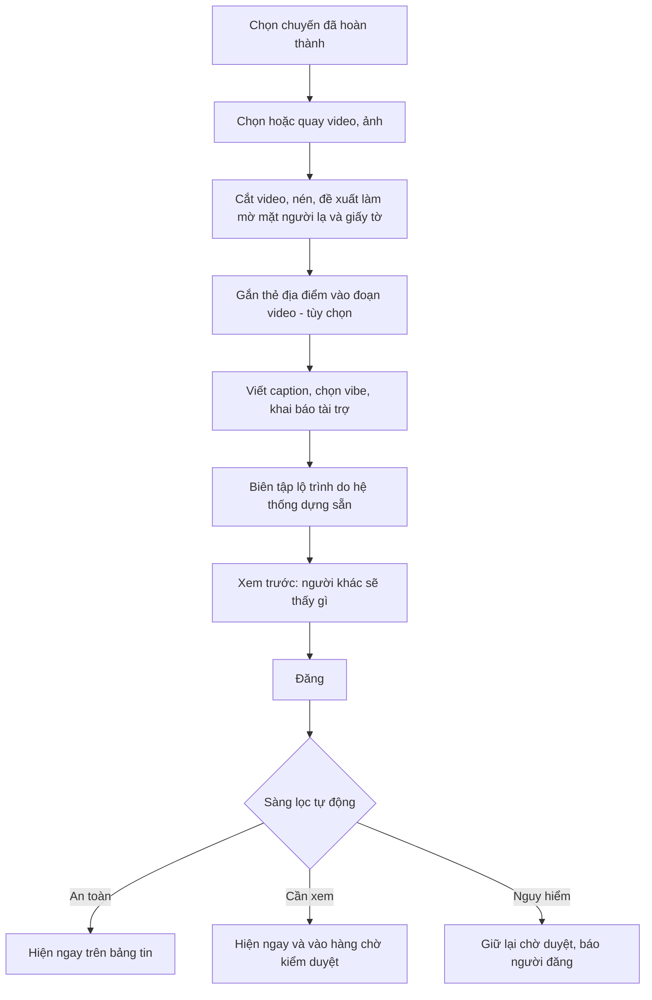
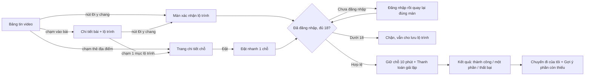

# 06. Luồng use case hoàn chỉnh: người đăng & người xem

> Mô tả luồng ở mức nghiệp vụ, bám [02 – Đề bài](02-de-bai-vinpearl-cho-nguoi-tre.md) (A2, A4, A10, A11, A12, mục 5, mục 6) và các đề xuất ở [03](03-y-tuong-trien-khai.md), [04](04-dinh-nghia-y-tuong-video-du-lich.md).
> Ví dụ xuyên suốt: **Linh** (Hà Nội) đã đi Phú Quốc 3 ngày 2 đêm và đăng video. **Khang** (Sài Gòn) xem video và muốn "đi y chang".

---

## 0. Ba quyết định nền tảng (trả lời thẳng các câu hỏi)

| Câu hỏi | Quyết định | Lý do |
|---|---|---|
| **Lộ trình do người đăng soạn hay hệ thống soạn?** | **Hệ thống soạn khung, người đăng biên tập.** Hệ thống tự dựng lộ trình từ các đơn *đã hoàn thành* trong chuyến đi. Người đăng chỉ được **ẩn/hiện** từng mục, **viết ghi chú**, thêm **mẹo** và **điểm gợi ý ghé thăm** (không đặt được). Người đăng **không được tự thêm mục đặt chỗ mà họ không đặt** | Đề bài A2: lộ trình *"lấy từ những gì đã đặt trong Chuyến đi của tôi, không phải gõ lại"*. Đây cũng là lá chắn chống seeding: không bịa được chuyến đi |
| **Giá vé mỗi thời điểm khác nhau thì sao?** | **Lộ trình không lưu giá.** Lộ trình chỉ lưu *sản phẩm nào* (loại phòng, loại vé, chặng bay, combo) và *ngày thứ mấy* (Ngày 1, 2, 3). Giá **luôn tính lại theo ngày người xem chọn**, tại thời điểm người xem xem | Đề bài A11: *"Giá là giá hiện tại, không phải giá người đăng đã trả"*, và không được lộ số tiền người đăng đã trả |
| **Hệ thống "đọc" video và caption để làm gì?** | **Không dùng để đoán video quay ở đâu**, vì địa điểm đã được *neo chắc chắn* từ đơn đặt. AI đọc video/caption để: (1) **kiểm duyệt** (lừa đảo, xúc phạm, mặt người lạ, giấy tờ); (2) **lập chỉ mục tìm kiếm** theo ý (A3: "chill mà không đông"); (3) **cho trợ lý và tóm tắt** dùng (A12, B1); (4) **gợi ý** thẻ và hashtag cho người đăng | Đoán địa điểm từ video thì dễ sai; neo từ đơn thì đúng 100% |

---

## 1. Luồng người đăng bài (Linh)

### 1.1. Điều kiện để được đăng
- Đã đăng nhập.
- Có ít nhất một đơn **đã hoàn thành**: qua ngày trả phòng hoặc ngày sử dụng, không hủy, đã thanh toán (giả lập). Trong demo có thể dùng nút "giả lập check-in" trên admin.
- Server kiểm tra lại điều kiện khi gửi bài. Ẩn nút trên giao diện là chưa đủ.

### 1.2. Điểm bắt đầu
1. **Từ "Chuyến đi của tôi"** (khuyến nghị): thẻ chuyến đi đã hoàn thành có nút **"Kể lại chuyến đi"**. Hệ thống có thể nhắc 1–2 ngày sau khi trả phòng.
2. **Từ nút "+" trên thanh điều hướng**: hiện danh sách các chuyến đã hoàn thành để chọn.
   - Chưa có chuyến nào → *"Bạn cần đi một chuyến với Vinpearl để kể lại chuyến đi"*, kèm gợi ý khám phá.

### 1.3. Các bước soạn bài



| Bước | Màn hình / thao tác | Thông tin | Bắt buộc? | Hệ thống làm gì |
|---|---|---|---|---|
| **1. Chọn chuyến** | Danh sách chuyến đã hoàn thành | Chuyến đi (gồm các đơn) | ✅ | Kiểm tra quyền đăng; gắn `trip_id` và các `booking_id` vào bài |
| **2. Media** | Chọn từ thư viện hoặc quay trong app | Video ngắn (gợi ý ≤ 60 giây), và/hoặc tối đa 10 ảnh | ✅ ít nhất 1 media *hoặc* chữ dài | Kiểm tra định dạng và dung lượng; cắt và nén trên máy để tải nhẹ; ghi dữ liệu kỹ thuật (thời điểm quay, vị trí nếu được phép) phục vụ huy hiệu "Quay tại chỗ" (đề xuất riêng) |
| **3. Riêng tư hình ảnh** | Các khuôn mặt và vùng chữ nhạy cảm được khoanh sẵn | Người đăng chọn giữ (mình, bạn mình) hoặc làm mờ | ✅ với giấy tờ, thẻ lên máy bay, mã đặt chỗ | Phát hiện khuôn mặt và chữ nhạy cảm (thẻ lên máy bay, CCCD, biển số). Chưa làm mờ giấy tờ thì không cho đăng (mục 6) |
| **4. Gắn thẻ địa điểm** | Thanh thời gian video; kéo thẻ vào đoạn tương ứng | Thẻ chỉ lấy từ **các mục trong chuyến** (khách sạn X, VinWonders…) | ⬜ Tùy chọn (mặc định: cả video gắn với chỗ chính) | Gợi ý tự động: so khung hình với ảnh chính thức của chỗ, đọc biển hiệu → đề xuất "đoạn 0:05–0:12 có vẻ là VinWonders". Người đăng xác nhận |
| **5. Caption & nhãn** | Ô chữ, hashtag, chip vibe | Caption; vibe (chill, quẩy, sống ảo, gia đình, cặp đôi…); mùa đi (tự điền: "Hè 2026"); **"Bài này có nhận tài trợ không?"** | Caption ⬜ (khuyến khích); câu hỏi tài trợ ✅ | Gợi ý hashtag và vibe từ nội dung; nếu khai có tài trợ → gắn nhãn **"Hợp tác"** |
| **6. Lộ trình** | Lộ trình **dựng sẵn** theo Ngày 1, 2, 3 | Bật/tắt từng mục; ghi chú cho từng mục; mẹo chung; **điểm gợi ý ghé thăm** (không có nút đặt, cần người hướng dẫn đồng ý); tùy chọn hiện "đi mấy người" (mặc định ẩn) | ⬜ (có thể đăng bài không kèm lộ trình) | Xem mục 1.4 |
| **7. Xem trước riêng tư** | "Người khác sẽ thấy" | — | ✅ (bước xác nhận) | Hiện rõ những gì **không bao giờ hiện**: ngày đi, số tiền đã trả, mã đặt chỗ, người đi cùng |
| **8. Đăng** | Nút Đăng | — | — | Lưu nháp trên máy; tải lên chạy nền theo từng phần (mất mạng thì tiếp tục được); trạng thái *Đang tải → Đang xử lý → Đã đăng / Đang xem xét* |

### 1.4. Hệ thống dựng lộ trình như thế nào

**Đầu vào**: các đơn đã hoàn thành trong chuyến của Linh.

| Đơn của Linh (riêng tư) | → Mục lộ trình (công khai) |
|---|---|
| Vé máy bay HAN → PQC, 12/07, 07:30, giá 1.450.000đ | **Ngày 1 · Bay đến Phú Quốc** (chặng HAN → PQC, *khung giờ sáng*) |
| Vinpearl Resort Phú Quốc, Deluxe hướng biển, 12/07–14/07, giá 3.200.000đ | **Ngày 1–3 · Ở Vinpearl Resort Phú Quốc**, loại phòng Deluxe hướng biển, 2 đêm |
| Vé VinWonders Phú Quốc, 13/07 | **Ngày 2 · VinWonders Phú Quốc** (vé 1 ngày) |
| Vé máy bay PQC → HAN, 14/07, 18:00 | **Ngày 3 · Bay về** (chặng PQC → HAN, *khung giờ tối*) |

**Quy tắc chuyển đổi**:
- **Ngày thật → ngày tương đối** (`day_offset`): ngày sớm nhất của chuyến là Ngày 1.
- **Giờ cụ thể → khung giờ** (sáng / chiều / tối), để người xem chọn chuyến bay tương tự mà không lộ chuyến của người đăng.
- **Giá, mã đặt chỗ, số hiệu chuyến bay, tên người đi** → **bỏ hẳn**, không lưu vào lộ trình công khai.
- **Sản phẩm** → lưu tham chiếu tới *loại sản phẩm*: loại phòng, loại vé, tuyến bay, combo. Không lưu bản ghi đơn.
- **Combo**: lưu là một mục combo (gồm các thành phần) để người xem đặt lại đúng combo đó.

**Người đăng biên tập**:
- Ẩn mục không muốn hiện (ví dụ ẩn chặng bay vì người xem ở nơi khác).
- Thêm **ghi chú cho từng mục**: *"Xin phòng tầng cao, view hoàng hôn đỉnh"*, *"VinWonders nên vào lúc 9h cho vắng"*.
- Thêm **điểm gợi ý ghé thăm** (chợ đêm, Sunset Town…): chỉ là ghi chú có vị trí, **không có nút đặt và không có giá**.
- **Không được**: sửa loại phòng, đổi ngày thứ tự của mục đặt chỗ, hay thêm mục đặt chỗ không có trong đơn. Bảo đảm lộ trình luôn là chuyến *thật*.

### 1.5. Hệ thống xử lý bài sau khi đăng (pipeline)

| Bước | Đầu vào | Xử lý | Đầu ra / dùng cho |
|---|---|---|---|
| 1. Kiểm tra quyền | Bài + trip_id | Đơn đã hoàn thành, thuộc người đăng, chưa có bài trùng cho cùng mục (chống spam) | Chấp nhận hoặc từ chối (`NOT_TRAVELED`) |
| 2. Xử lý media | Video, ảnh | Chuyển mã nhiều mức chất lượng, tạo ảnh bìa, tạo thumbnail nhỏ cho mạng yếu | Bảng tin mượt (A1) |
| 3. Kiểm duyệt tự động | Caption, chữ trong ảnh, khung hình, lời nói | Phân loại: xúc phạm, quảng cáo/spam, lừa đảo (số điện thoại kể cả viết bằng chữ, link, QR, "chuyển khoản trước"), nguy hiểm, lộ thông tin cá nhân | An toàn / Cần xem / Giữ lại (A14) |
| 4. Hiểu nội dung | Lời nói (chuyển thành chữ), chữ trên hình, caption, vibe, ghi chú lộ trình | Trích ý chính: "yên tĩnh", "đông vào cuối tuần", "view hoàng hôn"… → vector ngữ nghĩa | Tìm theo ý (A3, A6), trợ lý (A12), tóm tắt (B1) |
| 5. Kiểm tra nhất quán | Nội dung + các mục trong chuyến | Phát hiện bài nhắc nhiều tới nơi *không có* trong chuyến (dấu hiệu nội dung mượn hoặc quảng cáo) | Gắn cờ cho kiểm duyệt nếu bất thường |
| 6. Chống reup | Khung hình | So dấu vân tay video với kho đã có | Gắn cờ nếu trùng video người khác |
| 7. Xuất bản | — | Đưa vào bảng tin, tìm kiếm, trang chi tiết của chỗ; bắt đầu tính điểm xu hướng | Hiển thị trên app, web, trợ lý |

### 1.6. Sau khi đăng
- **Sửa bài**: sửa chữ nhỏ thì hiện ngay (vẫn qua sàng lọc); đổi media hoặc lộ trình thì vào hàng chờ, trong lúc chờ vẫn hiện bản cũ. Bài có nhãn "Đã chỉnh sửa".
- **Xóa bài**: nội dung biến mất; người đã lưu thấy *"Bài này đã được tác giả gỡ"*; đơn của người đã đặt theo vẫn giữ nguyên.
- **Bị ẩn bởi kiểm duyệt**: người đăng nhận thông báo kèm lý do.
- **Thông báo** (B6, nếu làm): có bình luận mới; có người đặt theo lộ trình.
- **Thưởng** (đề xuất riêng, cần người hướng dẫn đồng ý): khi có người đặt theo lộ trình **và đi xong**, Linh nhận điểm thưởng. Thưởng ở trạng thái "chờ" cho tới khi chuyến của người đó hoàn thành.

---

## 2. Luồng người xem (Khang)

### 2.1. Tổng quan



### 2.2. Bước 1 – Bảng tin: Khang thấy gì trên một video
| Thành phần | Nội dung | Ghi chú |
|---|---|---|
| Video | Tự phát không tiếng khi đang nhìn thấy; mạng yếu thì hiện ảnh bìa và chất lượng thấp trước | A1 |
| Thẻ địa điểm | Hiện đúng đoạn video có chỗ đó: *"Vinpearl Resort Phú Quốc"* | Chạm → trang chi tiết (một chạm, A4) |
| Dấu tin cậy | **"Đã đi thật · Hè 2026"**; nhãn **"Hợp tác"** nếu có tài trợ | A2, mục 6 |
| Lý do đang hot | *"32 người lưu trong 24h"*, *"5 người đã đi theo lộ trình này"* | Số thật (A1) |
| Giá tham khảo | *"Lộ trình từ ~4,2 triệu/người · giá thay đổi theo ngày"* | Mục 3 |
| Nút | ❤️ Cảm xúc · 💬 Bình luận · 🔖 Lưu · ↗ Chia sẻ · ⚑ Báo cáo · **"Đi y chang"** (chỉ hiện nếu bài có lộ trình) | A10, A11 |

### 2.3. Bước 2 – Chi tiết bài & lộ trình
- **Video/ảnh** và caption.
- **Lộ trình** dạng dòng thời gian:
  ```
  Ngày 1  ✈ Bay đến Phú Quốc (khung giờ sáng)          [đổi theo nơi bạn ở]
          🏨 Vinpearl Resort Phú Quốc · Deluxe hướng biển · 2 đêm
             💬 "Xin phòng tầng cao, view hoàng hôn đỉnh"
  Ngày 2  🎢 VinWonders Phú Quốc · vé 1 ngày
             💬 "Vào lúc 9h cho vắng"
          📍 Gợi ý ghé: Sunset Town (không đặt được)
  Ngày 3  ✈ Bay về (khung giờ tối)
  ```
  Mỗi mục đặt được có trạng thái **theo thời điểm hiện tại**: *Đang bán*, *Ngừng bán*. Chạm một mục → trang chi tiết của mục đó (để chỉ đặt riêng mục này).
- **"Người đã đi nói gì"** (B1, nếu làm): tóm tắt điểm cộng và điểm trừ từ các bài thật về cùng chỗ, có trích dẫn.
- **Bình luận**: bình luận của người *đã đi chỗ này* có huy hiệu và được xếp trên.

### 2.4. Bước 3 – Bấm "Đi y chang" → Màn xác nhận (trước thanh toán)
Theo đề bài A11, nút này **tới thẳng màn xác nhận**, đã điền sẵn các mục trong lộ trình.

| Khu vực | Nội dung | Hành vi |
|---|---|---|
| **Điểm xuất phát** | Mặc định lấy từ hồ sơ hoặc vị trí (Sài Gòn) | Khác nơi người đăng (Hà Nội) → **thay chặng bay** HAN → PQC bằng SGN → PQC (nếu dữ liệu có chặng này; không có thì báo và cho bỏ mục bay) |
| **Ngày đi** | Lịch chọn ngày, mỗi ngày có **gợi ý mức giá** (rẻ / trung bình / cao) dựa trên giá thật | Chọn ngày bắt đầu → mọi mục tự dời theo `day_offset`: nhận phòng Ngày 1, VinWonders Ngày 2, bay về Ngày 3 |
| **Số người** | Người lớn, trẻ em | Tự tính số phòng theo sức chứa (4 người → 2 phòng Deluxe), số vé, số ghế; cho chỉnh |
| **Danh sách mục** | Từng mục với **giá hiện tại** cho ngày và số người đã chọn | ✅ Còn chỗ · ⚠️ Hết chỗ ngày này → *gợi ý tương tự* (cùng điểm đến, cùng loại, giá gần nhất) hoặc *bỏ mục* · ⛔ Ngừng bán → bỏ hoặc thay |
| **Chuyến bay** | Chọn tự động chuyến **cùng khung giờ** với lộ trình gốc (sáng/tối), giá tốt nhất | Cho đổi chuyến khác |
| **Thêm / bớt** | Bỏ mục bất kỳ; thêm mục (ví dụ thêm đưa đón, thêm vé) | A11 |
| **Tổng tiền** | Tổng theo giá hiện tại | Nếu tổng **cao hơn > 20%** so với mức thường thấy của chính các mục này → cảnh báo và gợi ý dời 1–2 ngày rẻ hơn (mục 3) |
| **Chính sách nếu một mục lỗi** | **"Giữ phần đặt được"** (mặc định, kèm 30 phút hủy miễn phí phần còn lại) hoặc **"Tất cả hoặc không"** | A11 |
| **Nút** | **"Giữ chỗ & thanh toán"** | Bước tiếp theo |

> Mọi giá trên màn này là **giá của Khang, cho ngày Khang chọn**, không liên quan giá Linh đã trả. Màn này không hiện ngày Linh đi hay số tiền Linh trả.

### 2.5. Bước 4 – Kiểm tra đăng nhập & tuổi
- **Chưa đăng nhập**: Khang vẫn xem được màn xác nhận và chọn ngày. Bấm "Giữ chỗ & thanh toán" → đăng nhập → **quay lại đúng màn xác nhận với mọi lựa chọn còn nguyên** (A4).
- **Dưới 18 tuổi**: thông báo thân thiện *"Bạn cần đủ 18 tuổi để tự đặt chỗ"*; vẫn cho **lưu lộ trình** để lên kế hoạch. Server cũng chặn nếu gọi thẳng API.

### 2.6. Bước 5 – Giữ chỗ & thanh toán (giả lập)
1. Hệ thống **giữ chỗ tất cả mục cùng lúc** và chốt giá trong **10 phút**. Màn hình hiện giờ hết hạn thật (*"Giữ đến 14:32"*).
2. Mục nào giữ không được (vừa bị người khác lấy chỗ cuối) → báo ngay **trước khi trả tiền**, quay về màn xác nhận để bỏ hoặc thay mục.
3. **Giá đổi** trong lúc này → hiện chênh lệch, bắt xác nhận lại.
4. Thanh toán giả lập: chọn phương thức, xác nhận (có thể giả lập bước OTP). Mỗi lần thanh toán có **mã chống trùng**: bấm hai lần hay mất mạng rồi bấm lại cũng chỉ trừ tiền một lần.

### 2.7. Bước 6 – Kết quả
| Trường hợp | Khang thấy |
|---|---|
| **Tất cả thành công** | "Đặt thành công cả chuyến". Mã đơn, chi tiết từng mục, nút tới "Chuyến đi của tôi" |
| **Một phần thất bại** (hiếm, vì đã giữ chỗ trước) | Theo chính sách đã chọn. Mặc định: *"VinWonders ngày 13/07 không đặt được, đã hoàn 1.200.000đ. Các mục còn lại đã đặt. Bạn có 30 phút để hủy miễn phí phần còn lại nếu muốn."* |
| **Thất bại toàn bộ** | Không trừ tiền (hoặc đã hoàn ngay), giải thích lý do, gợi ý thử ngày khác |

### 2.8. Bước 7 – Sau khi đặt
- **Chuyến đi của tôi** hiện chuyến mới ở **cả app và web** (A5), có dòng *"Đặt theo lộ trình của một bài đăng"*. Không hiện tên người đăng nếu Khang không muốn; tên người đăng đã công khai sẵn trên bài nên không phải thông tin riêng tư.
- **Gợi ý phần còn thiếu** (A9): ví dụ lộ trình không có đưa đón sân bay → gợi ý xe đưa đón, hoạt động ở Phú Quốc; **không gợi ý thêm phòng**.
- Hệ thống **ghi nhận nguồn**: đơn này đặt từ bài của Linh (admin xem được ở A16; dùng cho xu hướng và thưởng).
- **Sau chuyến đi**: nhắc Khang *"Kể lại chuyến đi"*. Khang đăng bài của mình, vòng lặp nội dung tiếp tục.

---

## 3. Xử lý giá: vì sao "giá mỗi thời điểm khác nhau" không phải là vấn đề

| Tình huống | Cách hiển thị |
|---|---|
| **Người xem chưa chọn ngày** (trên bảng tin, chi tiết bài) | **"Từ ~X/người"** = tổng rẻ nhất *có chỗ thật* trong 30 ngày tới cho 2 người, ghi rõ *"giá thay đổi theo ngày"*. Không bao giờ hiện giá người đăng đã trả |
| **Người xem chọn ngày** | Giá thật của từng mục cho ngày đó và số người đó |
| **Giá ngày đã chọn cao bất thường** | So với "mức giá thường thấy" (trung vị 30 ngày) của chính các mục đó; lệch > 20% thì cảnh báo và gợi ý ngày rẻ hơn trên lịch |
| **Giá thay đổi trong lúc đang đặt** | Báo giá có hạn 10 phút theo thời gian giữ chỗ; đổi thì báo trước khi trả |
| **Người đăng tự ghi giá trong caption** ("mình đi hết 4 củ") | Đây là thông tin người đăng *tự nguyện* chia sẻ. Hệ thống hiện kèm ghi chú *"Giá do người đăng tự ghi, có thể khác giá hiện tại"* ngay cạnh giá thật |

---

## 4. Các luồng phụ

### 4.1. Tương tác (A10)
- **Thả cảm xúc**: phản hồi ngay trên máy; nơi khác cập nhật trong ≤ 2 giây; bấm liên tục chỉ bật/tắt.
- **Bình luận / trả lời**: soạn khi mất mạng vẫn giữ nội dung, có mạng thì tự gửi; mỗi bình luận qua sàng lọc tự động.
- **Lưu**: vào "Chuyến đi của tôi → Bài đã lưu"; ảnh hưởng gợi ý trên web.
- **Chia sẻ**: link web mở được ở mọi trình duyệt, máy đã cài app thì mở thẳng app.
- **Báo cáo**: chọn lý do (lừa đảo, quảng cáo ẩn, xúc phạm, nguy hiểm, sai sự thật…) → vào hàng chờ kiểm duyệt.
- **Chưa đăng nhập** mà muốn tương tác → đăng nhập → quay lại đúng bài.

### 4.2. Đặt riêng một mục
Chạm một mục trong lộ trình hoặc thẻ địa điểm → trang chi tiết (ảnh lớn, giá thật, còn chỗ, vài bài nổi bật) → "Đặt" → chọn ngày, phòng/vé → xác nhận → thanh toán (A4).

### 4.3. Hỏi trợ lý từ một bài
*"Có chỗ nào giống vậy mà rẻ hơn không?"* → trợ lý tìm chỗ tương tự **có thật**, có chỗ trống và giá thật, kèm bài đăng liên quan. Mỗi gợi ý bấm vào được; trợ lý **không tự đặt**.

### 4.4. Kiểm duyệt (nhân viên)
Hàng chờ có ưu tiên → mở mục → xem nội dung, nhãn và gợi ý của AI, lịch sử sửa → ẩn/hiện/xóa + lý do → hệ thống báo người đăng, ghi audit log. Bài bị ẩn biến khỏi app, web, tìm kiếm và trợ lý trong thời gian ngắn.

---

## 5. Bảng tình huống ngoại lệ

| Tình huống | Hệ thống xử lý |
|---|---|
| Người chưa đi bấm "Viết bài" | Chặn, giải thích, gợi ý khám phá |
| Đang tải video thì mất mạng | Giữ nháp; tự tiếp tục tải khi có mạng |
| Ảnh có thẻ lên máy bay chưa làm mờ | Không cho đăng, chỉ vùng cần làm mờ |
| Người đăng khai sai "không nhận tài trợ" (bị phát hiện) | Gắn nhãn hồi tố, hạ uy tín, thu hồi thưởng |
| Mục trong lộ trình ngừng bán | Bài vẫn hiện, mục có nhãn "Ngừng bán"; khi đặt thì gợi ý mục tương tự |
| Người xem ở thành phố không có chặng bay tới điểm đến | Báo rõ, cho bỏ mục bay và đặt phần còn lại |
| Ngày chọn hết phòng | Đánh dấu mục đó, gợi ý ngày khác hoặc phòng tương tự |
| Hai người tranh phòng cuối | Chỉ một người giữ chỗ được; người kia được báo ngay ở màn xác nhận, chưa bị trừ tiền |
| Hết 10 phút giữ chỗ | Nhả chỗ; quay lại thì kiểm tra lại chỗ và giá |
| Bấm thanh toán hai lần | Một giao dịch duy nhất |
| Người đăng xóa bài khi người xem đang ở màn xác nhận | Người xem vẫn hoàn tất được đơn (đơn là của họ); bài hiện "đã gỡ" |
| Người dưới 18 tuổi | Chặn đặt ở mọi kênh; vẫn cho lưu và lên kế hoạch |
| Bài bị ẩn | Biến khỏi bảng tin, tìm kiếm, trợ lý; người đã lưu thấy "Bài này không còn hiển thị" |

---

## 6. Tóm tắt dữ liệu của một bài đăng

| Trường | Ai cung cấp | Công khai? |
|---|---|---|
| Người đăng (tên hiển thị, ảnh đại diện) | Người đăng | ✅ |
| trip_id, booking_id | Hệ thống | ❌ (chỉ dùng nội bộ để xác minh) |
| Video, ảnh (đã làm mờ nếu cần) | Người đăng | ✅ |
| Thẻ địa điểm theo đoạn video | Người đăng (hệ thống gợi ý) | ✅ |
| Caption, hashtag, vibe | Người đăng (hệ thống gợi ý) | ✅ |
| Mùa đi ("Hè 2026") | Hệ thống | ✅ |
| Nhãn "Đã đi thật" | Hệ thống | ✅ |
| Nhãn "Hợp tác" | Người đăng khai / hệ thống phát hiện | ✅ |
| Lộ trình: mục, `day_offset`, khung giờ, ghi chú, điểm gợi ý | Hệ thống dựng, người đăng biên tập | ✅ (những mục được bật) |
| Ngày đi thật, giá đã trả, mã đặt chỗ, số hiệu chuyến kèm ngày, người đi cùng | Hệ thống (từ đơn) | ❌ Không bao giờ |
| Số người đi | Hệ thống | ⬜ Chỉ khi người đăng bật |
| Bản chép lời nói, chữ trên hình, vector ngữ nghĩa | Hệ thống (AI) | ❌ (chỉ dùng cho tìm kiếm, trợ lý, kiểm duyệt) |
| Nhãn kiểm duyệt, điểm uy tín | Hệ thống | ❌ (chỉ admin) |
