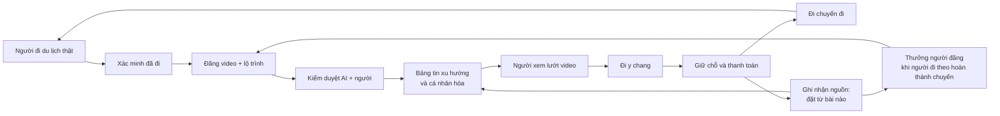
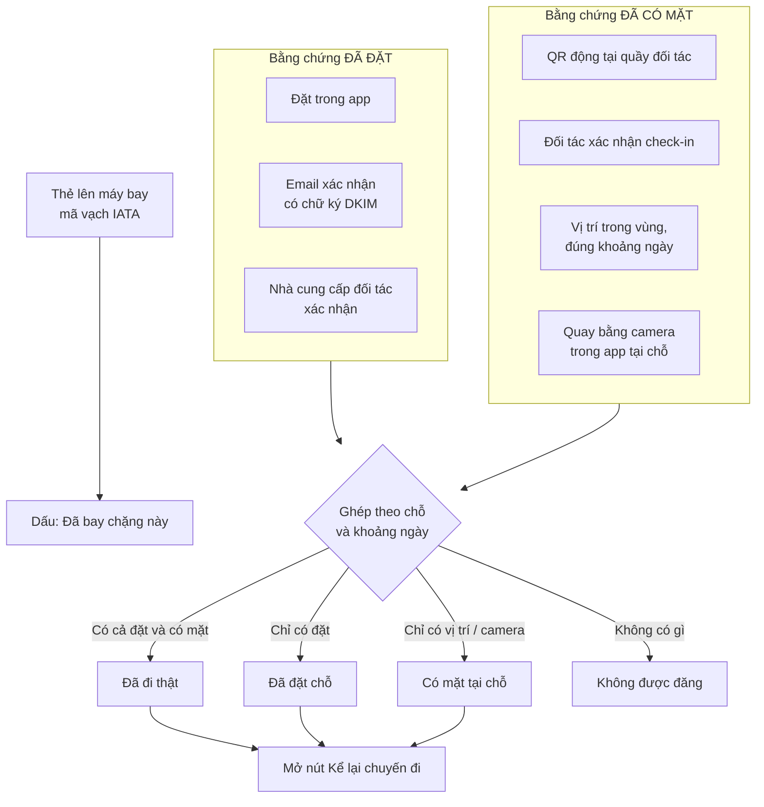
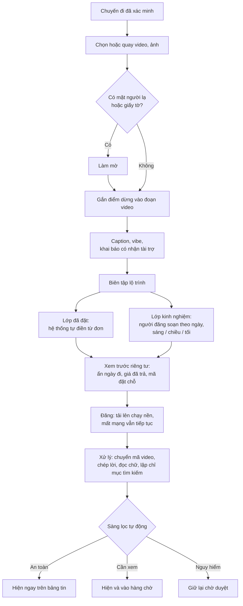
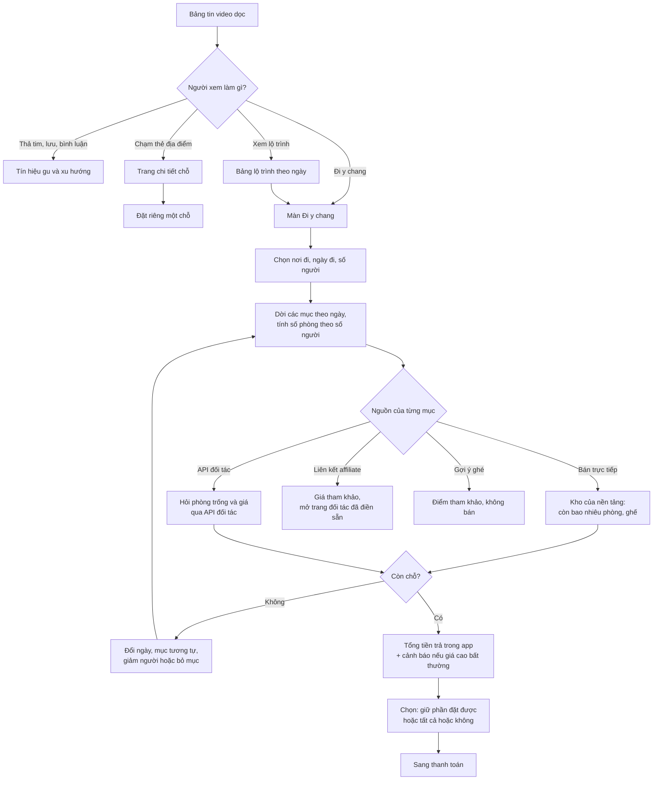
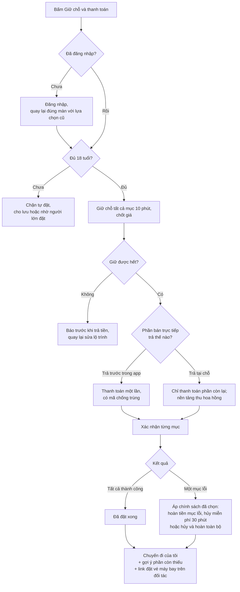
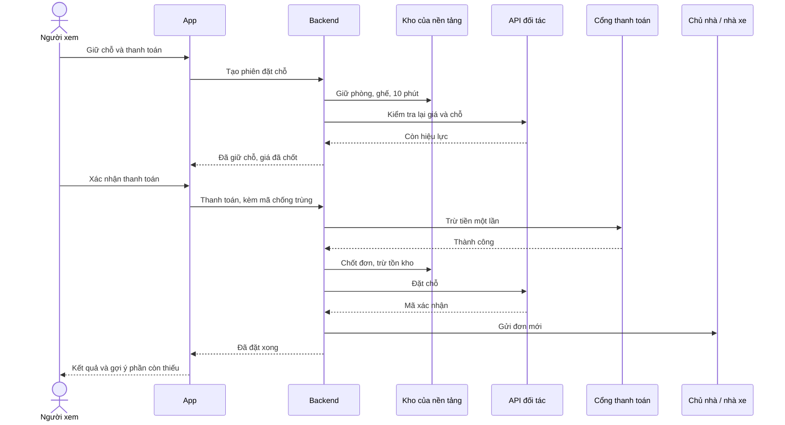
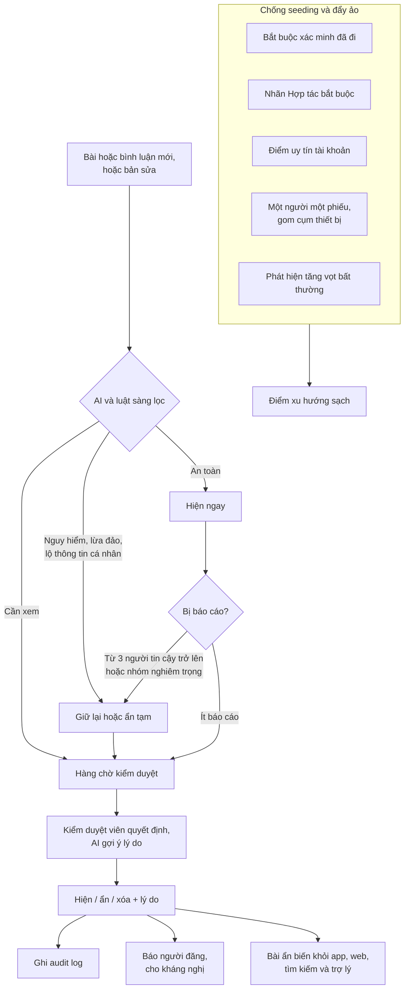
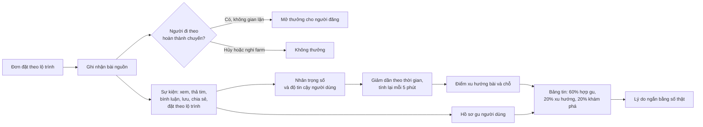
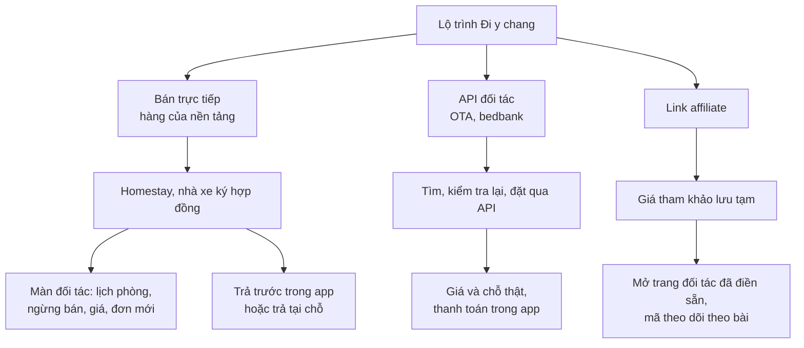
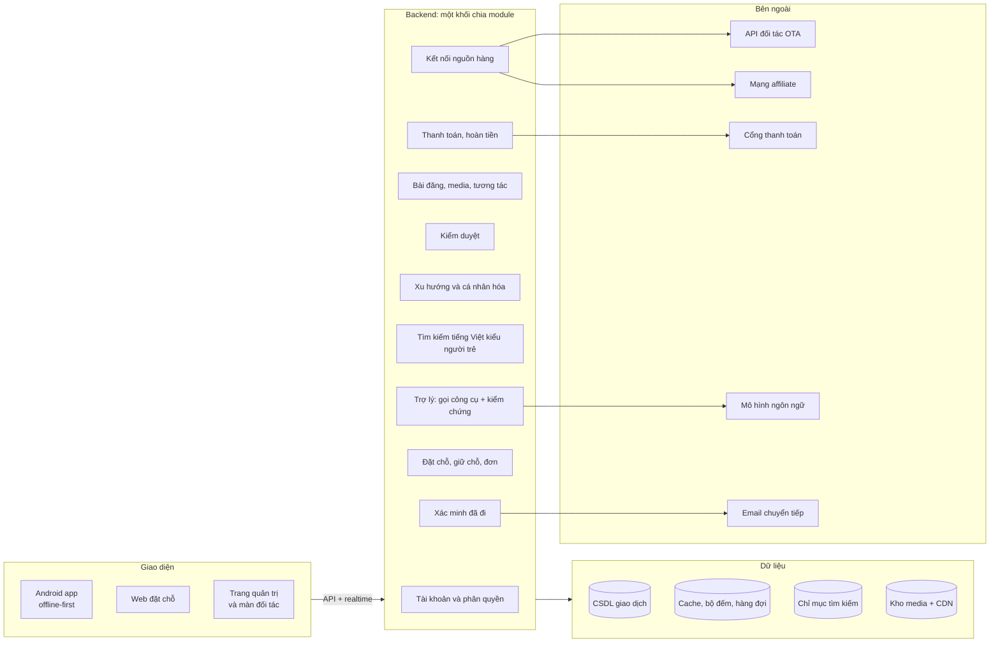

# 10. Diagram workflow toàn bộ ý tưởng

> Nền tảng video du lịch "xem là đi được": người đi thật đăng video kèm lộ trình, người xem bấm "Đi y chang" để đặt cả chuyến.
> Bản xem đẹp để trình bày: [demo/workflow-diagram.html](../demo/workflow-diagram.html) (cần mạng để tải thư viện vẽ sơ đồ).

---

## 1. Toàn cảnh: vòng lặp của nền tảng

---

## 2. Xác minh "đã đi thật"

---

## 3. Người đăng: từ chuyến đi đến bài đăng

---

## 4. Người xem: từ video đến "Đi y chang"

---

## 5. Giữ chỗ và thanh toán

### Trình tự các hệ thống khi thanh toán

---

## 6. Kiểm duyệt và chống seeding

---

## 7. Xu hướng, cá nhân hóa và thưởng

---

## 8. Nguồn hàng: hai mô hình cùng tồn tại

---

## 9. Kiến trúc hệ thống

