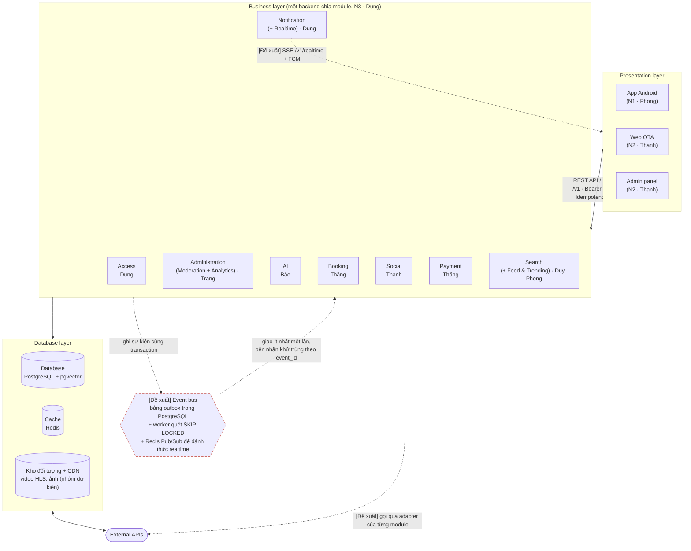
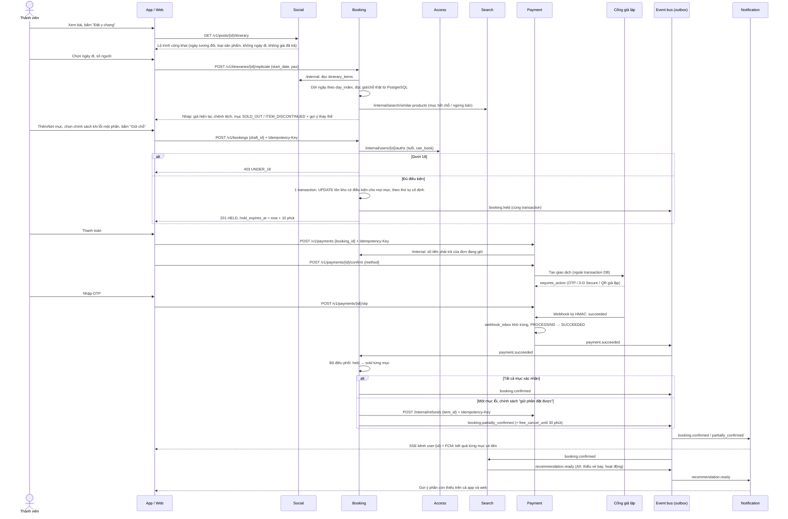
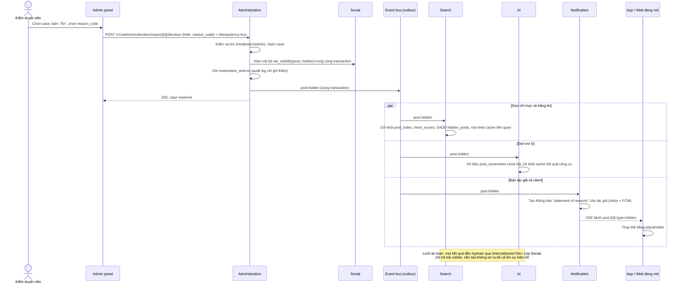
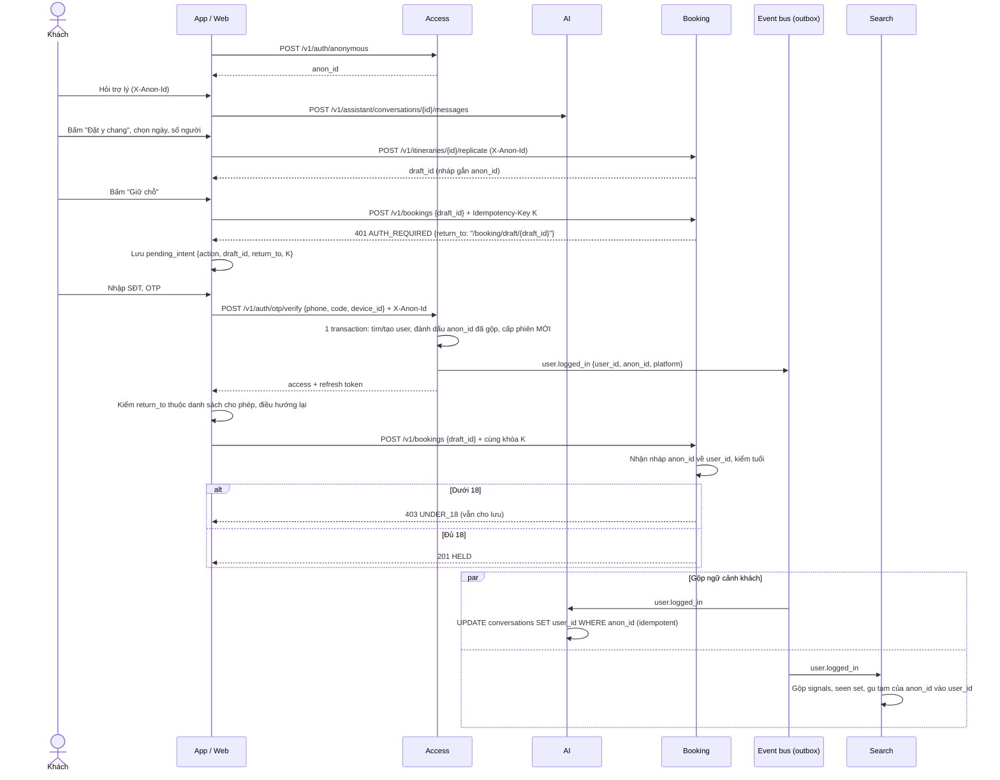
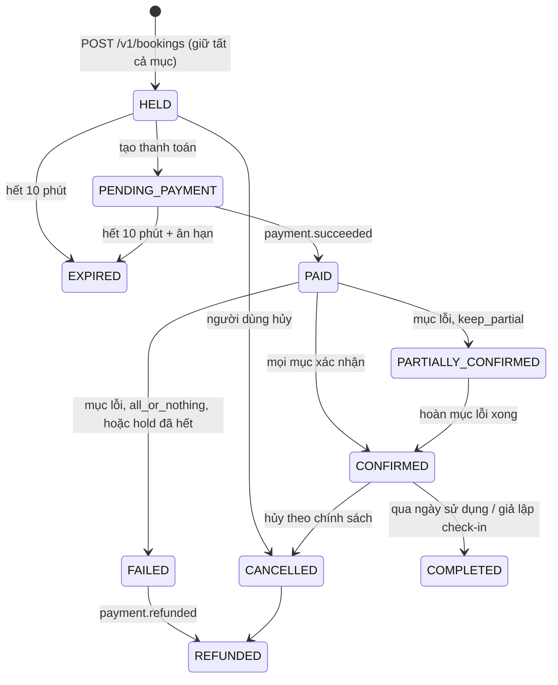

# Tám module dựng nên Tripflix, từ video tới "Đặt y chang"

Kiến trúc trong ảnh của nhóm (Presentation → REST API/HTTPS → 8 module nghiệp vụ → Database, Cache ↔ External APIs) đủ chỗ cho cả 10 module nhỏ trong file phân công mà chỉ cần **hai lần gộp**: Feed & Trending vào **Search**, Moderation và Analytics vào **Administration**; Realtime đi chung với **Notification**, còn lại khớp một–một. Điểm quyết định chất lượng của Tripflix không nằm ở từng module mà ở **bốn hợp đồng liên module**: lộ trình lưu theo ngày tương đối do Social giữ, đơn nhiều mục có máy trạng thái và `source_post_id` do Booking giữ, thanh toán có khóa idempotency và một lần "thành công" duy nhất mỗi đơn do Payment giữ, và trạng thái hiển thị bài có **một chủ ghi duy nhất** (Administration ghi qua Social). Ảnh kiến trúc chưa vẽ Event bus, nhưng ba luồng mentor chắc chắn thử (Đặt y chang xuyên Booking–Payment–Notification, bài bị ẩn biến khỏi bảng tin/tìm kiếm/trợ lý, đăng nhập giữa chừng không mất ngữ cảnh) đều cần một kênh sự kiện tin cậy; đề xuất của báo cáo là **bảng outbox trong PostgreSQL + worker quét bằng `FOR UPDATE SKIP LOCKED`**, đúng kiểu "scheduler quét DB" mà Traveloka mô tả trong kiến trúc event-driven của họ ([Traveloka Engineering](https://medium.com/traveloka-engineering/how-event-driven-architecture-and-microservices-help-us-to-scale-to-the-next-level-b5025f50ec7b)). Từ TikTok, Tripflix chỉ cần mượn khung xếp hạng ba bước và luật "không lặp, không hai video liền nhau cùng người đăng" ([TikTok Newsroom](https://newsroom.tiktok.com/en-us/how-tiktok-recommends-videos-for-you/)); từ Stripe, Airbnb, Expedia là chuỗi idempotency, PaymentIntent, kiểm giá trước khi đặt và giữ chỗ có hạn. Báo cáo gồm phần tổng quan dùng chung (sơ đồ, bảng mapping, quy ước API, danh mục sự kiện, ba sơ đồ trình tự, External APIs) và **tám bản báo cáo module theo đúng khung 8 mục của nhóm**, để mang thẳng vào buổi họp ghép tuần 1.

---

## Ba loại thông tin và giới hạn nguồn

Báo cáo trộn ba loại thông tin, và người đọc cần phân biệt được chúng khi bảo vệ trước mentor. Loại thứ nhất là **dữ kiện đã chốt của nhóm**, lấy từ [đề bài](../docs/02-de-bai-vinpearl-cho-nguoi-tre.md), [ý tưởng triển khai đã chốt](../docs/03-y-tuong-trien-khai.md) và [phân công](../team/01-phan-cong-nghien-cuu-module.md): tên Tripflix, nút "Đặt y chang", chỉ "Người đã đi" mới được đăng, Vinpearl, thanh toán giả lập, giữ chỗ 10 phút, sáu mã lỗi chung, các trọng số xu hướng. Loại thứ hai là **dữ kiện bên ngoài** về TikTok, Traveloka, Booking.com, Expedia, Trip.com, Airbnb, Stripe, Instagram, Twitter, Slack, Discord, LinkedIn, có link nguồn. Loại thứ ba là **đề xuất của nhóm nghiên cứu**: toàn bộ tên bảng, endpoint, tên sự kiện ngoài danh sách gợi ý của phân công, cơ chế outbox, chính sách cụ thể. Chỗ nào là đề xuất được ghi rõ **[Đề xuất]**; chỗ nào nguồn ngoài chưa đọc được toàn văn được ghi **[chưa xác minh]**.

Giới hạn quan trọng nhất: trong phiên nghiên cứu, các trang `stripe.com`, `medium.com`, `arxiv.org`, `huggingface.co`, `firebase.google.com`, `discord.com`, `auth0.com`, `microservices.io` bị chặn tải trực tiếp, nên phần lớn trích dẫn về Stripe, Airbnb Orpheus, Traveloka, Monolith của ByteDance, FCM và các mô hình embedding **chỉ được đọc qua tóm tắt kết quả tìm kiếm**. Ngoại lệ là các OWASP Cheat Sheet (đọc toàn văn trên GitHub), pgvector README và tài liệu API của Booking.com/Expedia. Không tìm được bài kỹ thuật công khai nào của Trip.com hay Agoda về booking/payment, cũng không có tài liệu chính thức về công thức trending của TikTok. Danh sách đầy đủ các điểm chưa xác minh nằm ở phần cuối báo cáo.

---

# Phần I. Tổng quan kiến trúc

## Ảnh ba tầng giữ nguyên, Event bus là phần nhóm thêm vào

Ảnh [so-do-module.png](../research_notes/Kiến%20trúc%20module%20Tripflix/so-do-module.png) có ba tầng: *Presentation layer* gồm App Android, Web OTA, Admin panel; mũi tên hai chiều "REST API / HTTPS" xuống *Business layer* gồm đúng 8 ô Access, Notification, Administration, AI, Booking, Social, Payment, Search; mũi tên một chiều xuống *Database layer* gồm Database và Cache; và mũi tên hai chiều từ Database layer tới đám mây *External APIs*. Ảnh **không** vẽ API Gateway, Event bus hay quan hệ giữa các module nghiệp vụ, trong khi sơ đồ trong [docs/03 §10.1](../docs/03-y-tuong-trien-khai.md) đã có "API chung · N3" và "Event bus" nối Social, Booking, Payment, Moderation sang Search/Feed, Analytics, Notification. Sơ đồ dưới đây giữ nguyên ba tầng và các mũi tên của ảnh (nét liền), rồi thêm những phần nhóm nghiên cứu đề xuất bằng **nét đứt**.

Sáu nguyên tắc đã chốt trong [docs/03 §10.1](../docs/03-y-tuong-trien-khai.md) quyết định hình dạng của mọi module: **một backend chia module, một CSDL** cho cả bốn sản phẩm; **server là nguồn sự thật** cho tiền, chỗ, tuổi, quyền; **offline-first** cho thao tác viết trên app; **nhẹ cho máy yếu, mạng yếu** (ảnh nhiều cỡ, HLS tự hạ chất lượng, phân trang con trỏ); **AI không phải nguồn sự thật**; **ghi sự kiện từ ngày đầu** để đo. Công nghệ dữ liệu dự kiến là PostgreSQL + pgvector, Redis, kho đối tượng + CDN; app/web/backend chưa chốt ([docs/03 §10.3](../docs/03-y-tuong-trien-khai.md)).

Có ba chỗ ảnh chưa rõ mà báo cáo xử lý như sau. Thứ nhất, Event bus không có trong ảnh nhưng có trong sơ đồ của nhóm; báo cáo coi **Event bus là quyết định của nhóm, còn cách hiện thực bằng outbox là [Đề xuất]**. Lý do chọn outbox thay vì Kafka hay chỉ Redis Pub/Sub: Redis Pub/Sub không lưu tin, subscriber lỡ là mất (at-most-once), còn outbox ghi sự kiện trong cùng transaction với thay đổi nghiệp vụ nên không mất khi process chết, và relay chỉ cần `SELECT … FOR UPDATE SKIP LOCKED` theo lô 50–200 dòng ([OneUptime: outbox](https://oneuptime.com/blog/post/2026-01-30-outbox-pattern-implementation/view); [OneUptime: Pub/Sub vs Streams](https://oneuptime.com/blog/post/2026-03-31-redis-when-to-use-redis-pubsub-vs-redis-streams/markdown)). Thứ hai, ảnh nối External APIs với *Database layer* chứ không phải Business layer; có thể chỉ là cách vẽ giản lược, nên báo cáo **đề xuất** mỗi module gọi dịch vụ ngoài qua adapter riêng và cần người vẽ xác nhận. Thứ ba, ảnh không có ô cho kho đối tượng/CDN, nhưng video dọc kiểu TikTok không thể sống thiếu nó; báo cáo xếp nó vào Database layer như một kho lưu trữ.

## Mười module nhỏ gộp vào tám ô chỉ với hai lần ghép

Bảng dưới là mapping chính. Cột "Tính năng sở hữu" là phần module chịu trách nhiệm nghiệm thu; cột "Tham gia" là phần module chỉ cung cấp dữ liệu hoặc API cho chủ sở hữu khác. Người phụ trách và phạm vi module nhỏ lấy từ [docs/03 §9](../docs/03-y-tuong-trien-khai.md) và [phân công §2.2, §3](../team/01-phan-cong-nghien-cuu-module.md); cách xếp vào 8 ô là **[Đề xuất]**.

| Module lớn (ảnh) | Module nhỏ gộp vào | Người phụ trách | Tính năng sở hữu | Tham gia (không sở hữu) | Câu hỏi mở được giao (đề bài §5) |
|---|---|---|---|---|---|
| **Access** | M9 Access | Hoang Duc Dung | A13; quay lại đúng màn sau đăng nhập (A4, A10, A11, A12); chặn dưới 18 (nguồn sự thật về tuổi); một tài khoản cho bốn sản phẩm | A5 (một tài khoản nhiều thiết bị), A8 (`UNDER_18`) | Không có câu riêng; gánh phần hạ tầng của "chưa đăng nhập thì sao" (trợ lý) và "biết chắc đã đi" (quyền) |
| **Notification** | M10 Notification & Realtime | Hoang Duc Dung | Đồng bộ app ↔ web (A5, A10); báo người đăng khi bị ẩn (A14); đẩy gợi ý A9 lên cả app và web; B3, B6 | A10 (lan bộ đếm), A14 (gỡ thẻ trên client) | "App và web mở cùng lúc, sửa một nơi thì nơi kia thấy sau bao lâu" |
| **Administration** | M6 Moderation + M7 Analytics (+ N4 Đo lường) | Le Thi Thuy Trang | A14; màn hình A15, A16, B7; riêng tư ảnh (đề bài §6); đo mục 9; nút "giả lập check-in" | A13 (giao diện quản trị dùng Access) | Báo cáo thì ẩn ngay hay chờ; tự động kiểm duyệt, AI Agent; sửa bài có duyệt lại |
| **AI** | M5 AI Assistant | Le Nguyen Quoc Bao | A12; B1; dữ liệu B7; đo chi phí trợ lý (đề bài §7) | A14 (không gợi ý bài ẩn); gợi ý lý do kiểm duyệt qua "cổng LLM" chung | Bốn câu về trợ lý |
| **Booking** | M3 Booking | Nguyen Le Phuc Thang | A4, A8, A11; danh mục sản phẩm/giá/tồn kho; dữ liệu chuyến cho A5; dữ liệu A16; xác định "đã đi" | A2 (nguồn lộ trình, `NOT_TRAVELED`), A9 (phát `booking.confirmed`) | Giữ chỗ bao lâu; một mục lỗi; xóa bài / mục ngừng bán |
| **Payment** | M4 Payment | Nguyen Le Phuc Thang | Thanh toán giả lập "luồng như thật"; idempotency; hoàn tiền; đối soát và cờ trừ tiền hai lần cho A16 | A4, A8, A11 | Một mục lỗi thì tiền ra sao (chung với Booking) |
| **Social** | M8 Social & Content | Le Quang Thanh | A2 (đăng bài, lộ trình, dấu "đã đi thật"); A10; B5; bài mô phỏng có nhãn; C1 | A5 (bài/chỗ đã lưu, bài đã đăng), A11 (lộ trình công khai) | Biết chắc đã đi; số cảm xúc đúng ngay hay lệch; lộ trình hiện gì (cùng Thắng) |
| **Search** | M1 Search & Recommendation + M2 Feed & Trending | Le Anh Duy (tìm kiếm, gợi ý) + Nguyen Thanh Phong (bảng tin, xu hướng) | A1, A3, A6, A7, A9, B2; điểm xu hướng và cờ đẩy ảo cho A15; mô hình embedding + vector index dùng chung | A12 (công cụ cho trợ lý), A4 ("vài bài nổi bật"), A11 (mục tương tự) | Bốn câu về xu hướng; không có kết quả thì nói gì |

Bốn việc nền tảng không phải module nghiệp vụ: **N1** (App Android, Phong) và **N2** (Web OTA + Admin panel, Thanh) nằm ở Presentation layer; **N3** (Dung) là lớp "REST API / HTTPS", Database layer, Event bus và quy ước API; **N4** (Trang) đi cùng Administration vì đo lường đọc bảng sự kiện ở đó. Với bảng này, nhóm viết đúng **8 bản báo cáo**: Thắng viết hai bản (Booking, Payment), Dung viết hai bản (Access, Notification), Search do Duy và Phong viết chung với hai tiểu mục, Administration do Trang viết một bản có hai tiểu mục, khớp quy tắc "người ghép hai module thì viết mỗi module một bản" của [phân công §6](../team/01-phan-cong-nghien-cuu-module.md).

### Từng tính năng có đúng một chủ

| Mã | Tính năng | Module chủ (người) | Module phụ gọi/đọc |
|---|---|---|---|
| A1 | Bảng tin xu hướng | Search (Phong) | Social (bài, bộ đếm), Access (khách/thành viên) |
| A2 | Đăng bài + lộ trình + "đã đi thật" | Social (Thanh) | Booking (đơn đã hoàn tất, `NOT_TRAVELED`), Administration (sàng lọc), kho đối tượng |
| A3 | Tìm trong bài đăng bằng lời | Search (Duy) | Social (nội dung để lập chỉ mục) |
| A4 | Một chạm tới chi tiết, đặt nhanh | Booking (Thắng) | Payment, Access (quay lại đúng chỗ, `UNDER_18`), Search (bài nổi bật) |
| A5 | Chuyến đi của tôi | Booking (chuyến) + Social (đã lưu, đã đăng) | Notification (đồng bộ đa thiết bị), Access |
| A6 | Tìm bằng lời (web) | Search (Duy) | Booking (giá, còn chỗ thật) |
| A7 | Gợi ý dành cho bạn | Search (Duy) | Access (ngân sách khai báo), Social (tín hiệu trên app) |
| A8 | Đặt chỗ đầy đủ | Booking (Thắng) | Payment, Access (`UNDER_18`) |
| A9 | Gợi ý phần còn thiếu | Search (Duy) | Booking (`booking.confirmed`), Notification (đẩy lên app và web) |
| A10 | Tương tác | Social (Thanh) | Notification (realtime), Access (cổng đăng nhập), Administration (báo cáo) |
| A11 | **Đặt y chang** | Booking (Thắng) | Social (lộ trình công khai), Payment, Search (mục tương tự), Access, Notification |
| A12 | Trợ lý gợi ý | AI (Bảo) | Search (công cụ), Booking (giá/chỗ), Access (gộp phiên khách) |
| A13 | Đăng nhập, phân quyền quản trị | Access (Dung) | Administration (giao diện) |
| A14 | Kiểm duyệt | Administration (Trang) | Social (`visibility`), Search, AI, Notification |
| A15 | Theo dõi xu hướng | Administration (màn hình, Trang) | Search (điểm xu hướng, `trend.flagged`) |
| A16 | Đơn đặt chỗ, đơn bất thường | Administration (màn hình, Trang) | Booking (đơn, `anomaly_flags`), Payment (giao dịch, đối soát) |
| B1 | Tóm tắt "N người đã đi nói gì" | AI (Bảo) | Social (bài đang hiển thị), Search |
| B2 | Tìm bằng hình ảnh | Search (Duy) | External: mô hình embedding ảnh |
| B3 | Báo giảm giá | Notification (Dung) | Booking (`product.price_changed`), Social (đã lưu) |
| B4 | Dùng khi mất mạng | Client N1 (Phong) | Search (bảng tin cache được), Social |
| B5 | Chia sẻ dạng ảnh | Social (Thanh) | Booking (chuyến đã đặt, không in giá/ngày khi công khai) |
| B6 | Thông báo tương tác | Notification (Dung) | Social (`comment.created`), Booking (`booking.confirmed` có `source_post_id`) |
| B7 | Theo dõi trợ lý | AI (dữ liệu) + Administration (màn hình) | — |
| C1 | Trang cá nhân và theo dõi (nhóm đề xuất) | Social (Thanh) | Search (ưu tiên người được theo dõi trong bảng tin) |

### Năm chỗ xếp dễ tranh cãi và lý do chọn

**Feed & Trending vào Search, không vào Social.** Khối "Tín hiệu xu hướng và gu" đã được nhóm giao chung cho M1 và M2 ([docs/03 §10.2](../docs/03-y-tuong-trien-khai.md)), và nhóm đã quyết Phong–Duy–Bảo dùng chung một mô hình embedding và một vector index ([phân công §5.1](../team/01-phan-cong-nghien-cuu-module.md)). Bảng tin là bài toán *xếp hạng phía đọc*, còn Social là *phía ghi* (bài, tương tác); đặt Feed vào Social sẽ làm Social quá tải và tách điểm xu hướng khỏi gu cá nhân. Ranh giới: Social giữ tương tác thô và bộ đếm hiển thị, Search giữ tín hiệu đã khử trùng, điểm xu hướng, gu suy ra và điểm uy tín tài khoản.

**Moderation vào Administration, không vào Social.** Người dùng chỉ *gửi báo cáo* qua A10; mọi quyết định ẩn/hiện/xóa là việc của nhân viên trên trang quản trị, có audit log. Social giữ bảng `reports` và trường `posts.visibility`; Administration giữ hàng chờ, quyết định, audit log và là **bên duy nhất được đổi `visibility` sang `hidden`/`removed`**, bằng cách gọi hàm nội bộ của Social trong cùng transaction rồi phát `post.hidden`.

**Analytics vào Administration.** M7 chủ yếu là "màn hình A15, A16, B7" trên Admin panel; phần *tính toán* vẫn ở module nguồn: điểm xu hướng ở Search, cờ đơn bất thường ở Booking/Payment, chi phí trợ lý ở AI. Administration giữ bảng sự kiện đo lường và kết quả đo mục 9.

**Realtime vào Notification.** Ảnh không có ô Realtime; cả hai đều là "đẩy dữ liệu ra client", cùng người phụ trách, cùng nhận sự kiện từ mọi module. Tính đúng của bộ đếm cảm xúc vẫn thuộc Social, Notification chỉ phân phát.

**Danh mục sản phẩm và trang chi tiết vào Booking.** Khối "Sản phẩm, giá, tồn kho" thuộc M3 ([docs/03 §10.2](../docs/03-y-tuong-trien-khai.md)). Search chỉ giữ *bản chỉ mục* của sản phẩm và luôn hỏi lại Booking giá/chỗ thật trước khi hiển thị giá. Ngoài ra, **sở thích người dùng có ba chủ**: ngân sách/gu *khai báo* ở Access, gu *suy ra* từ hành vi ở Search, *bộ nhớ hội thoại* ở AI; trợ lý đọc/ghi sở thích khai báo qua API của Access để có một nguồn duy nhất. Đây là điểm docs/03 đang nói hai cách ([§8.4](../docs/03-y-tuong-trien-khai.md) đặt "bộ nhớ sở thích" ở trợ lý, [§10.2](../docs/03-y-tuong-trien-khai.md) đặt "ngân sách, gu" ở tài khoản) và cần nhóm chốt.

## Một bộ quy ước API cho cả tám module

Nhóm đã chốt khung quy ước ở [docs/03 §10.2](../docs/03-y-tuong-trien-khai.md): API có phiên bản `/v1`, tiền là **số nguyên VNĐ**, thời gian **ISO 8601**, phân trang bằng **con trỏ**, `Idempotency-Key` cho giữ chỗ, thanh toán, đăng bài, tương tác, sáu mã lỗi chung `PRICE_CHANGED`, `SOLD_OUT`, `HOLD_EXPIRED`, `UNDER_18`, `NOT_TRAVELED`, `RATE_LIMITED`, và tên sự kiện dạng `thực_thể.hành_động`. Phần còn lại dưới đây là **[Đề xuất]** để N3 (Dung) đưa vào bản quy ước chính thức.

**Xác thực.** App và web gửi `Authorization: Bearer <access_token>` với access token ngắn hạn (10–15 phút) và refresh token xoay vòng; web giữ refresh token trong cookie `HttpOnly; Secure; SameSite`, không bao giờ trong `localStorage`, đúng khuyến nghị OWASP ([OWASP Session Management](https://github.com/OWASP/CheatSheetSeries/blob/master/cheatsheets/Session_Management_Cheat_Sheet.md)). Khách chưa đăng nhập nhận `anon_id` từ `POST /v1/auth/anonymous` và gửi trong header `X-Anon-Id`, để bảng tin, trợ lý và nháp đặt chỗ chạy được mà không cần tài khoản. Token của nhân viên mang `scope=admin` và không gọi được API người dùng. Mọi module **kiểm quyền ở server trên từng request, mặc định từ chối** ([OWASP Authorization](https://github.com/OWASP/CheatSheetSeries/blob/master/cheatsheets/Authorization_Cheat_Sheet.md)).

**Phân trang con trỏ.** Mọi danh sách nhận `?cursor=<opaque>&limit=20` và trả `{ "items": [...], "next_cursor": "..." | null }`; không dùng offset. Slack bỏ offset vì "trôi trang" khi có dữ liệu mới chèn vào và chậm ở trang sâu, chuyển sang con trỏ dựa trên cột duy nhất và tuần tự ([Slack Engineering](https://slack.engineering/evolving-api-pagination-at-slack/)). TikTok Display API cũng dùng `cursor` + `has_more` + `max_count` (tối đa 20) và cảnh báo có thể trả ít hơn `max_count` dù `has_more = true` do lọc an toàn ([TikTok Developers v1](https://developers.tiktok.com/doc/tiktok-api-v1-video-list/)); client Tripflix phải chịu được điều này vì bài bị ẩn sẽ bị lọc lúc đọc. Danh sách có thứ tự cố định (bình luận, bài của một người) dùng keyset `(created_at, id)` mã hóa base64; bảng tin cá nhân hóa dùng **con trỏ phiên** (xem module Search).

**Idempotency-Key.** Client sinh UUID một lần cho mỗi *ý định* (một lần bấm trả tiền, một bài đăng, một bình luận) và dùng lại khi bấm hai lần hoặc mất mạng. Server lưu `(user, endpoint, key)` 24 giờ cùng hash của body và response đầu tiên: gửi lại cùng khóa thì nhận lại đúng response cũ, cùng khóa khác nội dung thì `422 IDEMPOTENCY_CONFLICT`. Đây là cách Stripe làm: khóa tối đa 255 ký tự, có thể bị xóa sau ít nhất 24 giờ ở API v1, dùng lại khóa với tham số khác thì báo `idempotency_error` ([Stripe API: Idempotent requests](https://docs.stripe.com/api/idempotent_requests)). Từ Airbnb Orpheus, báo cáo mượn thêm ba điều: bảng idempotency luôn đọc/ghi trên **primary** (không đọc replica), khóa được giữ bằng **lease có hạn**, và lỗi được phân loại **retryable / non-retryable** ([Airbnb Engineering](https://medium.com/airbnb-engineering/avoiding-double-payments-in-a-distributed-payments-system-2981f6b070bb), đọc qua tóm tắt). Lỗi retryable (timeout, 5xx) không lưu response và nhả lease; lỗi nghiệp vụ (`SOLD_OUT`, thẻ bị từ chối) lưu response để lần thử sau nhận đúng lỗi đó. Cảm xúc, lưu, theo dõi dùng `PUT`/`DELETE` trên tài nguyên (`PUT /v1/posts/{id}/reaction`) nên tự idempotent theo ngữ nghĩa HTTP.

**Khung lỗi chung.** `{ "error": { "code": "SOLD_OUT", "message": "<tiếng Việt thân thiện>", "details": {...}, "retryable": false } }`.

| Mã lỗi | HTTP | Ý nghĩa | Nguồn |
|---|---|---|---|
| `PRICE_CHANGED` | 409 | Giá đổi so với báo giá; `details` có giá cũ/mới và báo giá mới | docs/03 |
| `SOLD_OUT` | 409 | Một hoặc nhiều mục hết chỗ; `details.items[]` | docs/03 |
| `HOLD_EXPIRED` | 410 | Giữ chỗ 10 phút đã hết | docs/03 |
| `UNDER_18` | 403 | Người đặt chưa đủ 18 | docs/03 |
| `NOT_TRAVELED` | 403 | Chưa có đơn đã hoàn tất cho chỗ định đăng bài | docs/03 |
| `RATE_LIMITED` | 429 | Vượt hạn mức; kèm `Retry-After` | docs/03 |
| `AUTH_REQUIRED` | 401 | Cần đăng nhập; kèm `return_to` để quay lại đúng màn | [Đề xuất] |
| `FORBIDDEN` | 403 | Sai vai trò (ví dụ kiểm duyệt viên xem thanh toán) | [Đề xuất] |
| `QUOTE_EXPIRED` | 410 | Báo giá quá hạn, cần lấy lại | [Đề xuất] |
| `ITEM_DISCONTINUED` | 409 | Mục trong lộ trình ngừng bán; kèm gợi ý thay thế | [Đề xuất] |
| `POST_UNAVAILABLE` | 404 / 410 | Bài bị ẩn (404) hoặc tác giả gỡ (410) | [Đề xuất] |
| `IDEMPOTENCY_CONFLICT` | 422 | Cùng khóa, khác nội dung | [Đề xuất] |
| `REQUEST_IN_PROGRESS` | 409 | Cùng khóa đang được xử lý (lease còn hạn) | [Đề xuất] |
| `PAYMENT_DECLINED` | 402 | Cổng giả lập từ chối | [Đề xuất] |
| `VALIDATION_FAILED` | 422 | Dữ liệu vào sai | [Đề xuất] |

**Phong bì sự kiện.** `{ event_id, name, version, occurred_at, producer, actor: {user_id | staff_id | anon_id}, payload }`. Sự kiện ghi vào bảng `outbox_events` trong cùng transaction với thay đổi nghiệp vụ, relay giao **ít nhất một lần**, và mỗi bên nhận ghi `(consumer, event_id)` vào bảng `processed_events` có khóa chính trong cùng transaction xử lý để bỏ qua bản trùng (mẫu "inbox") ([OneUptime: outbox duplicates](https://oneuptime.com/blog/post/2026-07-22-transactional-outbox-duplicate-events/view)). Không bên nhận nào được giả định thứ tự giao; trạng thái chỉ được "đi tới" (ví dụ `succeeded` đến trước `failed` thì `failed` bị bỏ qua), như Stripe khuyên với webhook ([Stripe Webhooks](https://docs.stripe.com/webhooks)).

**Realtime và đường nội bộ.** Một kết nối SSE mỗi client tại `/v1/realtime` với thông điệp `{ channel, type, data, seq }` và catch-up bằng `GET /v1/sync?since=<seq>`. Giữa các module, đường dẫn có tiền tố `/internal/...`; trong monolith có thể là lời gọi hàm, nhưng chữ ký vẫn giữ làm hợp đồng để không ai đọc thẳng bảng của module khác.

## Ba mươi sự kiện nối tám module

Bảy sự kiện đánh dấu **(PC)** lấy nguyên từ gợi ý của [phân công §5.2](../team/01-phan-cong-nghien-cuu-module.md); còn lại là **[Đề xuất]**.

| Sự kiện | Bên phát | Bên nhận | Trường chính |
|---|---|---|---|
| `user.logged_in` (PC) | Access | AI, Search, Booking | user_id, anon_id, platform, device_id |
| `user.preferences_updated` | Access | Search, AI | user_id, budget_min/max_vnd, budget_basis, tastes |
| `user.role_changed`, `session.revoked` | Access | Notification (đóng kết nối SSE) | user_id/staff_id, roles, sid |
| `post.created` (PC) | Social | Administration (sàng lọc), Search (chỉ mục, bảng tin) | post_id, author_id, place_ids, kind, has_itinerary, is_simulated, visibility |
| `post.updated` (PC) | Social | Administration, Search | post_id, change_type [minor_text \| media \| itinerary], revision_id |
| `post.deleted` | Social | Search, AI, Notification | post_id, author_id |
| `post.approved` | Administration | Social, Search | post_id, case_id |
| `post.hidden` (PC) | Administration | Search, AI, Notification, Social | post_id, author_id, reason_code, hidden_at, action_id |
| `post.restored` | Administration | Search, AI, Social | post_id, action_id |
| `comment.created` | Social | Administration, Notification (B6) | comment_id, post_id, author_id, post_author_id, parent_id |
| `comment.hidden` (PC) | Administration | Notification, Social | comment_id, post_id, author_id, reason_code |
| `interaction.created` (PC) | Social | Search (xu hướng, gu), Administration (đo), Notification (bộ đếm realtime) | user_id \| anon_id, post_id, type [view \| qualified_view \| reaction \| comment \| save \| share \| skip], value, device_id, reco_request_id, at |
| `report.created` | Social | Administration | report_id, target_type, target_id, reporter_id, reason |
| `trend.flagged` (PC) | Search | Administration | entity_type, entity_id, evidence (cụm thiết bị, tài khoản mới, tốc độ) |
| `recommendation.ready` | Search | Notification | user_id, booking_id, items |
| `booking.held` (PC) | Booking | Notification, Administration | booking_id, user_id, item_ids, hold_expires_at, total_vnd, source_post_id |
| `hold.expired` (PC) | Booking | Payment (hủy intent), Notification, Administration | booking_id, user_id |
| `booking.confirmed` (PC) | Booking | Notification, Administration, Search (A9 + tín hiệu "đặt y chang") | booking_id, user_id, items (sku, destination, dates), source_post_id |
| `booking.partially_confirmed` | Booking | Payment (hoàn mục lỗi), Notification, Administration (A16) | booking_id, confirmed_item_ids, failed_item_ids, refund_vnd, policy |
| `booking.failed` (PC) | Booking | Payment, Notification, Administration | booking_id, reason, refund_required |
| `booking.cancelled` | Booking | Payment, Notification, Administration | booking_id, item_ids, refund_vnd |
| `booking.completed` | Booking | Access (cờ "đã đi"), Social, Notification (nhắc "Kể lại chuyến đi") | booking_id, user_id, place_ids, completed_at |
| `booking.anomaly_detected` | Booking | Administration | booking_id, type [paid_no_inventory \| partial_itinerary] |
| `product.price_changed` | Booking | Notification (B3), Search | sku_id, date_range, old_price_vnd, new_price_vnd |
| `product.discontinued` | Booking | Social (nhãn "ngừng bán"), Search | sku_id |
| `payment.succeeded` (PC) | Payment | Booking (bộ điều phối), Administration | payment_id, booking_id, amount_vnd |
| `payment.failed` | Payment | Booking, Notification, Administration | payment_id, booking_id, reason |
| `payment.refunded` (PC) | Payment | Booking, Notification, Administration | refund_id, payment_id, booking_id, booking_item_id, amount_vnd |
| `payment.anomaly_detected` | Payment | Administration | type [double_charge \| paid_not_confirmed \| missed_webhook \| refund_failed], booking_id, payment_ids |
| `assistant.turn_completed` | AI | Administration (B7) | conversation_id, input_tokens, output_tokens, cost_vnd, refused, cited_ids, validation_action |

## Ba luồng liên module mentor sẽ tự thử

### Đặt y chang đi qua năm module trong một lần bấm

Luồng này hiện thực bảng 7 bước của [docs/03 §5](../docs/03-y-tuong-trien-khai.md) và trình tự thanh toán [§11.3](../docs/03-y-tuong-trien-khai.md), chi tiết hóa thành lời gọi API và sự kiện **[Đề xuất]**. Hai quyết định then chốt: **giữ chỗ cả lộ trình trong một transaction PostgreSQL** (nên "một mục hết chỗ" chỉ cần rollback thường, chưa cần saga), và **chỉ webhook của cổng giả lập mới được chuyển thanh toán sang thành công** (response trả cho app chỉ để hiển thị), theo khuyến nghị dùng webhook thay vì kiểm phía client của Stripe ([Stripe: payment status updates](https://docs.stripe.com/payments/payment-intents/verifying-status)).

Nếu webhook đến sau khi giữ chỗ đã hết hạn và không giữ lại được chỗ, Booking chuyển đơn sang `FAILED` và Payment tự hoàn tiền; đây cũng là tình huống "đã trả mà không có chỗ" mà A16 phải nhận ra. Để người đang nhập OTP ở giây 9:55 không mất chỗ, báo cáo đề xuất **ân hạn 60–120 giây** cho đơn có thanh toán đang `PROCESSING`/`REQUIRES_ACTION`, trong khi đồng hồ hiển thị vẫn là 10 phút thật.

### Một quyết định ẩn bài lan sang bốn module trong vòng một phút

A14 yêu cầu bài bị ẩn "biến mất khỏi ứng dụng, web và gợi ý của trợ lý trong thời gian ngắn"; nhóm đặt mục tiêu ≤ 60 giây ([docs/03 §12](../docs/03-y-tuong-trien-khai.md)). Thiết kế **[Đề xuất]** dùng hai lớp: sự kiện `post.hidden` để dọn chỉ mục và cache, cộng với **lưới an toàn lúc đọc** (Search và AI luôn "hydrate" bài qua Social và chỉ nhận bài `visible`), nên kể cả khi sự kiện trễ thì bài vẫn không lọt ra. Cách "cờ trạng thái + lọc lúc đọc + xóa cache qua sự kiện" thay vì xóa cứng tương ứng với thao tác ẩn/bỏ ẩn bình luận có thể đảo ngược của Instagram Graph API ([Meta](https://developers.facebook.com/docs/instagram-api/guides/comment-moderation)).

Thời điểm đo là từ lúc `moderation_actions.at` được ghi tới lúc bài không còn xuất hiện trong `GET /v1/feed`, `GET /v1/search/posts` và câu trả lời trợ lý; Trang và Dung cùng chịu chỉ số này.

### Đăng nhập giữa chừng không làm mất hội thoại hay giỏ đặt chỗ

Đề bài có ba chỗ đòi hỏi điều này: A4 ("đăng nhập xong vẫn quay lại đúng chỗ đang đặt, không phải chọn lại"), A10 ("xong quay lại đúng bài đăng đó") và A12 ("đang trò chuyện mà đăng nhập thì không mất cuộc trò chuyện"). Thiết kế **[Đề xuất]** dựa trên hai nguyên tắc OWASP: **cấp phiên mới sau khi đổi mức đặc quyền** (chống session fixation) ([OWASP Session Management](https://github.com/OWASP/CheatSheetSeries/blob/master/cheatsheets/Session_Management_Cheat_Sheet.md)) và **chỉ chấp nhận `return_to` là đường dẫn nội bộ khớp danh sách cho phép** ([OWASP Unvalidated Redirects](https://github.com/OWASP/CheatSheetSeries/blob/master/cheatsheets/Unvalidated_Redirects_and_Forwards_Cheat_Sheet.md)).

## Bảy module cần dịch vụ ngoài, Booking không cần

Đề bài cấm kết nối hệ thống khách hàng thật và yêu cầu thanh toán giả lập ([đề bài §7, §8](../docs/02-de-bai-vinpearl-cho-nguoi-tre.md)), nên Booking chỉ dùng bộ dữ liệu được cấp. Bảng dưới là **[Đề xuất]**; tên nhà cung cấp cụ thể chưa được nhóm chốt.

| Module | External API | Dùng cho | Ghi chú |
|---|---|---|---|
| Access | Nhà cung cấp OTP SMS (hoặc Firebase Phone Auth); Google Sign-In (Android Credential Manager, web Authorization Code + PKCE) | Đăng nhập SĐT, Google | Vẫn giữ bảng `users` riêng vì ngày sinh/tuổi là dữ liệu nghiệp vụ. OWASP yêu cầu PKCE cho mọi loại client, implicit grant đã bị loại khỏi OAuth 2.1 ([OWASP OAuth2](https://github.com/OWASP/CheatSheetSeries/blob/master/cheatsheets/OAuth2_Cheat_Sheet.md)) |
| Notification | Firebase Cloud Messaging HTTP v1; (tùy chọn) email | Thông báo khi app ở nền: kết quả đặt chỗ, bài bị ẩn, B3, B6, A9 | SSE và Redis Pub/Sub là hạ tầng nội bộ, không phải External API |
| Administration | API kiểm duyệt văn bản/ảnh (OpenAI omni-moderation, hoặc AWS Rekognition `DetectModerationLabels`); phát hiện khuôn mặt/chữ trong ảnh cho riêng tư | Sàng lọc khi đăng, gợi ý lý do, làm mờ mặt người lạ | Đi qua "cổng LLM" của AI để chung một chỗ đo chi phí [Đề xuất] |
| AI | Nhà cung cấp LLM có tool calling và prompt caching | A12, B1, phân tích câu hỏi khi luật không đủ | Phụ thuộc câu hỏi mentor: ban tổ chức có cấp khóa API/ngân sách không ([docs/03 §15](../docs/03-y-tuong-trien-khai.md)) |
| Booking | Không | — | Tùy chọn: API bản đồ để hiện vị trí, không bắt buộc |
| Payment | **Cổng thanh toán giả lập** (module riêng trong repo, có sổ cái, webhook ký HMAC, nút tiêm lỗi) | OTP/3-D Secure/QR giả lập, callback | Gọi HTTP thật vào chính app để chữ ký, gửi lại, gửi trùng được kiểm thật |
| Social | Kho đối tượng (S3/MinIO) + CDN; FFmpeg chuyển mã HLS; Android App Links (`assetlinks.json`) | A2, A10 (deep link), B5 | Tải lên có thể tiếp tục khi rớt mạng |
| Search | Mô hình embedding đa ngôn ngữ (dùng chung với AI); mô hình embedding ảnh cho B2 | A1, A3, A6, A7, A9, B2 | Vector index đặt trong PostgreSQL (pgvector), không cần dịch vụ ngoài |

---

# Phần II. Tám bản báo cáo module

Mỗi bản theo đúng khung 8 mục của [phân công §6](../team/01-phan-cong-nghien-cuu-module.md). Tên bảng, trường, endpoint, sự kiện trong các bản là **[Đề xuất]** trừ khi ghi nguồn nhóm; các con số mục tiêu lấy từ [docs/03 §8, §12](../docs/03-y-tuong-trien-khai.md) là giá trị khởi điểm, chốt ở tuần 2.

## Access: một danh tính cho bốn sản phẩm, tuổi kiểm ở server

*Phụ trách: Hoang Duc Dung (M9 Access).*

### 1. Phạm vi

Access sở hữu **A13** (chỉ nhân viên được cấp quyền mới vào trang quản trị; hai vai trò quản trị và kiểm duyệt), đăng nhập người dùng bằng **SĐT (OTP) hoặc Google** ([docs/03 §7](../docs/03-y-tuong-trien-khai.md)), danh tính khách ẩn danh (`anon_id`), cơ chế **quay lại đúng màn sau đăng nhập** dùng chung cho A4, A10, A11, A12, và là **nguồn sự thật về tuổi**: ngày sinh khai một lần ở cấp "sẵn sàng đặt", khóa không sửa, `is_minor` tính tại server. Access cũng giữ hồ sơ "sẵn sàng đặt" (họ tên đúng giấy tờ, email), hồ sơ hành khách lưu sẵn và **sở thích khai báo** (ngân sách theo người hoặc theo nhóm, gu) mà Search và AI cùng đọc.

Access **không** tự chặn đặt chỗ (Booking chặn ở `POST /v1/bookings` dựa trên dữ liệu tuổi của Access), **không** quyết định ai được đăng bài về chỗ nào (Social hỏi Booking `NOT_TRAVELED`), và **không** làm giao diện quản trị (N2). "Người đã đi" **không phải vai trò** mà là trạng thái của thành viên ([docs/03 Q5](../docs/03-y-tuong-trien-khai.md)); Access chỉ trả cờ `is_traveler` để client hiện nút "Kể lại chuyến đi".

### 2. Dữ liệu

| Bảng / đối tượng | Trường chính | Ghi chú |
|---|---|---|
| `users` | id, phone_e164 UNIQUE, phone_verified_at, email, google_sub UNIQUE, legal_full_name, date_of_birth, status [active \| suspended \| deleted], perm_version, created_at | `date_of_birth` chỉ ghi khi đang NULL; sửa phải qua quản trị viên và có audit |
| `user_preferences` | user_id, budget_min_vnd, budget_max_vnd, budget_basis [per_person \| group], tastes[], updated_at | Ngân sách/gu *khai báo* (A7, A12) |
| `passenger_profiles` | id, user_id, full_name, date_of_birth, pax_type [ADT \| CHD \| INF], doc_type, doc_number_enc | Booking chụp snapshot khi đặt |
| `staff_roles` | staff_user_id, role [admin \| moderator], granted_by, granted_at, revoked_at | A13 |
| `auth_sessions` | sid, user_id, device_id, platform [android \| web \| admin], created_at, last_seen_at, absolute_expires_at, revoked_at | Một dòng mỗi thiết bị, phục vụ "đăng xuất thiết bị khác" |
| `refresh_tokens` | id, session_id, token_hash UNIQUE, parent_id, issued_at, expires_at, used_at, replaced_by | Chỉ lưu hash; chuỗi `parent_id` tạo "token family" |
| `anonymous_identities` | anon_id, first_seen, merged_user_id, merged_at | Gộp phiên khách |
| `login_events` | user_id, device_id, ip_hash, at | Tín hiệu cho điểm uy tín của Search |
| OTP (Redis) | `otp:{phone}` = hash mã, TTL 5 phút, số lần thử | Tối đa 5 lần thử |

### 3. API cung cấp

| Method | Path | Bên gọi | Mục đích | Mã lỗi chính |
|---|---|---|---|---|
| POST | /v1/auth/anonymous | App, Web | Cấp `anon_id` cho khách | `RATE_LIMITED` |
| POST | /v1/auth/otp/request | App, Web | Gửi OTP qua SMS | `RATE_LIMITED`, `VALIDATION_FAILED` |
| POST | /v1/auth/otp/verify | App, Web (kèm `X-Anon-Id`) | Đăng nhập, cấp phiên mới, gộp khách, phát `user.logged_in` | 401 chung "mã không hợp lệ hoặc đã hết hạn", `RATE_LIMITED` |
| POST | /v1/auth/google | App, Web | Đăng nhập Google (ID token hoặc code + PKCE) | 401 |
| POST | /v1/auth/refresh · /v1/auth/logout · /v1/auth/logout-all | App, Web, Admin | Xoay vòng refresh token, thu hồi phiên | 401 `token_reused` |
| GET · DELETE | /v1/auth/sessions[/{sid}] | App, Web | Xem và đăng xuất từng thiết bị | `FORBIDDEN` |
| GET | /v1/me | App, Web | Hồ sơ, `roles`, `is_minor`, `is_traveler`, `can_book`, `permissions[]` để ẩn/hiện nút | `AUTH_REQUIRED` |
| PATCH | /v1/me | App, Web | Sửa họ tên, email; đặt ngày sinh một lần | `VALIDATION_FAILED`, 409 nếu ngày sinh đã khóa |
| GET · PUT | /v1/me/preferences | App, Web, AI | Ngân sách, gu khai báo | `AUTH_REQUIRED` |
| GET · POST · PATCH · DELETE | /v1/me/passengers[/{id}] | App, Web | Hồ sơ hành khách | `VALIDATION_FAILED` |
| POST | /v1/admin/auth/login | Admin | Đăng nhập nhân viên (khuyến nghị thêm TOTP) | 401, `RATE_LIMITED` |
| GET · PUT | /v1/admin/staff[/{id}/roles] | Admin (quản trị) | Cấp/thu quyền kiểm duyệt, quản trị; ghi audit | `FORBIDDEN` |
| GET | /internal/users/{id}/authz | Mọi module | Claims, tuổi, `can_book`, `is_traveler`, `perm_version` | 404 |

### 4. Phụ thuộc

Access đọc `GET /internal/users/{id}/completed-trips` của **Booking** để tính cờ `is_traveler` (cache trong Redis, làm mới khi nhận `booking.completed`). Access dùng **Redis** cho OTP, rate limit và danh sách phiên bị thu hồi (`auth:revoked_sid:{sid}` sống bằng TTL của access token), và dùng **External API** OTP SMS, Google Sign-In. Không module nào được đọc thẳng bảng `users`; mọi module khác chỉ dùng `user_id` do Access cấp, hoặc `anon_id` với khách.

### 5. Sự kiện

Access **phát** `user.logged_in {user_id, anon_id, platform, device_id}` (AI gộp hội thoại, Search gộp tín hiệu, Booking nhận nháp), `user.preferences_updated` (Search, AI), `user.role_changed` và `session.revoked` (Notification đóng kết nối SSE của phiên đó). Access **nhận** `booking.completed` để làm mới cờ `is_traveler`.

### 6. Cách làm đề xuất

**Phương án A — tự cấp token: access token JWT ngắn hạn + refresh token opaque xoay vòng + RBAC có "móc" thuộc tính.** Access token sống 10–15 phút, mang `sub`, `sid`, `roles`, `age_band`, `perm_version`; refresh token là chuỗi ngẫu nhiên chỉ lưu hash, mỗi lần dùng thì cấp cái mới và vô hiệu cái cũ, phát hiện dùng lại thì thu hồi cả "family". OWASP chấp nhận rotation như một trong hai cách bảo vệ refresh token ([OWASP OAuth2](https://github.com/OWASP/CheatSheetSeries/blob/master/cheatsheets/OAuth2_Cheat_Sheet.md)) và mô tả cách lưu "identifier + hash của verifier" ([OWASP Session Management](https://github.com/OWASP/CheatSheetSeries/blob/master/cheatsheets/Session_Management_Cheat_Sheet.md)). Ưu điểm: nhóm hiểu và giải thích được từng dòng (tiêu chí 4 của đề bài), tuổi và quyền nằm cùng CSDL nghiệp vụ, không phụ thuộc dịch vụ ngoài. Nhược điểm: tự viết nên dễ sai chi tiết bảo mật.

**Phương án B — dùng nhà cung cấp danh tính ngoài (Firebase Auth, Keycloak, Auth0).** Có sẵn OTP, Google, rotation, quản lý phiên. Nhược điểm: thêm một hạ tầng phải đồng bộ với bảng `users` (tuổi, hồ sơ hành khách vẫn phải ở CSDL của Tripflix), cấu hình RBAC chi tiết phức tạp, và nhóm khó giải thích nguyên lý bên trong.

**Phương án C — phiên phía server thuần (cookie session).** Đơn giản cho web nhưng kém tự nhiên cho app Android và phải tra CSDL trên mọi request.

**Chọn A**, chỉ thuê ngoài *kênh gửi OTP* (nhà cung cấp SMS sandbox hoặc Firebase Phone Auth). Về mô hình quyền, OWASP khuyên "ưu tiên ABAC và ReBAC hơn RBAC" nhưng thừa nhận RBAC "thiết lập ban đầu thường đơn giản hơn", vài vai trò như User/Admin có thể đủ lúc đầu ([OWASP Authorization](https://github.com/OWASP/CheatSheetSeries/blob/master/cheatsheets/Authorization_Cheat_Sheet.md)); vì vậy Tripflix dùng **RBAC cho vai trò hệ thống** (member, moderator, admin), **thuộc tính** cho tuổi và "đã đi", **quan hệ sở hữu** cho nội dung (chỉ tác giả sửa bài), tất cả qua một hàm `authorize(principal, action, resource)` gọi từ middleware toàn cục, mặc định từ chối. Hai chi tiết cho mạng yếu: refresh bị gửi lại do mất mạng rất dễ bị nhầm là "dùng lại token" và đăng xuất oan người dùng ([DZone](https://dzone.com/articles/nodejs-refresh-tokens), nguồn thứ cấp), nên báo cáo đề xuất **cửa sổ ân hạn 10–30 giây** trả lại đúng cặp token vừa cấp; và bộ đếm đăng nhập sai gắn với **tài khoản/SĐT**, không chỉ IP, kèm thông báo lỗi chung chống dò tài khoản ([OWASP Authentication](https://github.com/OWASP/CheatSheetSeries/blob/master/cheatsheets/Authentication_Cheat_Sheet.md)).

### 7. Câu hỏi mở và cách đo

Đề bài không giao câu hỏi mở riêng cho Access, nhưng Access gánh phần hạ tầng của ba câu khác. Với "trợ lý chưa đăng nhập thì sao", Access cấp `anon_id` và phát `user.logged_in` kèm `anon_id` để AI gộp hội thoại. Với "làm sao biết chắc người đăng đã đi", Access không lưu vai trò "Người đã đi" mà để Social hỏi Booking theo từng chỗ, tránh một cờ toàn cục bị lạm dụng. Với "người dưới 18 không tự đặt", Access **khóa ngày sinh sau lần nhập đầu** và tính tuổi tại thời điểm giao dịch; client chỉ ẩn nút cho đẹp, server mới là nơi chặn.

Chỉ số đề xuất (bổ sung cho [docs/03 §12](../docs/03-y-tuong-trien-khai.md)): **0 lần lọt** trong tình huống thử bắt buộc "dưới 18 gọi thẳng API" (thử trên `POST /v1/bookings`, `POST /v1/payments`, `POST /v1/payments/{id}/confirm`, kể cả sửa token phía client); **100% quay lại đúng màn** trên 4 luồng A4, A10, A11, A12 với cả OTP và Google; **0 hội thoại hoặc nháp bị mất** khi đăng nhập giữa chừng; thời gian từ bấm "Gửi OTP" tới vào lại đúng màn, p50 và p95 trên mạng yếu.

### 8. Rủi ro và câu hỏi cho mentor

Rủi ro lớn nhất là **ngày sinh tự khai**: người dùng có thể khai sai, và khóa sửa chỉ ngăn đổi sau đó. Rủi ro pháp lý: Nghị định 147/2024 (hiệu lực 25/12/2024) yêu cầu xác thực tài khoản mạng xã hội bằng **số điện thoại di động Việt Nam**, và với trẻ **dưới 16 tuổi** thì cha mẹ hoặc người giám hộ phải đăng ký tài khoản bằng thông tin của mình ([Tilleke & Gibbins](https://www.tilleke.com/insights/a-closer-look-at-vietnams-decree-147-on-internet-services-and-online-information/); [VietnamNet](https://vietnamnet.vn/en/new-vietnam-law-mandates-parental-registration-for-child-online-accounts-2531595.html)); phạm vi chính xác của quy định với một app như Tripflix **chưa được xác minh** trên văn bản gốc. Rủi ro vận hành: chi phí SMS OTP và việc mentor tự đăng ký bằng số thật trong buổi demo. Câu hỏi cho mentor: (1) Ngày sinh khai khi "sẵn sàng đặt", khóa sửa, kiểm ở server đã đủ chưa, hay cần mô phỏng xác minh giấy tờ? (2) Có cần xử lý riêng người dùng dưới 16 theo NĐ 147 (ví dụ không cho đăng bài, bình luận) trong phạm vi demo không? (3) OTP có được giả lập (mã cố định trong môi trường demo) không? (4) Người đi cùng, không phải người đặt, có được trạng thái "đã đi" cho chuyến đó không ([docs/03 §15 Q3](../docs/03-y-tuong-trien-khai.md))?

---

## Notification: đẩy là gợi ý, kéo mới là sự thật

*Phụ trách: Hoang Duc Dung (M10 Notification & Realtime).*

### 1. Phạm vi

Notification sở hữu **đồng bộ app ↔ web** cho A5 ("hai điện thoại và web thấy cùng dữ liệu") và A10 ("tương tác trên web thì ứng dụng thấy ngay"), việc **báo người đăng khi bài hoặc bình luận bị ẩn** (A14), việc **đẩy gợi ý phần còn thiếu** lên cả app và web ngay sau khi đặt (A9), **B3 báo giảm giá** và **B6 thông báo tương tác** (bình luận mới, có người đặt theo lộ trình). Module giữ kênh realtime (SSE), API bắt kịp `/v1/sync`, thông báo đẩy FCM, hộp thông báo trong app và cài đặt bật/tắt từng loại.

Notification **không** quyết định số cảm xúc đúng hay sai (Social), **không** quyết định ẩn bài (Administration), **không** tính gợi ý (Search); nó chỉ phân phát. Với B6, thông báo "có người đặt theo lộ trình của bạn" chỉ báo **số lượng**, không lộ người đặt, để giữ quy tắc riêng tư của đề bài §5.

### 2. Dữ liệu

| Bảng / đối tượng | Trường chính | Ghi chú |
|---|---|---|
| `notifications` | id, recipient_id, type [post_hidden \| comment_hidden \| new_comment \| itinerary_booked \| price_drop \| trip_completed \| booking_result \| trip_gap], actor_ids[], target_type, target_id, dedup_key, group_key, title, body, deeplink, priority, created_at, read_at, pushed_at | `UNIQUE(recipient_id, dedup_key)` chống spam khi thích/bỏ thích liên tục |
| `devices` | id, user_id, fcm_token UNIQUE, platform, app_version, last_seen_at, invalid_at | Đánh dấu `invalid_at` khi FCM báo token không còn hiệu lực |
| `notification_preferences` | user_id, type, push_enabled, in_app_enabled, quiet_hours | Tra trước khi gửi |
| `user_change_log` | user_id, seq BIGSERIAL, entity_type, entity_id, op, created_at | Nguồn cho `/v1/sync?since=seq` |
| `price_watches` | user_id, target_type [product \| itinerary], target_id, baseline_price_vnd, last_notified_price_vnd | B3, sinh từ danh sách đã lưu của Social |
| Kênh Redis Pub/Sub | `rt:user:{id}`, `rt:post:{id}` | Không lưu; chỉ để đánh thức kết nối |

### 3. API cung cấp

| Method | Path | Bên gọi | Mục đích | Mã lỗi chính |
|---|---|---|---|---|
| GET (SSE) | /v1/realtime | App (foreground), Web, Admin | Kênh `user:{id}` (A5, kết quả đặt chỗ, A9) và `post:{id}` (bộ đếm, bài bị ẩn); hỗ trợ `Last-Event-ID`; heartbeat 15–25 giây | `AUTH_REQUIRED` (khách chỉ được kênh `post:{id}`) |
| GET | /v1/sync?since={seq}&limit= | App, Web | Bắt kịp thay đổi sau khi mất mạng hoặc mở lại | 410 nếu `seq` quá cũ (client tải lại toàn bộ) |
| POST · DELETE | /v1/me/devices[/{token}] | App | Đăng ký/xóa token FCM | `VALIDATION_FAILED` |
| GET | /v1/me/notifications?cursor= | App, Web | Hộp thông báo | `AUTH_REQUIRED` |
| POST | /v1/me/notifications/read | App, Web | Đánh dấu đã đọc `{ids[] \| up_to}` | — |
| GET | /v1/me/notifications/unread-count | App, Web | Chấm đỏ | — |
| GET · PUT | /v1/me/notification-preferences | App, Web | Bật/tắt từng loại (B3, B6) | — |
| POST | /internal/notify | Mọi module (ít dùng; ưu tiên sự kiện) | Gửi thông báo trực tiếp khi không có sự kiện phù hợp | — |

### 4. Phụ thuộc

Notification đọc từ **Social** danh sách đã lưu (để dựng `price_watches`) và tác giả bài (để biết gửi B6 cho ai), từ **Booking** giá hiện tại (`/internal/prices`) để xác nhận một lần giảm giá là thật trước khi báo B3, và từ **Access** trạng thái phiên (để đóng kết nối khi phiên bị thu hồi). Hạ tầng: **Redis Pub/Sub** cho đánh thức, bảng **outbox/processed_events** của N3, **FCM** bên ngoài.

### 5. Sự kiện

Notification là **bên nhận lớn nhất**: `post.hidden`, `comment.hidden` (báo tác giả + đẩy `post:{id} hidden`), `comment.created` (B6, gộp kiểu "Lan và 12 người khác"), `interaction.created` (chỉ để đẩy bộ đếm mới trên kênh `post:{id}`, gộp tối đa 1 lần/giây/bài), `booking.held`, `booking.confirmed`, `booking.partially_confirmed`, `booking.failed`, `hold.expired`, `payment.failed`, `payment.refunded`, `booking.completed` (nhắc "Kể lại chuyến đi"), `recommendation.ready` (A9), `product.price_changed` (B3), `session.revoked`. Module **phát** `notification.sent` chỉ để đo (có thể bỏ).

### 6. Cách làm đề xuất

**Phương án A — WebSocket qua lớp gateway riêng**, như Slack (mỗi client một kết nối WebSocket bền, Gateway Servers đứng giữa client và Channel Servers, chia tải bằng consistent hashing) ([Slack Engineering](https://slack.engineering/real-time-messaging/)) và Discord (mỗi guild là một process Elixir; năm 2020 có hơn 12 triệu người dùng đồng thời và hơn 26 triệu sự kiện WebSocket mỗi giây) ([Elixir blog](https://elixir-lang.org/blog/2020/10/08/real-time-communication-at-scale-with-elixir-at-discord/)). Ưu: hai chiều, độ trễ thấp. Nhược: phải tự viết heartbeat, reconnect, resume; Tripflix không cần hai chiều vì client đã gửi mọi thao tác qua REST.

**Phương án B — SSE + Redis Pub/Sub + outbox + FCM + `/v1/sync`.** LinkedIn dùng Server-Sent Events cho tin nhắn, trạng thái đang gõ, đã đọc, với một actor Akka mỗi kết nối và đạt hàng trăm nghìn kết nối bền trên một máy ([LinkedIn Engineering](https://engineering.linkedin.com/blog/2016/10/instant-messaging-at-linkedin--scaling-to-hundreds-of-thousands-)). SSE chạy trên HTTP thường, trình duyệt tự kết nối lại và gửi `Last-Event-ID`, khớp với con trỏ `seq` khi mạng chập chờn. Nhược: một chiều, và Redis Pub/Sub là at-most-once nên phải có `/sync` bù.

**Phương án C — polling 5–10 giây.** Dễ nhất, đủ "vài giây" cho web, nhưng tốn pin và dữ liệu trên Android mạng yếu và không đạt p95 ≤ 2 giây cho tương tác.

**Chọn B** với nguyên tắc "đẩy là gợi ý, kéo là sự thật": SSE và FCM chỉ mang `{type, id, seq}` cùng payload nhỏ; client luôn có thể gọi `/v1/sync` để lấy chính xác. Luồng: thao tác ghi → transaction ghi bảng nghiệp vụ + `outbox_events` + `user_change_log` → relay (đánh thức bằng `LISTEN/NOTIFY` hoặc quét 200–500 ms) `PUBLISH rt:user:{uid}` → mọi instance API đang giữ kết nối SSE của user đẩy xuống → nếu user không có kết nối nào thì gửi **FCM data message priority normal** với `collapse_key: "sync"`. FCM mặc định cho notification message priority high và data message priority normal; high mới đánh thức được máy ở chế độ Doze nhưng tốn pin hơn, nên Google khuyên chỉ dùng cho tin gấp ([FCM REST v1](https://firebase.google.com/docs/reference/fcm/rest/v1/projects.messages); [Android Developers Blog](https://android-developers.googleblog.com/2018/09/notifying-your-users-with-fcm.html)). Vì vậy kết quả đặt chỗ và thanh toán thất bại dùng **high**, còn đồng bộ và tương tác xã hội dùng **normal** và được gộp. FCM trả message ID không có nghĩa thiết bị đã nhận ([FCM HTTP reference](https://firebase.google.com/docs/cloud-messaging/http-server-ref)), thêm một lý do cần `/sync`. Để đơn giản trong 4 tuần, app Android có thể bỏ SSE, chỉ dùng FCM + `/sync` khi app trở lại foreground; SSE dành cho web và admin.

### 7. Câu hỏi mở và cách đo

**"App và web mở cùng lúc, sửa ở một nơi thì nơi kia thấy sau bao lâu?"** Đề xuất của nhóm là **p95 ≤ 2–3 giây khi cả hai đang mở, và đồng bộ ngay khi mở lại hoặc có mạng lại** ([docs/03 §8.5](../docs/03-y-tuong-trien-khai.md)). Lý do: người dùng thường thả cảm xúc trên điện thoại rồi mở web trên máy tính trong vòng vài giây, nên độ trễ quá 3 giây sẽ bị thấy; còn đòi "tức thì tuyệt đối" thì phải đổi sang kiến trúc khóa phân tán không đáng với lợi ích. Với bài bị ẩn, cam kết **≤ 60 giây** (mục tiêu kỹ thuật nội bộ < 5 giây). Cách đo theo mục 9 "mọi sản phẩm luôn thấy cùng một dữ liệu": script mở cùng tài khoản trên hai điện thoại và một trình duyệt, thực hiện 100 thao tác (thả cảm xúc, lưu, đặt chỗ), ghi `committed_at` ở server và thời điểm client nhận (đồng bộ giờ bằng NTP hoặc dùng giờ server trong payload), báo p50/p95 tách theo kênh SSE, FCM, `/sync`; chạy cả trên mạng yếu ~400 kbps/400 ms theo môi trường chuẩn của nhóm. Chỉ số "tương tác lan sang thiết bị khác p95 ≤ 2 giây" đo chung với Social.

### 8. Rủi ro và câu hỏi cho mentor

FCM trên Android ở chế độ tiết kiệm pin có thể hoãn tin priority normal tới cửa sổ bảo trì; một số proxy hoặc mạng di động cắt kết nối SSE lâu không có dữ liệu, cần heartbeat; khi chạy hai instance API, nếu thiếu Redis Pub/Sub thì kết nối ở instance này không nhận được sự kiện từ instance kia. B3 phải tránh tạo khan hiếm hoặc khuyến mãi giả (đề bài §5, §6): chỉ báo khi giá thật sự giảm so với giá lúc lưu và còn chỗ. Chi tiết FCM như giới hạn payload khoảng 4 KB, số `collapse_key` đồng thời trên Android, quyền `POST_NOTIFICATIONS` của Android 13 **chưa xác minh** từ trang gốc. Câu hỏi cho mentor: (1) Demo có cần thông báo đẩy thật trên máy mentor hay chỉ cần đồng bộ khi app đang mở? (2) Mức trễ 2–3 giây có được chấp nhận là "ngay" theo A10 không? (3) Nhóm có nên chọn B3 và B6 trong phần mở rộng, hay ưu tiên B7, B1, B4 như đề xuất ban đầu?

---

## Administration: người quyết định cuối, máy chỉ xếp hàng

*Phụ trách: Le Thi Thuy Trang (M6 Moderation + M7 Analytics, kiêm N4 Đo lường). Bản này có hai tiểu mục trong từng phần: Kiểm duyệt và Phân tích & đo lường.*

### 1. Phạm vi

Về **kiểm duyệt**, Administration sở hữu toàn bộ **A14**: hàng chờ gồm bài mới, bình luận mới, bản sửa và những gì bị báo cáo, xếp theo ưu tiên; ẩn, hiện, xóa kèm lý do; audit log "ai làm, lúc nào, vì sao"; và trách nhiệm để bài đã ẩn biến khỏi app, web, trợ lý trong thời gian ngắn. Module cũng lo **riêng tư ảnh** theo đề bài §6 (ảnh có mặt người lạ hoặc thông tin cá nhân): phát hiện, đề xuất vùng làm mờ, quyết định giữ lại. Về **phân tích**, module sở hữu *màn hình* **A15** (chỗ nào, bài nào đang lên, vì sao, nghi đẩy ảo), **A16** (tìm đơn, trạng thái đặt chỗ và thanh toán, bài nguồn, đơn bất thường), **B7** (người dùng hỏi gì, trợ lý gợi ý gì, từ chối gì, tốn bao nhiêu), nút **"giả lập check-in"** cho demo ([docs/03 §6](../docs/03-y-tuong-trien-khai.md)), và việc **gom cách đo mục 9** cho cả nhóm.

Administration **không** tính điểm xu hướng hay cờ đẩy ảo (Search tính), **không** tự phát hiện đơn bất thường (Booking và Payment gắn cờ), **không** lưu đơn hay giao dịch (chỉ đọc qua API nội bộ và lọc trường theo vai trò), và **không** nhận báo cáo trực tiếp từ người dùng (Social giữ bảng `reports` và phát `report.created`). Kiểm duyệt viên **không xem được thông tin thanh toán** (A13).

### 2. Dữ liệu

| Bảng / đối tượng | Trường chính | Ghi chú |
|---|---|---|
| `moderation_cases` | id, target_type [post \| comment \| post_revision \| media], target_id, source [new \| report \| edit \| auto_flag \| trend_flag], auto_verdict [safe \| review \| hold], priority_score, status [open \| claimed \| resolved], assigned_to, claimed_at, created_at, resolved_at | Hàng chờ |
| `moderation_scores` | id, target_type, target_id, provider [openai \| rekognition \| rules], model_version, categories JSONB, max_score, created_at | Lưu điểm để giải thích quyết định |
| `moderation_actions` | id, actor_staff_id, action [approve \| hide \| unhide \| delete \| hold \| blur], target_type, target_id, reason_code, note_internal, note_to_user, automated BOOL, prev_state, new_state, at | **Audit log chỉ ghi thêm**: thu hồi quyền UPDATE/DELETE, trigger chặn sửa, tùy chọn chuỗi hash |
| `reason_codes` | code, label_vi, user_message_template | `SPAM`, `SCAM_FAKE_TOUR`, `NUDITY`, `VIOLENCE`, `HATE`, `HARASSMENT`, `MINOR_SAFETY`, `PII_EXPOSED`, `UNDISCLOSED_SPONSORSHIP`, `MISLEADING_ITINERARY`… |
| `trend_flag_reviews` | flag_id, reviewer_id, verdict [real \| inflated], note, at | A15 |
| `analytics_events` | id, name, user_id \| anon_id, platform, build, device, network, props JSONB, at | Sự kiện đo lường từ client và server |
| `metric_runs` | id, metric, build, device, network, p50, p95, sample_size, notes, at | Kết quả đo mục 9 theo [docs/03 §12](../docs/03-y-tuong-trien-khai.md) |

### 3. API cung cấp

Mọi đường `/v1/admin/...` yêu cầu token `scope=admin`; cột "Bên gọi" ghi vai trò.

| Method | Path | Bên gọi | Mục đích | Mã lỗi chính |
|---|---|---|---|---|
| GET | /v1/admin/moderation/queue?type=&source=&cursor= | Admin (kiểm duyệt, quản trị) | Hàng chờ theo `priority_score` | `FORBIDDEN` |
| POST | /v1/admin/moderation/cases/{id}/claim · /release | Admin | Nhận/nhả case, tránh hai người xử lý trùng | 409 nếu đã có người nhận |
| GET | /v1/admin/moderation/cases/{id} | Admin | Nội dung, điểm tự động, lý do AI gợi ý, báo cáo, lịch sử tác giả | 404 |
| POST | /v1/admin/moderation/cases/{id}/decision | Admin | `approve \| hide \| unhide \| delete \| blur` + `reason_code` + ghi chú; Idempotency-Key; ghi audit; phát sự kiện | `FORBIDDEN`, `VALIDATION_FAILED`, `IDEMPOTENCY_CONFLICT` |
| GET | /v1/admin/audit-log?target=&actor=&from=&to=&cursor= | Admin | Tra nhật ký | `FORBIDDEN` |
| GET | /v1/admin/trends?entity=post\|place&window= | Admin | Đang lên xu hướng và lý do (A15) | — |
| GET · POST | /v1/admin/trends/flags[/{id}/review] | Admin | Cờ nghi đẩy ảo và đánh giá | — |
| GET | /v1/admin/bookings?q=&status=&anomaly=&source_post_id=&cursor= | Admin (**chỉ quản trị**) | Tìm đơn, lọc đơn bất thường (A16) | `FORBIDDEN` với kiểm duyệt viên |
| GET | /v1/admin/bookings/{id} | Admin (chỉ quản trị) | Trạng thái từng mục, thanh toán, hoàn tiền, bài nguồn, lịch sử trạng thái | `FORBIDDEN` |
| POST | /v1/admin/bookings/{id}/simulate-checkin | Admin (chỉ quản trị) | Giả lập "đã đi" cho demo | 409 nếu đơn chưa xác nhận |
| GET | /v1/admin/assistant/metrics · /assistant/conversations | Admin (chỉ quản trị) | B7 | `FORBIDDEN` |
| GET | /v1/admin/metrics?metric= | Admin | Kết quả đo mục 9 | — |
| POST | /v1/analytics/events | App, Web | Gửi gộp sự kiện đo (thời gian thấy bài đầu, số chạm…) | `RATE_LIMITED` |

### 4. Phụ thuộc

Administration gọi **Social** để đọc nội dung và đổi `visibility` (hàm nội bộ `set_visibility` trong cùng transaction, Administration là chủ ghi duy nhất); **Search** để lấy `/internal/trends`, cờ đẩy ảo và điểm uy tín tài khoản; **Booking** (`/internal/bookings`, `simulate-checkin`) và **Payment** (`/internal/payments`, `/internal/anomalies`) cho A16, và **lọc trường thanh toán theo vai trò** trước khi trả về Admin panel; **AI** (`/internal/ai/classify` để gợi ý nhãn và lý do qua cổng LLM chung, `/internal/assistant/usage` cho B7); **Access** để kiểm vai trò nhân viên. Dịch vụ ngoài: API kiểm duyệt văn bản/ảnh và phát hiện khuôn mặt/chữ trong ảnh.

### 5. Sự kiện

Administration **nhận** `post.created`, `post.updated`, `comment.created` (mở case sàng lọc), `report.created` (cộng vào case, tính ngưỡng ẩn tạm), `trend.flagged` (case loại `trend_flag`), `booking.*`, `payment.*`, `booking.anomaly_detected`, `payment.anomaly_detected` (bảng A16), `assistant.turn_completed` (B7), `interaction.created` (đo lường). Module **phát** `post.hidden`, `post.restored`, `post.approved`, `comment.hidden`, `comment.restored`.

### 6. Cách làm đề xuất

*Kiểm duyệt.* **Phương án A — hậu kiểm**: bài hiện ngay, chỉ xử lý khi bị báo cáo. Nhanh, rẻ, nhưng nội dung lừa đảo hoặc lộ thông tin cá nhân có thể tồn tại hàng giờ. **Phương án B — tiền kiểm bằng người**: mọi bài phải chờ duyệt. An toàn nhưng với "hàng trăm bài mỗi ngày" (chân dung nhân viên kiểm duyệt trong đề bài) thì người đăng phải chờ lâu, mất cảm giác mạng xã hội. **Phương án C — hai tầng**: máy chấm điểm ngay khi đăng, quyết định theo ngưỡng (hiện ngay / hiện nhưng chưa vào bảng tin và tìm kiếm / giữ lại), rồi người xử lý hàng chờ có ưu tiên, mỗi hành động có mã lý do và nhật ký.

**Chọn C**, vì nó ghép đúng ba mẫu đã được chứng minh. Reddit có **modqueue** gom mục chờ duyệt và bị báo cáo, **removal reasons** chuẩn hóa và **mod log** ghi người làm và hành động ([PRAW](https://praw.readthedocs.io/en/stable/code_overview/other/subredditmoderation.html)). OpenAI `omni-moderation-latest` nhận cả văn bản và ảnh, nhưng với ảnh chỉ hỗ trợ các nhóm bạo lực, tự hại, tình dục ([OpenAI](https://openai.com/index/upgrading-the-moderation-api-with-our-new-multimodal-moderation-model/)); điểm của các API kiểu Perspective là **xác suất**, 0,9 không có nghĩa là "độc hơn" 0,7 ([Perspective FAQ](https://developers.perspectiveapi.com/s/about-the-api-faqs?language=en_US)), và nghiên cứu ACM cảnh báo API phát hiện độc hại chuyển sang ngữ cảnh khác thì kém đi ([ACM](https://dl.acm.org/doi/full/10.1145/3582568)), nên tầng máy chỉ là bộ lọc thô, cộng thêm danh sách từ khóa tiếng Việt và regex SĐT/đường link bán tour. TikTok cũng để video vừa đăng hoặc đang được xem xét **không đủ điều kiện** vào For You ([TikTok Newsroom 2021](https://newsroom.tiktok.com/an-update-on-our-work-to-safeguard-and-diversify-recommendations?lang=en)), tương ứng trạng thái "hiện nhưng chưa vào bảng tin" của Tripflix. Thông báo cho người bị ẩn theo mẫu **statement of reasons** của DSA (nội dung bị ảnh hưởng, hành động, căn cứ, có dùng tự động không, cách khiếu nại) ([EC DSA Transparency Database](https://digital-strategy.ec.europa.eu/en/faqs/dsa-transparency-database-questions-and-answers)). Công thức ưu tiên **[Đề xuất]**: `priority = w1·max_score + w2·log(1+số báo cáo tin cậy) + w3·log(1+lượt xem giờ qua) + w4·mức nghiêm trọng + w5·rủi ro tác giả`, để bài đang lan nhanh và bị báo cáo nhiều lên đầu; nhận case bằng `FOR UPDATE SKIP LOCKED` như outbox.

*Phân tích.* **Phương án A** là đường ống riêng (Kafka, kho dữ liệu, công cụ BI); **phương án B** là bảng `analytics_events` trong PostgreSQL cộng truy vấn SQL và job 5 phút. **Chọn B** vì 4 tuần, một CSDL, và dữ liệu demo nhỏ; Meta phát hiện tài khoản giả bằng hơn 20.000 đặc trưng hành vi mỗi hồ sơ ([MIT Technology Review](https://www.technologyreview.com/2020/03/04/905551/how-facebook-uses-machine-learning-to-detect-fake-accounts)), còn Tripflix chỉ cần mượn ý tưởng "đặc trưng của các kết nối" (nhiều tài khoản mới cùng thiết bị, cùng mạng) bằng vài truy vấn SQL ở Search và hiển thị ở đây.

### 7. Câu hỏi mở và cách đo

**"Bị báo cáo thì ẩn ngay hay chờ người kiểm duyệt?"** Đề xuất đã chốt của nhóm: **ẩn tạm** khi có **từ 3 người báo cáo tin cậy** hoặc AI xác nhận nhóm nghiêm trọng (an toàn trẻ em, tự hại, lộ thông tin cá nhân); còn lại vào hàng chờ ([docs/03 §8.2](../docs/03-y-tuong-trien-khai.md)). "Tin cậy" lấy từ điểm uy tín của Search (tài khoản mới, chưa đi chuyến nào, cùng cụm thiết bị thì trọng số thấp), để một người lập nhiều tài khoản không ẩn được bài người khác. Lý do: ẩn ngay khi có một báo cáo biến nút báo cáo thành vũ khí; chờ hoàn toàn thì nội dung nguy hiểm sống quá lâu.

**"Có tự động kiểm duyệt không? AI Agent tham gia được không?"** Có tự động ở tầng **sàng lọc và gợi ý lý do**, nhưng **người quyết định cuối** với mọi hành động ẩn vĩnh viễn hoặc xóa. AI Agent được dùng để tóm tắt case, gợi ý `reason_code`, chỉ ra đoạn vi phạm; không được bấm nút. Lý do: độ chính xác của API kiểm duyệt với tiếng Việt và teencode chưa được kiểm chứng, và đề bài yêu cầu mọi thao tác có "ai làm, vì sao".

**"Người đăng sửa bài thì có phải duyệt lại không?"** Sửa chữ nhỏ thì hiện ngay (vẫn qua sàng lọc văn bản tự động); đổi video hoặc lộ trình thì tạo `post_revision` chờ duyệt, **trong lúc chờ vẫn hiện bản cũ** ([docs/03 §8.2](../docs/03-y-tuong-trien-khai.md)). Lý do: đổi lộ trình làm đổi nội dung "Đặt y chang", là thứ có tiền đi kèm.

Chỉ số: **bài ẩn biến mất ≤ 60 giây** khỏi bảng tin, tìm kiếm, trợ lý (đo chung với Dung, cách đo ở sơ đồ trình tự Phần I); tỷ lệ đúng của tầng sàng lọc trên **≥ 500 bài mô phỏng có nhãn** (độ chính xác và độ phủ của nhãn "giữ lại"); thời gian từ khi case mở tới khi xử lý, p50/p95; 0 lần kiểm duyệt viên đọc được trường thanh toán (thử gọi thẳng API). Với vai trò N4, Trang gom toàn bộ bảng chỉ số mục 9 theo môi trường chuẩn: Android 9–10, RAM 2–3 GB, mạng ~400 kbps/~400 ms, mỗi phép đo ghi build, thiết bị, mạng, p50 và p95 ([docs/03 §12](../docs/03-y-tuong-trien-khai.md)).

### 8. Rủi ro và câu hỏi cho mentor

API kiểm duyệt có thể kém với tiếng Việt, teencode và ngữ cảnh du lịch (ví dụ "chém giá" không phải bạo lực); một nguồn bên thứ ba nói Perspective API sẽ ngừng vào 31/12/2026 nhưng **chưa xác minh** ([Apify](https://apify.com/koyourmoon/perspective-api-alternative)), nên không nên phụ thuộc vào nó. Video chỉ quét ảnh bìa và 3–5 khung hình nên có thể lọt nội dung ở giữa. Rủi ro phân quyền: một API A16 quên lọc trường là lộ thanh toán cho kiểm duyệt viên. Câu hỏi cho mentor: (1) Kiểm duyệt viên có được xem màn hình xu hướng không? [docs/03 §2.3](../docs/03-y-tuong-trien-khai.md) cho phép, còn artifact "Bản đồ tính năng" ghi "một phần, cần hỏi". (2) Có cần quy trình kháng nghị cho người bị ẩn bài không, hay chỉ cần báo lý do? (3) Nhãn "mô phỏng" trên bài mẫu có cần hiện cho người dùng cuối không ([docs/03 §15 Q1](../docs/03-y-tuong-trien-khai.md))? (4) Ngưỡng "3 người báo cáo tin cậy" có hợp lý ở quy mô demo không?

---

## AI: trợ lý chỉ được nói về những gì công cụ trả về

*Phụ trách: Le Nguyen Quoc Bao (M5 AI Assistant).*

### 1. Phạm vi

AI sở hữu **A12** trên cả app và web: hiểu câu hỏi kiểu người trẻ, hỏi lại khi thiếu thông tin quan trọng (không hỏi dồn), gợi ý **địa điểm** và **bài đăng** có thật và bấm được, không gợi ý bài đã ẩn, tôn trọng gu và ngân sách, nói thật khi không có gì phù hợp, **không tự đặt chỗ**, từ chối yêu cầu ngoài du lịch hoặc nguy hiểm, dùng được khi chưa đăng nhập và không mất hội thoại khi đăng nhập. Module cũng sở hữu **B1** ("N người đã đi nói gì": điểm cộng, điểm trừ, chỉ từ bài có thật), **dữ liệu B7** (log hỏi, gợi ý, từ chối, chi phí) và nghĩa vụ **đo chi phí vận hành trợ lý** của đề bài §7. **[Đề xuất]** AI giữ luôn "cổng LLM" chung để Administration gọi khi cần gợi ý lý do kiểm duyệt, nhờ đó mọi chi phí mô hình ngôn ngữ nằm ở một chỗ.

AI **không** tìm kiếm hay xếp hạng (Search), **không** giữ giá hay chỗ (Booking), **không** quyết định kiểm duyệt, và **không có công cụ đặt chỗ** ([docs/03 §8.4](../docs/03-y-tuong-trien-khai.md)).

### 2. Dữ liệu

| Bảng / đối tượng | Trường chính | Ghi chú |
|---|---|---|
| `conversations` | id, user_id?, anon_id?, started_platform, title, created_at, last_message_at, expires_at, merged_at | 30 ngày với thành viên, 7 ngày với khách |
| `messages` | id, conversation_id, role [user \| assistant \| tool], content JSONB, tool_name, tool_args, cited_product_ids[], cited_post_ids[], clarifying, refused, refusal_reason, client_msg_id, created_at | `client_msg_id` chống gửi trùng |
| `llm_calls` | id, conversation_id, message_id, purpose [assistant \| summary \| moderation_assist \| query_parse], provider, model, input_tokens, output_tokens, cache_read_tokens, cache_write_tokens, latency_ms, cost_vnd, price_version, status | Một dòng cho **mỗi** lần gọi LLM (một lượt có thể nhiều lần do vòng công cụ) |
| `model_prices` | provider, model, input/output/cache_read/cache_write per 1M tokens, currency, effective_from, source_url | Bảng giá có phiên bản, nhập tay từ trang giá chính thức |
| `answer_validations` | message_id, cited_ids, invalid_ids, unverified_mentions, action [pass \| stripped \| retried \| fallback] | Nguồn số liệu "tỷ lệ bịa" |
| `post_summaries` | subject_type [place \| product], subject_id, pros[], cons[], source_post_ids[], post_count, generated_at | B1; vô hiệu khi có `post.hidden` |
| Hạn mức (Redis) | `ai:quota:{user\|anon}:{yyyymmdd}`, `ai:cost:global:{yyyymmdd}` | 20/50 tin mỗi ngày; trần chi phí toàn hệ thống |
| `eval_runs`, `ai_feedback` | question_set_version, n, valid_id_rate, correct_refusal_rate · message_id, rating | Bộ câu thử ≥ 200 câu |

### 3. API cung cấp

| Method | Path | Bên gọi | Mục đích | Mã lỗi chính |
|---|---|---|---|---|
| POST | /v1/assistant/conversations | App, Web (khách được) | Mở hội thoại | `RATE_LIMITED` |
| POST | /v1/assistant/conversations/{id}/messages | App, Web (khách được) | Gửi câu hỏi `{text, client_msg_id}`; phản hồi gồm đoạn văn + thẻ `{type: product \| place \| post, id}` + câu hỏi lại hoặc lời từ chối; luồng SSE các sự kiện `status`, `cards`, `clarification`, `done {usage, cost_vnd}` | `RATE_LIMITED` (429 + `Retry-After`), `AUTH_REQUIRED` khi hội thoại thuộc người khác |
| GET | /v1/assistant/conversations?cursor= · /{id} | App, Web | Tiếp tục hội thoại giữa app và web | 404 |
| DELETE | /v1/assistant/conversations/{id} | App, Web | Xóa hội thoại | — |
| POST | /v1/assistant/messages/{id}/feedback | App, Web | Thích/không thích câu trả lời | — |
| GET | /v1/places/{id}/summary · /v1/products/{id}/summary | App, Web | B1, chỉ từ bài đang hiển thị, kèm `source_post_ids` | 404 khi chưa đủ bài |
| GET | /internal/assistant/usage?from=&to=&group_by= | Administration | Dữ liệu B7: token, VNĐ, số lần gọi, p95 độ trễ, tỷ lệ fallback | — |
| POST | /internal/ai/classify | Administration | [Đề xuất] Gợi ý nhãn và lý do kiểm duyệt qua cổng LLM chung | 503 khi vượt ngân sách |

### 4. Phụ thuộc

Công cụ của trợ lý là adapter gọi **Search** (`/internal/search/tools/places`, `/tools/posts`, chỉ trả bài đang hiển thị, dùng chung bộ lọc và ngưỡng "không có kết quả"), **Booking** (`/internal/prices` để thẻ hiện giá thật lúc hiển thị), **Social** (`/internal/posts?ids=` để lấy đoạn trích thật cho B1 và trích dẫn), **Access** (`/v1/me/preferences` để đọc ngân sách, gu khai báo). Bên ngoài: nhà cung cấp LLM có tool calling.

### 5. Sự kiện

AI **nhận** `user.logged_in` (gộp hội thoại khách vào tài khoản, idempotent), `post.hidden`, `post.deleted` (xóa bài khỏi `post_summaries` và cache kết quả công cụ), `post.restored`, `user.preferences_updated`. AI **phát** `assistant.turn_completed {conversation_id, tokens, cost_vnd, refused, cited_ids, validation_action}` cho B7 và `assistant.budget_exceeded` khi chạm trần chi phí ngày.

### 6. Cách làm đề xuất

**Phương án A — RAG nhồi văn bản**: tìm vài bài và sản phẩm, dán vào prompt, để LLM tự viết câu trả lời tự do. Dễ làm nhưng LLM vẫn có thể bịa tên, giá, hoặc gán cho bài điều bài không nói, và không có cách tự động chứng minh "không bịa". **Phương án B — tool calling chỉ trả ID thật + đầu ra có cấu trúc + bộ kiểm chứng ở server**: LLM chỉ được nhắc tới chỗ, bài, sản phẩm qua công cụ trả về ID; đầu ra là JSON `{segments: [{text, cites: [{type, id}]}], cards: [...], clarification?}`; bộ kiểm chứng loại mọi ID không có trong kết quả công cụ của lượt này, so số tiền trong chữ với dữ liệu công cụ, và nếu vẫn sai sau một lần thử lại thì trả câu mẫu "Mình chưa tìm thấy thông tin chắc chắn" kèm kết quả tìm kiếm thô. **Phương án C — không dùng LLM**: phân tích câu bằng luật của Search và trả kết quả theo mẫu câu. Rẻ, không bịa, nhưng không hội thoại được.

**Chọn B, với C làm đường lùi** khi vượt ngân sách hoặc nhà cung cấp lỗi. Bằng chứng từ ngành: Trip.com dùng Agent Search làm bộ truy hồi cho TripGenie và tính năng **Grounding** để kiểm phản hồi của Gemini với nguồn dữ liệu xác minh được (nguồn của nhà cung cấp, tự báo cáo, chỉ đọc qua tóm tắt) ([Google Cloud](https://cloud.google.com/customers/tripgenie)), và TripGenie dựa trên nội dung xếp hạng của chính Trip.com ([PhocusWire](https://www.phocuswire.com/Trip-com-unveils-AI-travel-assistant-focused-on-personalization)). Booking.com AI Trip Planner kết hợp các mô hình ML của Booking.com với API ChatGPT, và trong thử nghiệm của USA TODAY không đặt trực tiếp được trong trợ lý mà phải sang trang khách sạn ([OpenAI](https://openai.com/index/booking-com/); [USA TODAY qua Yahoo](https://ca.news.yahoo.com/ai-trip-planning-tool-best-134756743.html)), đúng với quy tắc "không tự đặt chỗ" của Tripflix. Cùng bài thử đó ghi nhận Expedia Romie còn "glitches", nên giao diện cần nhãn "giá và còn chỗ lấy từ hệ thống". Hệ quả thiết kế: **lý do gợi ý và giá luôn sinh từ dữ liệu**, không do LLM viết; tối đa 3–4 vòng gọi công cụ mỗi lượt; nội dung bài của người khác được bọc như dữ liệu để chống prompt injection. Về chi phí, đặt phần tĩnh (system prompt, định nghĩa công cụ) ở đầu để dùng prompt caching: với Anthropic, đọc cache tính 0,1× giá input, ghi cache 5 phút tính 1,25× ([Anthropic docs](https://docs.claude.com/en/docs/build-with-claude/prompt-caching), qua tóm tắt), nên chỉ lợi khi một hội thoại có nhiều lượt liên tiếp; cần đo tỷ lệ token đọc từ cache thay vì giả định. Vì bộ kiểm chứng chỉ chạy được khi có đủ câu trả lời, bản demo nên **sinh xong, kiểm, rồi mới trả** (hoặc chỉ stream trạng thái "đang tìm…"), thay vì stream chữ tự do.

### 7. Câu hỏi mở và cách đo

**"Trợ lý dựa vào đâu để chọn gợi ý? Làm sao chắc nó không bịa?"** Hiểu câu hỏi (luật của Search trước, LLM sau) → gọi công cụ tìm chỗ, giá, bài đang hiển thị → chỉ trả lời bằng ID có thật → bộ kiểm chứng kiểm ID tồn tại, giá khớp, trích dẫn là đoạn có thật ([docs/03 §8.4](../docs/03-y-tuong-trien-khai.md)). Khi mọi công cụ trả rỗng, chỉ cho phép kiểu trả lời "không có" hoặc "hỏi lại".

**"Trợ lý nhớ những gì, trong bao lâu? Chưa đăng nhập thì sao? App sang web có tiếp tục được không?"** Nhớ hội thoại **30 ngày** với thành viên; sở thích (ngân sách, gu) người dùng xem/sửa/xóa được và đọc/ghi qua Access; khách giữ hội thoại **7 ngày**, đăng nhập thì gộp; tiếp tục được giữa app và web vì hội thoại nằm ở server theo `user_id` ([docs/03 §8.4](../docs/03-y-tuong-trien-khai.md)). Điểm cần chỉnh nhẹ: docs/03 ghi khách "lưu trên thiết bị 7 ngày", nhưng muốn gộp khi đăng nhập trên thiết bị khác thì hội thoại khách nên nằm ở server theo `anon_id` với hạn 7 ngày, thiết bị chỉ giữ `conversation_id` **[Đề xuất]**.

**"Trợ lý được dùng những thông tin nào?"** Gu, ngân sách, thích/lưu, điểm đến đã đặt. **Không** dùng thanh toán, giấy tờ, dữ liệu của người khác ([docs/03 §8.4](../docs/03-y-tuong-trien-khai.md)).

**"Một cuộc trò chuyện tốn bao nhiêu? Có giới hạn không?"** Đo token mỗi lần gọi, quy ra VNĐ theo bảng giá có phiên bản; giới hạn khởi điểm **20 tin/ngày với khách, 50 tin/ngày với thành viên**, cộng trần chi phí toàn hệ thống mỗi ngày; vượt trần thì chuyển sang chế độ "chỉ tìm kiếm".

Chỉ số theo mục 9 "trợ lý không bịa": **100% gợi ý có ID hợp lệ trên ≥ 200 câu**, **từ chối đúng ≥ 95%**, báo cáo **VNĐ mỗi cuộc** p50/p95 ([docs/03 §12](../docs/03-y-tuong-trien-khai.md)). Bộ câu chia nhóm: có dấu, không dấu, teencode ("dưới 3 củ", "4 đứa quẩy mà k quá đông k"), trộn tiếng Anh, mơ hồ ngân sách (đo tỷ lệ hỏi lại đúng), không có kết quả (đo tỷ lệ nói thật), ngoài phạm vi, nguy hiểm, và một bộ red-team nhỏ (lệnh chèn trong bài đăng, đòi đặt hộ, đòi "rẻ nhất Việt Nam"). Đo tỷ lệ ID sai **cả trước và sau** bộ kiểm chứng để biết mô hình "muốn bịa" bao nhiêu; chấm tay 30–50 hội thoại theo từng ý (kiểu faithfulness của RAGAS, nơi mỗi ý không được ngữ cảnh hỗ trợ bị tính là bịa ([letsdatascience](https://letsdatascience.com/blog/llm-evaluation-ragas-llm-as-judge-and-production-evals))).

### 8. Rủi ro và câu hỏi cho mentor

Rủi ro chính là chi phí vượt dự kiến khi mentor thử nhiều, LLM hiểu kém teencode, và độ trễ cao trên mạng yếu khi có nhiều vòng công cụ. Bộ kiểm chứng ID không bắt được câu đúng ID nhưng diễn đạt sai ý bài, nên vẫn cần chấm tay. Thông tin về TripGenie là nguồn của nhà cung cấp và chưa đọc được toàn văn; tài liệu chính thức về tool use và structured output của các nhà cung cấp LLM **chưa được đọc trực tiếp** trong phiên. Câu hỏi cho mentor: (1) Ban tổ chức có cấp khóa API hay ngân sách mô hình ngôn ngữ không ([docs/03 §15 Q7](../docs/03-y-tuong-trien-khai.md))? (2) Có chấp nhận trợ lý trả lời sau 3–5 giây (không stream chữ) để đổi lấy kiểm chứng đầy đủ không? (3) Lưu hội thoại 30 ngày có cần cho người dùng tắt không?

---

## Booking: giữ chỗ cả lộ trình trong một transaction

*Phụ trách: Nguyen Le Phuc Thang (M3 Booking).*

### 1. Phạm vi

Booking sở hữu **A4** (một chạm tới trang chi tiết với ảnh lớn, giá thật, còn chỗ, nút đặt; đặt xong trong vài bước), **A8** (khách sạn, vé máy bay, vé vui chơi, combo; chặn dưới 18), và luồng quan trọng nhất **A11 Đặt y chang** (màn xác nhận điền sẵn, dời ngày theo lộ trình gốc, giá hiện tại, báo mục hết chỗ hoặc ngừng bán, thêm/bớt mục, một lần thanh toán, báo rõ khi chỉ đặt được một phần). Module giữ **danh mục sản phẩm, giá, tồn kho** nạp từ bộ dữ liệu Vinpearl được cấp, **báo giá có hạn**, **giữ chỗ 10 phút**, **máy trạng thái đơn**, **bộ điều phối thanh toán nhiều mục**, dữ liệu "chuyến đã đặt" cho **A5**, cờ bất thường phía đặt chỗ cho **A16**, và là nơi xác định **"đã đi"**: đơn đã qua ngày trả phòng hoặc ngày sử dụng, không hủy, đã thanh toán, hoặc được quản trị giả lập check-in ([docs/03 §6](../docs/03-y-tuong-trien-khai.md)).

Booking **không** thu hay hoàn tiền (Payment), **không** lưu lộ trình của bài đăng (Social), **không** tự tính mục thay thế (gọi Search), **không** làm màn hình A16 (Administration), và **không** hiện "vài bài đăng nổi bật" trên trang chi tiết (client gọi Search).

### 2. Dữ liệu

| Bảng / đối tượng | Trường chính | Ghi chú |
|---|---|---|
| `destinations` | id, name, city | Phú Quốc, Nha Trang, Hội An… |
| `products` | id, type [hotel \| flight \| ticket \| combo], destination_id, name, media, attributes JSONB, status [active \| discontinued] | Nạp từ bộ dữ liệu được cấp |
| `skus` | id, product_id, kind [room_type \| rate_plan \| route \| ticket_type \| combo_package], attributes, refundable, cancel_deadline_hours | Rate plan chỉ mang giá và điều kiện, dùng chung bể phòng của room type |
| `inventory` | sku_id, date, capacity, held, sold, price_vnd, closed, `CHECK (held + sold <= capacity)` | **Một dòng mỗi đơn vị bán mỗi ngày**; combo không có kho riêng mà trỏ tới mục con |
| `quotes` | id, owner (user/anon), items JSONB, total_vnd, price_fingerprint, expires_at | Báo giá có hạn, **chưa giữ kho** |
| `booking_drafts` | id, user_id?, anon_id?, source_post_id?, source_itinerary_id?, start_date, pax, items JSONB, partial_policy | Giữ đúng chỗ đang đặt khi phải đăng nhập |
| `bookings` | id, code, user_id, status, partial_policy [keep_partial \| all_or_nothing], total_vnd, hold_expires_at, free_cancel_until, source_post_id?, source_itinerary_id?, trip_start, trip_end, completed_at, checked_in_at, anomaly_flags[], version, created_at | `version` để khóa lạc quan khi chuyển trạng thái |
| `booking_items` | id, booking_id, sku_id, parent_item_id, service_date_from, service_date_to, day_index?, qty, unit_price_vnd, status [held \| confirmed \| failed \| released \| expired \| cancelled \| refunded] | Giá **khóa trên mục** khi giữ chỗ |
| `inventory_holds` | id, booking_item_id, sku_id, date, qty, status [active \| consumed \| released \| expired], expires_at | Để nhả đúng số đã giữ |
| `booking_travelers` | booking_id, item_id, traveler_snapshot JSONB | Chụp hồ sơ hành khách lúc đặt |
| `order_status_history` | booking_id, from_status, to_status, actor_type [user \| system \| admin], actor_id, reason, at | Nhật ký đơn cho A16 |

Máy trạng thái đơn, ánh xạ với chuỗi đã chốt "Giữ chỗ → Chờ thanh toán → Đã thanh toán → Đã xác nhận / Thất bại → Hoàn tiền" ([docs/03 §7](../docs/03-y-tuong-trien-khai.md)), thêm hai nhánh **[Đề xuất]** là `PARTIALLY_CONFIRMED` và `COMPLETED`:

Mọi chuyển trạng thái đi qua **một hàm duy nhất** `transition(booking, to, actor, reason)`: kiểm bảng chuyển hợp lệ, cập nhật `WHERE id = ? AND version = ?`, ghi `order_status_history` và `outbox_events` trong cùng transaction.

### 3. API cung cấp

| Method | Path | Bên gọi | Mục đích | Mã lỗi chính |
|---|---|---|---|---|
| GET | /v1/destinations[/{id}] | App, Web (khách) | Điểm đến | — |
| GET | /v1/products/{id} | App, Web (khách) | Trang chi tiết: ảnh lớn, giá thật, còn chỗ (A4) | 404 |
| GET | /v1/products/{id}/availability?from=&to=&pax= | App, Web (khách) | Giá và chỗ theo ngày (đọc cache 30–60 giây) | — |
| POST | /v1/quotes | App, Web | Kiểm giá từ PostgreSQL cho danh sách mục, trả `quote_id`, `total_vnd`, `expires_at`, `price_changes[]`, `unavailable[]`, `required_traveler_fields` | `SOLD_OUT` |
| POST | /v1/itineraries/{itinerary_id}/replicate | App, Web (khách xem được) | **Đặt y chang**: nhận `start_date`, `pax`; trả nháp đã dời ngày theo `day_index`, giá hiện tại, chênh lệch so với lúc bài được tạo (chỉ báo mức chênh, không lộ giá người đăng đã trả), mục hết chỗ/ngừng bán + gợi ý thay thế | `SOLD_OUT`, `ITEM_DISCONTINUED`, `POST_UNAVAILABLE` |
| POST · GET · PATCH | /v1/booking-drafts[/{id}] | App, Web (khách tạo được) | Thêm/bớt mục, đổi ngày/số người, chọn `partial_policy`; nháp `anon_id` được nhận về tài khoản sau đăng nhập | `VALIDATION_FAILED` |
| POST | /v1/bookings | App, Web | Từ nháp hoặc báo giá: kiểm tuổi, kiểm giá lại, **giữ tất cả mục 10 phút trong một transaction**; Idempotency-Key bắt buộc; trả `HELD`, `hold_expires_at`, `links.pay` | `AUTH_REQUIRED`, `UNDER_18`, `PRICE_CHANGED` (kèm báo giá mới), `SOLD_OUT`, `QUOTE_EXPIRED` |
| GET | /v1/bookings/{id} | App, Web | Trạng thái từng mục, giờ hết hạn thật, tiền | 404 |
| POST | /v1/bookings/{id}/cancel | App, Web | Hủy; đang giữ thì nhả kho, đã xác nhận thì theo chính sách; gồm hủy miễn phí 30 phút phần còn lại khi đặt được một phần | 409 `NOT_CANCELLABLE` |
| GET | /v1/me/trips?status=upcoming\|completed&cursor= | App, Web | Chuyến đã đặt (A5) | `AUTH_REQUIRED` |
| GET | /internal/users/{id}/completed-trips?place_id= | Social, Access | Điều kiện đăng bài, cờ `is_traveler` | — |
| GET | /internal/users/{id}/itinerary-candidates | Social | Mục từ đơn đã hoàn tất để dựng lộ trình (không trả giá, mã đặt chỗ, người đi cùng) | — |
| GET | /internal/prices?sku_ids=&dates= | Search, AI, Notification | Giá/chỗ thật tại thời điểm hỏi | — |
| GET | /internal/bookings[?…] · /{id} | Administration | Dữ liệu A16 kèm `anomaly_flags`, `source_post_id`, lịch sử trạng thái | — |
| POST | /internal/bookings/{id}/simulate-checkin | Administration | Giả lập "đã đi" | 409 |

### 4. Phụ thuộc

Booking gọi **Access** (`/internal/users/{id}/authz` để chặn dưới 18; hồ sơ hành khách), **Social** (đọc `itinerary_items` công khai cho A11), **Search** (`/internal/search/similar-products` khi mục hết chỗ hoặc ngừng bán), **Payment** (`/internal/refunds` khi bù trừ). Booking dùng **Redis** chỉ để cache giá/chỗ cho trang tìm kiếm và chi tiết; **báo giá và giữ chỗ luôn đọc PostgreSQL**, không bao giờ đọc cache.

### 5. Sự kiện

Booking **phát** `booking.held`, `hold.expired`, `booking.confirmed`, `booking.partially_confirmed`, `booking.failed`, `booking.cancelled`, `booking.completed`, `booking.anomaly_detected`, `product.price_changed`, `product.discontinued`. Booking **nhận** `payment.succeeded`, `payment.failed`, `payment.refunded` (bộ điều phối chuyển trạng thái), `user.logged_in` (nhận nháp `anon_id`).

### 6. Cách làm đề xuất

*Chống bán trùng chỗ cuối.* **Phương án A — khóa hoặc bộ đếm trong Redis** làm nguồn sự thật: nhanh nhưng thêm một nguồn sự thật thứ hai, mất dữ liệu Redis là bán trùng. **Phương án B — `UPDATE` có điều kiện trong PostgreSQL**: `UPDATE inventory SET held = held + :q WHERE sku_id = :s AND date BETWEEN … AND capacity - held - sold >= :q`, so số dòng cập nhật với số đêm, thiếu thì rollback cả transaction và trả `SOLD_OUT`; `CHECK (held + sold <= capacity)` là lưới an toàn cuối. **Phương án C — exclusion constraint theo khoảng ngày**, hợp với listing chỉ có một đơn vị kiểu Airbnb nhưng không hợp với khách sạn có N phòng cùng loại. **Chọn B**: các nguồn system design đều nhấn mạnh bước kiểm còn chỗ và bước cập nhật phải nguyên tử, và để database tự bảo vệ vì "code ứng dụng có thể bị vượt qua còn ràng buộc DB thì không" ([techinterview.org](https://www.techinterview.org/post/3233474326/system-design-design-airbnb-accommodation-booking-search-availability-calendar-pricing-review-system-geospatial/), nguồn thứ cấp; **không tìm được bài kỹ thuật gốc của Airbnb hay Booking.com**). Mô hình "inventory theo room type theo ngày, giá theo rate plan" mượn từ Booking.com, nơi availability được quản lý chủ yếu ở mức phòng và room type bị đóng thì không đặt được dù còn tổ hợp room-rate mở ([Booking.com Connectivity](https://developers.booking.com/connectivity/docs/b_xml-roomrateavailability)). Khi một đơn giữ nhiều mục, **luôn khóa theo thứ tự cố định** (loại kho, id, ngày) để tránh deadlock.

*Giá thật và giữ chỗ.* Expedia Rapid có bước **price check** riêng trước khi đặt, xử lý **409 price mismatch** bằng cách chạy lại price check lấy token mới ([Expedia Rapid errors](https://developers.expediagroup.com/rapid/lodging/reference/error-responses)), và có mô hình **Hold and Resume** đặt hai bước, hủy đơn đang giữ thì trả phòng về kho ([Expedia Rapid Hold and Resume](https://developers.expediagroup.com/rapid/lodging/booking/hold-resume)); Amadeus bắt đặt chỗ bằng đúng offer trả về từ bước Price, không phải từ Search ([jentic](https://jentic.com/apis/amadeus.com/amadeus-flight-create-orders), thứ cấp). Tripflix làm tương tự: `POST /v1/quotes` là price check, `POST /v1/bookings` kiểm `price_fingerprint` và trả `409 PRICE_CHANGED` kèm báo giá mới.

*Thanh toán nhiều mục.* **Phương án A — choreography**: Booking, Payment, Notification tự phản ứng với sự kiện của nhau. Không có điểm lỗi đơn lẻ nhưng khó kiểm thử tích hợp. **Phương án B — orchestration**: một `CheckoutOrchestrator` trong Booking giữ và diễn giải trạng thái từng bước, chạy bù trừ khi lỗi ([Azure Architecture Center](https://learn.microsoft.com/en-us/azure/architecture/patterns/saga); [microservices.io](https://microservices.io/patterns/data/saga)). **Chọn B**, vì luồng A11 có rẽ nhánh và chính sách lỗi do người dùng chọn; Temporal cũng lấy chính ví dụ đặt chuyến "tất cả hoặc không" để minh họa saga có bước bù trừ ([Temporal](https://docs.temporal.io/php/booking-saga-tutorial)). Trạng thái saga **chính là** `bookings.status` + `booking_items.status` trong PostgreSQL, giao tiếp qua outbox, không cần Temporal hay Camunda. Thứ tự bước: giữ chỗ tất cả (rẻ, hoàn tác bằng rollback) → thu tiền (hoàn tác bằng refund) → xác nhận từng mục (có thể lỗi, nên vẫn giả lập lỗi được cho mentor thử). Traveloka mô tả mẫu rất gần: sau khi thanh toán được xác nhận, service đặt `booking_status = PAYMENT_VERIFIED`, một scheduler quét DB, và bộ tổng hợp sản phẩm đánh dấu booking đã **issued** để không bị quét lại ([Traveloka Engineering](https://medium.com/traveloka-engineering/how-event-driven-architecture-and-microservices-help-us-to-scale-to-the-next-level-b5025f50ec7b), qua tóm tắt) — tương ứng `PAID` rồi `CONFIRMED` của Tripflix.

*Lưu lộ trình để Đặt y chang dời được ngày.* Lộ trình lưu theo **ngày tương đối** (Ngày 1, 2, 3) và khung giờ, tham chiếu **loại sản phẩm** (loại phòng, loại vé, tuyến bay, combo), không lưu ngày thật, giá đã trả, mã đặt chỗ, người đi cùng ([docs/03 §5](../docs/03-y-tuong-trien-khai.md)). `replicate` chỉ cần cộng `start_date + day_index`, tính số phòng theo số người, rồi chạy logic báo giá.

### 7. Câu hỏi mở và cách đo

**"Đang thanh toán thì chỗ được giữ bao lâu?"** **10 phút**, giờ hết hạn hiển thị là thật ([docs/03 §7](../docs/03-y-tuong-trien-khai.md)), cộng ân hạn 60–120 giây ở server cho thanh toán đang chờ OTP **[Đề xuất]**. Lý do: đủ cho một lần nhập OTP/3-D Secure kể cả trên mạng yếu, nhưng không giữ phòng quá lâu làm người khác thấy "hết chỗ" giả; nguồn system design cũng nêu 10–15 phút (thứ cấp), và không tìm được thời gian giữ công khai của Booking.com, Agoda, Traveloka hay Trip.com.

**"Thanh toán cả lộ trình mà một mục thất bại: hủy hết hay giữ phần đã đặt được?"** Không chọn thay người dùng: **người dùng chọn trước khi trả** giữa "giữ phần đặt được" (hoàn tiền mục lỗi, cho hủy miễn phí phần còn lại trong 30 phút) và "tất cả hoặc không" ([docs/03 §7](../docs/03-y-tuong-trien-khai.md)). Vì cả lộ trình đã được giữ chỗ trong một transaction trước khi trả, lỗi sau khi trả chỉ đến từ bước xác nhận, rất hiếm, và màn kết quả phải liệt kê từng mục: được hay không, tiền hoàn bao nhiêu, khi nào.

**"Người đăng xóa bài, hoặc một mục trong lộ trình ngừng bán, thì người đã lưu bài thấy gì?"** Người đã lưu thấy **"Bài này đã được tác giả gỡ"**; mục ngừng bán có nhãn, và khi bấm Đặt y chang thì gợi ý mục tương tự; **đơn đã đặt theo bài vẫn giữ nguyên** ([docs/03 §8.3](../docs/03-y-tuong-trien-khai.md)). Booking phát `product.discontinued` để Social gắn nhãn.

Chỉ số theo mục 9: **từ bài đăng tới thanh toán xong ≤ 6 chạm, trung vị ≤ 60 giây**, đo trên ≥ 5 người ngoài nhóm; **0 lần bán chỗ cuối hai lần** với 50 yêu cầu đồng thời tranh chỗ cuối, đo bằng script bắn song song vào `POST /v1/bookings` rồi kiểm `sold <= capacity` và đúng một đơn `HELD` ([docs/03 §12](../docs/03-y-tuong-trien-khai.md)). Đo thêm: tỷ lệ `PRICE_CHANGED` khi Đặt y chang, thời gian phản hồi `replicate` p95.

### 8. Rủi ro và câu hỏi cho mentor

Rủi ro cao nhất là **A11 rơi vào tuần 3** trong khi phụ thuộc vào Social, Payment, Search; nhóm đã chốt phải xong mô hình lộ trình theo ngày tương đối và giữ chỗ nhiều mục **từ tuần 2** ([docs/03 §14](../docs/03-y-tuong-trien-khai.md)). Rủi ro dữ liệu: chưa thấy cấu trúc thật của bộ dữ liệu được cấp, nên các bảng trên là giả định. Rủi ro kỹ thuật: deadlock khi giữ nhiều mục, giờ và múi giờ khi dời ngày, vé máy bay đòi đúng tên hành khách (sai tên gần như không sửa được theo [kiến thức ngành](../docs/01-kien-thuc-nganh-OTA.md)). Câu hỏi cho mentor: (1) Combo trong dữ liệu là gói giá cố định hay ghép từ mục lẻ, và dời ngày áp dụng thế nào ([docs/03 §15 Q5](../docs/03-y-tuong-trien-khai.md))? (2) Dữ liệu có trạng thái check-in không; nếu không, coi đơn qua ngày trả phòng là đã đi và dùng nút giả lập có được không? (3) Ân hạn ngắn sau 10 phút cho người đang nhập OTP có chấp nhận được không? (4) Mặc định của chính sách lỗi một phần nên là "giữ phần đặt được" hay "tất cả hoặc không"?

---

## Payment: một đơn chỉ có một lần thành công

*Phụ trách: Nguyen Le Phuc Thang (M4 Payment).*

### 1. Phạm vi

Payment sở hữu **thanh toán giả lập nhưng luồng như thật** cho A4, A8, A11: tạo ý định thanh toán cho một đơn đang giữ chỗ, bước xác thực của cổng (OTP, 3-D Secure, QR giả lập), nhận kết quả qua webhook có chữ ký, **chống trừ tiền hai lần**, **hoàn tiền** (tự động khi bù trừ, theo chính sách hủy, thủ công bởi quản trị viên), và **đối soát** để phát hiện trừ tiền hai lần, đã trả mà chưa xác nhận, webhook bị lỡ, hoàn tiền lỗi, làm dữ liệu cho A16. Module kèm một **cổng giả lập** riêng trong repo có sổ cái, webhook và nút "tiêm lỗi".

Payment **không** tính số tiền phải trả (lấy từ đơn của Booking, client không được gửi số tiền), **không** quyết định đơn được xác nhận hay không (Booking), **không** hiện màn hình A16 (Administration). Thanh toán thật nằm ngoài phạm vi ([đề bài §8](../docs/02-de-bai-vinpearl-cho-nguoi-tre.md)).

### 2. Dữ liệu

| Bảng / đối tượng | Trường chính | Ghi chú |
|---|---|---|
| `payments` | id, booking_id, user_id, amount_vnd, status [requires_payment_method \| requires_action \| processing \| succeeded \| canceled], method [card_sim \| qr_sim \| wallet_sim], gateway_ref, last_error, created_at, updated_at | **Partial unique index**: `UNIQUE(booking_id) WHERE status = 'succeeded'` |
| `payment_attempts` | id, payment_id, gateway_txn_id UNIQUE, result, raw, at | Mỗi lần gửi cổng |
| `refunds` | id, payment_id, booking_item_id?, amount_vnd, reason [compensation \| policy \| manual], status [pending \| succeeded \| failed], idempotency_key UNIQUE, attempts, at | Tổng hoàn ≤ số đã thu |
| `webhook_inbox` | provider_event_id PK, type, object_id, payload JSONB, received_at, processed_at | Chèn trước khi xử lý, trùng khóa là bản trùng |
| `idempotency_keys` (N3 dùng chung) | user_id, key ≤ 255, endpoint, request_hash, status [in_progress \| completed], locked_until, response_code, response_body, created_at | Xóa sau 24 giờ |
| `gateway_ledger` (cổng giả lập) | id, type [charge \| refund], gateway_txn_id, amount_vnd, booking_ref, at | "Sự thật phía cổng" để đối soát |
| `reconciliation_anomalies` | id, type [DOUBLE_CHARGE \| PAID_NOT_CONFIRMED \| MISSED_WEBHOOK \| CONFIRMED_NOT_PAID \| AMOUNT_MISMATCH \| REFUND_FAILED], booking_id, payment_id, amount_vnd, detected_at, resolved_at, resolution | Dữ liệu A16 |

Máy trạng thái thanh toán rút gọn từ PaymentIntent của Stripe ([Stripe lifecycle](https://docs.stripe.com/payments/paymentintents/lifecycle)): `requires_payment_method` → (confirm) → `requires_action` (OTP/3DS/QR) → `processing` → `succeeded`; OTP sai hoặc cổng từ chối thì quay về `requires_payment_method` để thử lại; đơn hết hạn hoặc bị hủy thì `canceled`. Bỏ `requires_confirmation` và `requires_capture` vì demo không tách ủy quyền và thu tiền.

### 3. API cung cấp

| Method | Path | Bên gọi | Mục đích | Mã lỗi chính |
|---|---|---|---|---|
| POST | /v1/payments | App, Web | Tạo thanh toán cho đơn `HELD` (số tiền do server lấy từ đơn); đơn → `PENDING_PAYMENT`; **Idempotency-Key bắt buộc** | `HOLD_EXPIRED`, `UNDER_18`, `IDEMPOTENCY_CONFLICT`, `REQUEST_IN_PROGRESS` |
| POST | /v1/payments/{id}/confirm | App, Web | Chọn phương thức, gửi cổng; trả `requires_action` + `next_action` hoặc `processing` | `PAYMENT_DECLINED`, `HOLD_EXPIRED` |
| POST | /v1/payments/{id}/otp | App, Web | Hoàn tất bước 3-D Secure/OTP giả lập | 422 `OTP_INVALID` |
| GET | /v1/payments/{id} | App, Web | Hỏi trạng thái khi mất mạng, **thay vì bấm trả lần nữa** | 404 |
| POST | /v1/payment-gateway/webhook | Cổng giả lập | Nhận `charge.succeeded/failed`, `refund.succeeded/failed`; xác thực HMAC trên raw body, lệch giờ ≤ 5 phút; khử trùng theo `provider_event_id` | 400 `BAD_SIGNATURE` |
| POST | /internal/refunds | Booking | Hoàn mục lỗi hoặc khi hủy; Idempotency-Key | 409 `REFUND_EXCEEDS_CAPTURED` |
| GET | /internal/payments?booking_id= | Administration (chỉ quản trị) | Giao dịch, hoàn tiền của một đơn | — |
| GET · POST | /internal/reconciliation/anomalies · /run | Administration (chỉ quản trị) | Danh sách bất thường, chạy đối soát | — |
| POST | /v1/admin/payments/{id}/refunds | Admin (chỉ quản trị) | Hoàn tiền thủ công, ghi audit | `FORBIDDEN` |
| POST | /mock-gateway/scenarios | Chỉ môi trường demo | Chọn kịch bản: từ chối, timeout, gửi webhook hai lần, gửi webhook trễ sau khi hết giữ chỗ, sai chữ ký | — |

### 4. Phụ thuộc

Payment đọc từ **Booking** số tiền và trạng thái đơn (chỉ đơn `HELD`/`PENDING_PAYMENT` chưa hết hạn mới được tạo thanh toán), và hỏi lại **Access** tuổi người trả ở `POST /v1/payments` và `confirm` (phòng thủ nhiều lớp cho tình huống "dưới 18 gọi thẳng API"). Payment gọi **cổng giả lập** qua HTTP thật, ngoài transaction CSDL.

### 5. Sự kiện

Payment **phát** `payment.succeeded`, `payment.failed`, `payment.refunded`, `payment.anomaly_detected`. Payment **nhận** `hold.expired` (hủy thanh toán chưa xong), `booking.failed`, `booking.partially_confirmed`, `booking.cancelled` (khi Booking chọn phát sự kiện thay vì gọi `/internal/refunds`).

### 6. Cách làm đề xuất

**Phương án A — gọi cổng đồng bộ và tin response.** Đơn giản, nhưng khi mạng rớt giữa chừng thì không biết tiền đã trừ chưa; người dùng bấm lại là trừ lần hai; và không tạo được tình huống "đã trả nhưng chưa xác nhận" để demo. **Phương án B — mô hình PaymentIntent + webhook + idempotency hai lớp + đối soát.** **Chọn B**, ghép từ ba nguồn. Từ Stripe: khóa idempotency lưu response đầu tiên và trả lại cho mọi lần thử lại, khóa dùng lại với tham số khác thì báo lỗi ([Stripe idempotent requests](https://docs.stripe.com/api/idempotent_requests)); dùng webhook thay vì kiểm phía client để biết kết quả ([Stripe](https://docs.stripe.com/payments/payment-intents/verifying-status)); webhook có thể đến nhiều lần và sai thứ tự, phải khử trùng bằng event ID lưu bền, xác thực chữ ký trên **raw body**, chặn replay bằng timestamp đã ký, thư viện mặc định chấp nhận lệch 5 phút ([Stripe Webhooks](https://docs.stripe.com/webhooks)); mẫu khử trùng bền là bảng có khóa chính, **chèn trước khi xử lý** ([Stripe thin events](https://docs.stripe.com/webhooks/migrate-snapshot-to-thin-events)). Từ Airbnb Orpheus: lease có hạn trên khóa, đọc primary, phân loại lỗi retryable/non-retryable, và cấu trúc ba pha **trước gọi ngoài / gọi ngoài không đụng DB / sau gọi ngoài** ([Airbnb Engineering](https://medium.com/airbnb-engineering/avoiding-double-payments-in-a-distributed-payments-system-2981f6b070bb); minh họa ba pha là [mã cộng đồng](https://gist.github.com/jonjchew/da2b31e96922f52eed6026aa948c22ce), không phải mã Airbnb). Từ Traveloka: trạng thái trung gian "đã xác minh thanh toán" tách khỏi "đã phát hành" ([Traveloka Engineering](https://medium.com/traveloka-engineering/how-event-driven-architecture-and-microservices-help-us-to-scale-to-the-next-level-b5025f50ec7b)).

Lớp idempotency thứ hai ở tầng nghiệp vụ là **partial unique index một `succeeded` mỗi đơn**: kể cả khi hai thiết bị dùng hai khóa khác nhau cùng trả một đơn, CSDL chỉ cho một lần thành công; lần còn lại bị cổng giả lập hoàn ngay và ghi `DOUBLE_CHARGE` cho A16. Chuyển trạng thái chỉ đi tới (`UPDATE … SET status='succeeded' WHERE id=:id AND status IN ('processing','requires_action')`), nên `failed` đến sau `succeeded` bị bỏ qua và ghi log. Đối soát chạy mỗi 1–5 phút, so `gateway_ledger` với `payments`: `PAID_NOT_CONFIRMED` thì thử xác nhận lại hoặc tự hoàn khi kho đã nhả; `DOUBLE_CHARGE` thì tự hoàn phần thừa; `MISSED_WEBHOOK` thì tự áp trạng thái; các loại còn lại đưa lên trang quản trị. Thiết kế đối soát này là **suy luận**, không tìm được tài liệu gốc của OTA nào về đối soát.

### 7. Câu hỏi mở và cách đo

**"Thanh toán cả lộ trình mà một mục thất bại, tiền của người dùng ra sao?"** (chung với Booking). Với "giữ phần đặt được": hoàn **đúng số tiền mục lỗi** ngay, hiện dòng "Đã hoàn X đ cho mục Y, về trong Z", cho hủy miễn phí phần còn lại trong 30 phút (nếu hủy thì hoàn tiếp). Với "tất cả hoặc không": hủy các mục đã xác nhận, hoàn **toàn bộ**, đơn `FAILED` rồi `REFUNDED`. Hoàn tiền cũng có thể lỗi (Azure cảnh báo bước bù trừ có thể không thành công ([Azure](https://learn.microsoft.com/en-us/azure/architecture/patterns/saga))), nên refund lỗi được thử lại có giới hạn rồi đưa vào A16.

Chỉ số theo mục 9 "không bao giờ trừ tiền hai lần": **0 lần** trên các tình huống bấm hai lần, mất mạng rồi thử lại, xác nhận trùng, hai thiết bị cùng trả, 50 yêu cầu tranh chỗ cuối, dưới 18 gọi thẳng API ([docs/03 §12](../docs/03-y-tuong-trien-khai.md)), cộng thêm bốn kịch bản của cổng giả lập: webhook gửi hai lần, webhook trễ sau khi giữ chỗ hết hạn, timeout không phản hồi, sai chữ ký. Mỗi tình huống chạy tự động, kết quả kiểm bằng truy vấn `gateway_ledger` (số charge thành công mỗi đơn ≤ 1 sau đối soát) và số dòng `reconciliation_anomalies` chưa xử lý bằng 0.

### 8. Rủi ro và câu hỏi cho mentor

Rủi ro: cổng giả lập quá "ngoan" thì không chứng minh được gì, nên nút tiêm lỗi là bắt buộc; lease idempotency quá ngắn thì hai request chồng nhau, quá dài thì người dùng chờ lâu khi retry; các con số của Stripe và Orpheus **chỉ đọc qua tóm tắt**, chưa đọc nguyên văn (`stripe.com`, `medium.com` bị chặn). Rủi ro trải nghiệm: hiển thị "đang xử lý" quá lâu khi webhook trễ, cần client hỏi `GET /v1/payments/{id}` theo backoff có jitter. Câu hỏi cho mentor: (1) Cổng giả lập tự viết có được chấp nhận là "luồng như thật", hay nên dùng sandbox của một cổng thật được cấp phép? (2) Cần mô phỏng những phương thức nào (thẻ có 3-D Secure, QR, ví)? (3) Hoàn tiền giả lập có cần mô phỏng thời gian về tài khoản (vài ngày) hay báo hoàn ngay?

---

## Social: bài đăng gắn với đơn đã đi, bộ đếm đúng tuyệt đối

*Phụ trách: Le Quang Thanh (M8 Social & Content, kiêm N2 Web OTA và quản trị).*

### 1. Phạm vi

Social sở hữu **A2**: bài có chữ, ảnh, video ngắn; **chỉ người đã đặt và đã đi** mới đăng được về đúng chỗ đó, bài có dấu **"đã đi thật"**; lộ trình **tự dựng từ đơn đã hoàn tất** trong "Chuyến đi của tôi", người đăng bật/tắt từng mục và thêm ghi chú nhưng không thêm được mục mình không đặt; khai báo tài trợ (có thì gắn nhãn Hợp tác); xem trước "người khác sẽ thấy gì"; mất mạng không mất bài ([docs/03 §6](../docs/03-y-tuong-trien-khai.md)). Social sở hữu **A10**: thả cảm xúc, bình luận, trả lời, lưu, chia sẻ đường dẫn (mở trên trình duyệt, mở thẳng app nếu đã cài), báo cáo; số đếm luôn đúng; đang bình luận mất mạng không mất nội dung; khách xem được. Thêm **B5** (ảnh chia sẻ), **bài mô phỏng có nhãn** (bộ dữ liệu không có bài đăng, đề bài §7), **C1** trang cá nhân và theo dõi, đường ống **tải lên và chuyển mã video**, và phần "đã lưu, đã đăng" của **A5**.

Social **không** xếp hạng bảng tin (Search), **không** quyết định ẩn bài (Administration là chủ ghi duy nhất của trạng thái `hidden`/`removed`), **không** đẩy realtime (Notification), **không** tính điểm xu hướng (Search). Social cung cấp **lộ trình công khai** cho A11 nhưng không đặt chỗ.

### 2. Dữ liệu

| Bảng / đối tượng | Trường chính | Ghi chú |
|---|---|---|
| `posts` | id, author_id, kind [video \| photo \| text], caption, place_ids[], verified_traveled, sponsored, is_simulated, visibility [pending \| limited \| visible \| held \| hidden \| removed \| author_deleted], current_revision, client_post_id (UNIQUE theo tác giả), created_at, updated_at | `limited` = hiện cho người có link nhưng chưa vào bảng tin/tìm kiếm |
| `post_private_sources` | post_id, booking_id | **Chỉ server và quản trị đọc**; liên kết bài với đơn gốc |
| `post_media` | id, post_id, type, storage_key, hls_url, mp4_fallback_url, poster_url, thumb_urls {sm, md, lg}, duration_ms, width, height, blur_regions, status [uploading \| processing \| ready \| failed] | |
| `itineraries` · `itinerary_items` | id, post_id, destination_id, days · id, itinerary_id, day_index, time_slot, sku_kind, sku_ref, note, visible, sort_order, discontinued | **Không có** ngày thật, giá, mã đặt chỗ, người đi cùng |
| `post_revisions` | id, post_id, change_type [minor_text \| media \| itinerary], payload, status [pending \| approved \| rejected] | Bản sửa chờ duyệt |
| `reactions` | post_id, user_id, type, created_at, `PRIMARY KEY(post_id, user_id)` | Nguồn sự thật, idempotent tự nhiên |
| `comments` | id, post_id, parent_id, author_id, body, visibility, client_comment_id (UNIQUE theo tác giả), created_at | Một cấp trả lời là đủ |
| `post_counters` | post_id, reactions, comments, saves, shares, views, updated_at | Hiển thị; cảm xúc/bình luận cập nhật cùng transaction, lượt xem gộp từ Redis |
| `saves` · `shares` · `reports` · `follows` | user_id, target_type [post \| product], target_id · id, post_id, user_id?, channel · id, reporter_id, target_type, target_id, reason, note, `UNIQUE(reporter_id, target_type, target_id)` · follower_id, followee_id | A5, A10, C1 |
| `interaction_events` | id, user_id \| anon_id, post_id, type, value, device_id, reco_request_id, client_event_id UNIQUE, at | Nhật ký chỉ ghi thêm, nguồn cho Search và đo lường |

### 3. API cung cấp

| Method | Path | Bên gọi | Mục đích | Mã lỗi chính |
|---|---|---|---|---|
| GET | /v1/posts/{id} | App, Web (khách) | Bài + bộ đếm + `viewer_state` + dấu "đã đi thật" + nhãn Hợp tác/mô phỏng | `POST_UNAVAILABLE` |
| GET | /v1/posts/{id}/itinerary | App, Web (khách) | Lộ trình công khai cho A11 | `POST_UNAVAILABLE` |
| GET | /v1/me/itinerary-candidates | App, Web | Chuyến đã hoàn tất để "Kể lại chuyến đi" | `AUTH_REQUIRED` |
| POST | /v1/media/uploads | App, Web | Cấp URL tải lên có thể tiếp tục (multipart presigned hoặc tus) | `RATE_LIMITED`, 413 |
| POST | /v1/posts | App, Web | Đăng bài `{client_post_id, media_ids, caption, itinerary_item_toggles, sponsored}`; Idempotency-Key | `NOT_TRAVELED`, `VALIDATION_FAILED`, `RATE_LIMITED` |
| PATCH · DELETE | /v1/posts/{id} | App, Web (tác giả) | Sửa (chữ nhỏ hiện ngay; media/lộ trình tạo bản chờ duyệt) / gỡ bài | `FORBIDDEN` |
| PUT · DELETE | /v1/posts/{id}/reaction | App, Web | Thả/bỏ cảm xúc | `AUTH_REQUIRED` (kèm `return_to`) |
| GET · POST | /v1/posts/{id}/comments | App, Web (khách xem) | Danh sách (con trỏ) / gửi bình luận hoặc trả lời `{body, parent_id, client_comment_id}` | `AUTH_REQUIRED`, `RATE_LIMITED` |
| DELETE | /v1/comments/{id} | App, Web (tác giả) | Xóa bình luận của mình | `FORBIDDEN` |
| PUT · DELETE | /v1/saves/{target_type}/{target_id} | App, Web | Lưu bài hoặc chỗ | `AUTH_REQUIRED` |
| GET | /v1/me/saves?type=&cursor= · /v1/me/posts | App, Web | Đã lưu, đã đăng (A5) | `AUTH_REQUIRED` |
| GET · POST · DELETE | /v1/users/{id}/posts · /v1/users/{id}/follow | App, Web | Trang cá nhân, theo dõi (C1) | — |
| POST | /v1/posts/{id}/shares | App, Web (khách) | Link chia sẻ `https://…/p/{id}` mở web hoặc app qua App Links | — |
| POST | /v1/posts/{id}/share-card · /v1/bookings/{id}/share-card | App, Web | B5: ảnh chia sẻ; chuyến đã đặt không in giá/ngày khi công khai | `FORBIDDEN` |
| POST | /v1/reports | App, Web | Báo cáo bài/bình luận | `AUTH_REQUIRED`, `RATE_LIMITED` |
| POST | /v1/interactions/batch | App, Web (khách) | Gửi gộp lượt xem, thời lượng xem, bỏ qua, có `client_event_id`; gửi lại được khi có mạng | — |
| GET | /internal/posts?ids= | Search, AI | Hydrate bài, **chỉ trả bài `visible`** | — |
| POST | /internal/posts/{id}/visibility | Administration | Đổi trạng thái hiển thị (chủ ghi duy nhất) | — |

### 4. Phụ thuộc

Social gọi **Booking** (`/internal/users/{id}/completed-trips?place_id=` để kiểm `NOT_TRAVELED`, `/internal/users/{id}/itinerary-candidates` để dựng lộ trình), đọc **điểm uy tín** người báo cáo từ **Search** (`/internal/trust/{user_id}`), kiểm quyền qua **Access**. Sàng lọc và quyết định kiểm duyệt đến từ **Administration** qua sự kiện. Hạ tầng: kho đối tượng + CDN, worker FFmpeg, Android App Links.

### 5. Sự kiện

Social **phát** `post.created`, `post.updated`, `post.deleted`, `comment.created`, `interaction.created`, `report.created`. Social **nhận** `post.approved` (chuyển `pending`/`limited` → `visible`), `post.hidden`/`post.restored` (khi Administration không ghi trực tiếp), `product.discontinued` (gắn nhãn "ngừng bán" trên mục lộ trình), `booking.completed` (mở nút "Kể lại chuyến đi").

### 6. Cách làm đề xuất

*Bộ đếm.* **Phương án A** đếm `COUNT(*)` mỗi lần đọc: đúng nhưng chậm khi bài nhiều tương tác. **Phương án B** lấy bảng theo người làm nguồn sự thật (`reactions` khóa chính `(post_id, user_id)`, `INSERT … ON CONFLICT DO NOTHING`) và **chỉ khi thật sự chèn được dòng mới** mới `UPDATE post_counters SET reactions = reactions + 1` trong cùng transaction. **Phương án C** cộng trong Redis (`HINCRBY`) rồi định kỳ ghi gộp vào PostgreSQL. Instagram chọn **denormalize bộ đếm like ngay trên bài** thay vì `COUNT(*)`, và xóa cache bộ đếm mỗi lần có like mới vì lượt xem và like dồn dập trong vài phút đầu sau khi người nổi tiếng đăng ([Instagram Engineering](https://instagram-engineering.com/instagration-pt-2-scaling-our-infrastructure-to-multiple-data-centers-5745cbad7834)). **Chọn B cho cảm xúc, bình luận, lưu** vì đề bài đòi đúng tuyệt đối và quy mô demo không có "hot row"; **chọn C cho lượt xem** vì ghi rất nhiều và chấp nhận xấp xỉ. Lượt xem công khai đếm mỗi lần bắt đầu phát, giống cách YouTube Shorts đổi sang từ 31/3/2025 để thống nhất với TikTok và Reels, còn "lượt xem đủ lâu" (≥ 3 giây hoặc ≥ 50% thời lượng) tách riêng làm tín hiệu xu hướng, giống "engaged views" ([TechCrunch](https://techcrunch.com/2025/03/26/youtube-is-changing-how-youtube-shorts-views-are-counted)). Trạng thái "tôi đã thả chưa" lấy từ bảng theo người, hiện ngay trên máy người bấm (optimistic UI).

*Tải lên trên mạng yếu.* **Phương án A** một lần `PUT` cả file: rớt mạng là làm lại từ đầu. **Phương án B** S3/MinIO multipart với URL ký sẵn cho từng phần ~5 MB, client lưu `upload_id` và danh sách ETag để tiếp tục. **Phương án C** giao thức **tus**: client `HEAD` để biết `Upload-Offset` rồi `PATCH` tiếp từ đó ([tus 1.0.0](https://github.com/tus/tus-resumable-upload-protocol/blob/main/protocol.md)). **Chọn B** (hoặc C nếu nhóm muốn có server `tusd` sẵn), cộng **nén phía client** (video ≤ 60 giây, ~720p) và `client_post_id` để đăng lại sau khi có mạng không tạo bài trùng.

*Phát video cho máy yếu.* Worker FFmpeg tạo **HLS ba bậc 240p/360p/480p, H.264**, một MP4 360p dự phòng và ảnh bìa nhiều cỡ **[Đề xuất]**. Mốc tham chiếu là bậc thấp nhất 416×234 @ 145 kb/s trong ví dụ ladder của Apple HLS ([Unified Streaming](https://docs.unified-streaming.com/best-practice/content-preparation/improving-experience-recommendations.html)); Meta giữ các bản mã hóa "cơ bản" vì dễ giải mã hơn trên máy cũ ([Meta Engineering 2022](https://engineering.fb.com/2022/11/04/video-engineering/instagram-video-processing-encoding-reduction/)) và cho biết giải mã AV1 bằng phần mềm tốn CPU trên máy không có phần cứng hỗ trợ ([Meta Engineering 2023](https://engineering.fb.com/2023/02/21/video-engineering/av1-codec-facebook-instagram-reels/)), nên không dùng AV1/HEVC. Nghiên cứu đo Douyin và Kuaishou thấy cả hai tải trước đoạn đầu của các video sắp tới và gây lãng phí dữ liệu đáng kể ([The Register](https://www.theregister.com/2025/09/23/short_video_prefetch_research/)), nên client (N1) chỉ tải trước **đoạn đầu của 1–2 video kế tiếp** và tắt khi bật tiết kiệm dữ liệu.

### 7. Câu hỏi mở và cách đo

**"Làm sao biết chắc người đăng đã đi thật?"** Bài chỉ tạo được từ một **đơn đã hoàn tất của chính người đăng**, server kiểm lại `NOT_TRAVELED` khi đăng (không tin client), lộ trình chỉ chứa mục của đơn đó, và liên kết bài–đơn nằm ở `post_private_sources` để quản trị tra được ([docs/03 §6, §8.2](../docs/03-y-tuong-trien-khai.md)). Bài nhận tài trợ phải khai và mang nhãn Hợp tác. Đây là khác biệt cốt lõi với TikTok: không có "chưa đến mà quay".

**"Số cảm xúc phải đúng tuyệt đối ngay lập tức, hay chấp nhận lệch vài giây?"** **Kết quả cuối luôn đúng tuyệt đối** (nguồn sự thật là bảng theo người, khóa chính chặn đếm trùng); **hiển thị giữa các thiết bị được trễ ≤ 2 giây**; **người bấm thấy ngay** trên máy mình ([docs/03 §8.2](../docs/03-y-tuong-trien-khai.md)). Lý do: người dùng không phân biệt được 1.203 và 1.204 trên máy người khác trong một giây, nhưng thấy ngay nếu nút mình bấm không đổi màu hoặc số bị nhảy lùi.

**"Lộ trình đính kèm hiện những gì? Cái gì là riêng tư?"** (bàn cùng Thắng). Hiện: điểm đến, chỗ ở, loại phòng/vé, thứ tự ngày, chặng bay, ghi chú. Riêng tư, **không bao giờ hiện**: ngày đi, giá đã trả, mã đặt chỗ, người đi cùng ([docs/03 §8.3](../docs/03-y-tuong-trien-khai.md)). Màn xem trước trước khi đăng cho người đăng thấy đúng những gì người khác sẽ thấy.

Chỉ số theo mục 9 "lượt tương tác luôn đúng": **200 tài khoản cùng thả một bài: sai số 0**; **"bấm 200 lần = 1 người"**; **lan sang thiết bị khác p95 ≤ 2 giây** (đo chung với Notification) ([docs/03 §12](../docs/03-y-tuong-trien-khai.md)). Thêm hai phép thử offline: tắt mạng giữa lúc viết bài và bình luận rồi bật lại, kiểm 0 bài/bình luận bị mất và 0 bản trùng.

### 8. Rủi ro và câu hỏi cho mentor

Rủi ro cao nhất là **bảng tin trống** vì bộ dữ liệu không có bài; nhóm đã chốt tạo bài mô phỏng có nhãn gắn với đơn mô phỏng đã hoàn tất từ tuần 1 ([docs/03 §14](../docs/03-y-tuong-trien-khai.md)). Rủi ro bản quyền ảnh/video của bài mô phỏng (đề bài §7), riêng tư ảnh (mặt người lạ, biển số, giấy tờ), và thời gian chuyển mã video trên máy chủ yếu làm bài "đang xử lý" lâu. Câu hỏi cho mentor: (1) Nhãn "mô phỏng" có cần hiện cho người dùng cuối không? (2) Người đi cùng, không phải người đặt, có được đăng bài "đã đi thật" không ([docs/03 §15 Q3](../docs/03-y-tuong-trien-khai.md))? (3) Bạn dưới 18 đi cùng người lớn có được đăng bài về chuyến đó không? (4) Video tối đa bao nhiêu giây là hợp lý cho máy yếu?

---

## Search: tìm, gợi ý và bảng tin dùng chung một chỉ mục

*Phụ trách: Le Anh Duy (M1 Search & Recommendation) và Nguyen Thanh Phong (M2 Feed & Trending, kiêm N1 App Android). Bản này có hai tiểu mục: "Tìm kiếm & gợi ý" (Duy) và "Bảng tin & xu hướng" (Phong).*

### 1. Phạm vi

*Tìm kiếm & gợi ý (Duy)* sở hữu **A3** (tìm trong bài đăng theo ý, hiểu không dấu, viết tắt, tiếng lóng, trộn tiếng Anh, emoji; không có thì nói thật), **A6** (tìm chỗ bằng lời trên web, hiểu ngân sách theo đầu người hay cả nhóm, gợi ý nới điều kiện), **A7** (gợi ý riêng kèm lý do, tôn trọng ngân sách, dùng cả hành vi trên app), **A9** (gợi ý phần còn thiếu sau khi đặt, trên cả web và app), **B2** (tìm bằng ảnh). *Bảng tin & xu hướng (Phong)* sở hữu **A1** (mở là thấy kể cả chưa đăng nhập, phản ánh "lúc này", đổi theo gu, không lặp, mỗi bài có lý do ngắn) và phần **tính điểm xu hướng, cờ đẩy ảo, điểm uy tín tài khoản** cho A15. Cả hai dùng chung **một mô hình embedding và một vector index** với AI ([phân công §5.1](../team/01-phan-cong-nghien-cuu-module.md)), và cung cấp công cụ tìm cho trợ lý, mục tương tự cho Booking, "vài bài nổi bật" cho trang chi tiết A4.

Search **không** lưu bài hay tương tác gốc (Social), **không** là nguồn giá/chỗ (luôn hỏi Booking trước khi hiển thị giá), **không** quyết định ẩn bài, **không** vẽ màn hình A15 (Administration). Chế độ đọc khi mất mạng (B4) là việc của client N1, Search chỉ cần trả bảng tin cache được.

### 2. Dữ liệu

| Bảng / đối tượng | Trường chính | Ghi chú |
|---|---|---|
| `search_documents` | id, entity_type [post \| product \| place], entity_id, title, body_raw, search_text_norm, tsv, price_min_vnd, province_code, capacity, tags[], visible, embedding vector(384–1024), embedding_model, content_hash, updated_at | Read model dựng từ sự kiện; HNSW (cosine) + GIN(tsv) + GIN trigram |
| `image_index` | media_id, owner_type, owner_id, model, embedding, phash | B2 |
| `embedding_jobs` | entity_type, entity_id, content_hash, status, attempts | Embed lại khi nội dung đổi |
| `query_lexicon` | term, normalized, kind [teencode \| slang \| no_diacritic \| emoji \| place_alias], confidence | "củ" = triệu, "k" sau số = nghìn, "đl" = Đà Lạt… |
| `query_logs` | id, user_id \| anon_id, raw, normalized, parsed {budget_vnd, budget_basis, pax, dates, location, vibe_tags}, result_ids, zero_result, relax_suggestions, latency_ms, at | Đánh giá và cải tiến |
| `signals` | user_id \| anon_id, post_id, type, first_at, `UNIQUE(actor, post_id, type)` | **Khử trùng theo người × bài × loại** |
| `user_taste` | user_id, taste_vector, tag_weights, n_interactions, updated_at | Gu suy ra, có suy giảm theo thời gian |
| `trend_scores` | entity_type [post \| place], entity_id, score, velocity, reason_code, computed_at | Redis ZSET `trend:global`, `trend:dest:{id}` + bản lưu PostgreSQL |
| `account_trust` | user_id, score, factors JSONB, updated_at | Tài khoản mới, chưa đi, cùng cụm thiết bị/mạng → thấp |
| `trend_flags` | id, entity_type, entity_id, evidence JSONB, status, created_at | Nghi đẩy ảo |
| `recommendation_logs` | id, user_id, surface [home \| post_detail \| post_booking], items [{entity_id, score, reason_type, reason_entity_id}], at | Đo CTR, tái hiện lý do |
| `complement_rules` | trigger_product_type, conditions, suggest_product_type, priority, reason_template | A9 |
| Redis | `feed:{session}` (danh sách đã xếp hạng, TTL 30 phút), `seen:{actor}` (ZSET ~1–2 nghìn bài gần nhất), `hidden_posts` (SET) | Không lặp, lọc bài ẩn lúc đọc |

### 3. API cung cấp

| Method | Path | Bên gọi | Mục đích | Mã lỗi chính |
|---|---|---|---|---|
| GET | /v1/feed?cursor=&limit=8&network=&data_saver= | App, Web (khách) | Bảng tin xu hướng + cá nhân hóa; mỗi bài kèm `reason` ngắn, `media` (hls, mp4 dự phòng, poster), `stats`, `viewer_state`, thẻ sản phẩm, `reco {source, request_id}`; con trỏ phiên | — |
| POST | /v1/feed/onboarding | App, Web | Thẻ "Bạn thích kiểu nào?" (bỏ qua được) | — |
| GET | /v1/search/posts?q=&cursor= | App, Web (khách) | A3; trả `parsed`, kết quả, `no_result_reason` khi không có | `RATE_LIMITED` |
| GET | /v1/search?q=&cursor= | Web, App (khách) | A6; trả `parsed` (ngân sách, `budget_basis`, số người, gu), `clarification` khi mơ hồ, kết quả, `relax_suggestions` | `RATE_LIMITED` |
| GET | /v1/recommendations?context=home | Web, App | A7, mỗi mục có `reason {type, entity_id, text}` | — |
| GET | /v1/recommendations?context=post_booking&booking_id= | Web, App | A9 phần còn thiếu | `FORBIDDEN` nếu đơn của người khác |
| GET | /v1/products/{id}/related-posts | App, Web (khách) | Vài bài nổi bật trên trang chi tiết (A4) | — |
| POST | /v1/search/image | App, Web | B2 (ảnh tải lên chỉ giữ tới khi mã hóa xong) | 413, `RATE_LIMITED` |
| POST | /v1/recommendations/feedback | App, Web | "Không quan tâm" | — |
| POST | /internal/search/tools/places · /tools/posts | AI | Công cụ của trợ lý; chỉ dữ liệu thật, chỉ bài đang hiển thị | — |
| GET | /internal/search/similar-products?sku_id=&date= | Booking | Mục tương tự khi hết chỗ/ngừng bán (A11) | — |
| GET | /internal/trends · /internal/trust/{user_id} | Administration, Social | Điểm xu hướng và lý do, cờ (A15); điểm uy tín người báo cáo | — |

### 4. Phụ thuộc

Search hydrate bài qua **Social** (`/internal/posts?ids=`, chỉ nhận bài `visible`, đây là lưới an toàn cho A14), hỏi **Booking** giá và còn chỗ thật (`/internal/prices`) mỗi khi trả kết quả có giá, đọc ngân sách/gu khai báo và `login_events` từ **Access**. Bên ngoài: mô hình embedding đa ngôn ngữ (dùng chung với AI) và mô hình embedding ảnh cho B2.

### 5. Sự kiện

Search **nhận** `post.created`, `post.updated`, `post.deleted`, `post.approved`, `post.hidden`, `post.restored` (cập nhật chỉ mục, bảng tin), `interaction.created` (tín hiệu xu hướng và gu), `booking.confirmed` (A9 và tín hiệu "đặt y chang" trọng số 10), `user.logged_in` (gộp tín hiệu, seen set của khách), `user.preferences_updated`, `product.price_changed`, `product.discontinued`. Search **phát** `trend.flagged` (Administration) và `recommendation.ready` (Notification đẩy A9).

### 6. Cách làm đề xuất

*Tìm kiếm (Duy).* **Phương án A — engine chuyên dụng** (Elasticsearch/OpenSearch có RRF sẵn, Meilisearch chịu lỗi gõ tốt): mạnh nhưng thêm một hạ tầng phải đồng bộ với PostgreSQL. **Phương án B — tất cả trong PostgreSQL**: nhánh từ khóa chuẩn hóa về không dấu (`unaccent` bọc trong hàm `IMMUTABLE` để đánh index, vì bản gốc chỉ là STABLE ([OneUptime](https://oneuptime.com/blog/post/2026-01-25-postgresql-accent-insensitive-collation/view))) + `pg_trgm` + full-text `simple`; nhánh ngữ nghĩa dùng **pgvector HNSW** trên văn bản gốc có dấu; hợp nhất bằng **Reciprocal Rank Fusion** `Σ 1/(60 + rank)` viết trong một CTE. **Chọn B**: chính README của pgvector khuyến nghị hybrid search = pgvector + full-text của Postgres, hợp nhất bằng RRF; HNSW không cần bước huấn luyện nên tạo được trên bảng rỗng; từ bản 0.8 có **iterative index scan** cho truy vấn có lọc, vì không có nó, lọc khớp 10% dòng với `ef_search = 40` chỉ còn trung bình khoảng 4 kết quả; giới hạn index 2.000 chiều cho `vector` ([pgvector](https://github.com/pgvector/pgvector)). Trên NanoVNMTEB, có tác vụ tiếng Việt BM25 thắng (quora_vn) và có tác vụ dense thắng (msmarco_vn) ([hakari-bench](https://hakari-bench-leaderboard.hf.space/docs/benchmark-tasks/NanoVNMTEB)), là bằng chứng tiếng Việt cần cả hai nhánh. Hiểu câu hỏi đi **luật trước, LLM sau**: regex tiền ("2 củ", "1tr5", "500k"), số người ("4 đứa"), cơ sở ngân sách ("mỗi người", "cả nhóm"); có ngân sách và số người > 1 mà không rõ cơ sở thì **hỏi lại** thay vì đoán. Thư viện tách từ như underthesea không lo phần đổi số và tiền ([VietNormalizer](https://arxiv.org/html/2603.04145v1)), nên bảng `query_lexicon` tự viết là bắt buộc. Traveloka cũng có một "Query Understanding Engine" riêng cho Universal Search ([Traveloka Engineering](https://medium.com/traveloka-engineering/query-understanding-engine-in-traveloka-universal-search-62313439cce4)), cho thấy đây là thành phần đáng đầu tư.

*Gợi ý (Duy).* Gu = **trung bình có trọng số và suy giảm theo thời gian** của embedding các mục đã thích, lưu, đặt (bỏ qua mang trọng số âm), dùng lại embedding của tìm kiếm; ứng viên lấy bằng `ORDER BY embedding <=> taste LIMIT 200` có lọc ngân sách, rồi xếp lại với độ phổ biến, độ mới và đa dạng tỉnh. **Lý do sinh từ dữ liệu**: mục đã lưu có cosine cao nhất với mục được gợi ý ("Vì bạn đã lưu…"), không do LLM viết nên không thể bịa. Airbnb là tiền lệ: embedding listing nắm sở thích ngắn và dài hạn cho xếp hạng tìm kiếm và listing tương tự ([Airbnb Tech Blog](https://airbnb.tech/ai-ml/personalizing-airbnb-search-by-learning-from-the-guest-journey/)); một case study thứ cấp báo +21% CTR carousel "listing tương tự" ([bestpractice.ai](https://www.bestpractice.ai/ai-case-study-best-practice/airbnb_increased_similar_property_listing_recommendations_click-through-rates_by_21%25_with_machine_learning_embeddings)). A9 dùng **luật bổ sung**: nhận `booking.confirmed`, so các mục đã có của chuyến (cùng người, cùng tỉnh, ngày chồng nhau) với danh sách "chỗ ở, di chuyển, hoạt động", gợi ý loại còn thiếu ("đã có phòng ở Nha Trang thì gợi ý vé máy bay và hoạt động, không gợi ý thêm phòng"); không tìm được tài liệu kỹ thuật công khai về "complete your trip" của Trip.com hay Expedia.

*Bảng tin (Phong).* **Phương án A — xếp hạng bằng mô hình học máy huấn luyện trực tuyến** kiểu Monolith của ByteDance: hành động người dùng chảy qua Kafka, Flink ghép đặc trưng với nhãn, mô hình cập nhật liên tục và đồng bộ tăng dần sang máy phục vụ ([Monolith](https://arxiv.org/pdf/2209.07663), qua tóm tắt). Không làm được trong 4 tuần và không có dữ liệu. **Phương án B — giữ khung ba bước của ngành, thay ML bằng công thức**: (1) *ứng viên* đa kênh 200–500 bài từ xu hướng toàn cục, xu hướng theo điểm đến, gu (vector), người được theo dõi (C1), bể khám phá bài mới; (2) *chấm điểm* tuyến tính theo xu hướng, độ hợp gu, độ mới, phạt người đăng hay bị bỏ qua; (3) *xếp lại và lọc*: bỏ bài đã xem, bài ẩn/chưa duyệt, không hai bài liền nhau cùng người đăng hoặc cùng chỗ, chèn khám phá. **Chọn B.** Khung "sinh ứng viên rồi xếp hạng" là chuẩn từ YouTube ([Google Research](https://research.google/pubs/pub45530)); TikTok công bố tín hiệu gồm tương tác, thông tin video và (trọng số thấp hơn) thiết bị, xem hết video là tín hiệu mạnh, "Không quan tâm" là tín hiệu âm, và hệ thống không gợi ý nội dung trùng, đã xem, spam, thường không đưa hai video liền nhau cùng người đăng hoặc cùng âm thanh ([TikTok Newsroom 2020](https://newsroom.tiktok.com/en-us/how-tiktok-recommends-videos-for-you/); [2021](https://newsroom.tiktok.com/an-update-on-our-work-to-safeguard-and-diversify-recommendations?lang=en)). Bảng tin cá nhân hóa không có thứ tự ổn định nên dùng **con trỏ phiên**: lưu danh sách đã xếp hạng ở `feed:{session}` (TTL 30 phút) và trả từng trang, giống `search_id` của TikTok Research API ([TikTok Developers](https://developers.tiktok.com/docs/en/research-api-specs-query-videos)). Bảng tin "For You" là kéo lúc đọc; mô hình đẩy-lúc-ghi kiểu Twitter (đẩy ID vào timeline dựng sẵn, trừ tài khoản rất nhiều người theo dõi) ([TechInterview](https://www.techinterview.org/post/3233474168/system-design-twitter-news-feed-timeline-fanout-on-write-fanout-on-read-celebrity-problem-ranking-caching/), thứ cấp) chỉ cần nếu tab "Đang theo dõi" của C1 lớn lên.

*Xu hướng (Phong).* Điểm của một bài **[Đề xuất hiện thực trọng số đã chốt]**: `trend(post) = Σ w(type) × trust(người) × 2^(−tuổi_tín_hiệu / 24 giờ)`, mỗi người chỉ tính một lần cho mỗi loại tín hiệu trên mỗi bài, với `w` = xem đủ lâu 1, cảm xúc 2, bình luận 3, lưu/chia sẻ 4, **đặt y chang 10**, bỏ qua −1 ([docs/03 §8.1](../docs/03-y-tuong-trien-khai.md)); điểm địa điểm dùng chu kỳ bán rã 72 giờ. Hai công thức kinh điển là phương án thay thế để giải thích với mentor: Hacker News chia điểm cho `(T+2)^1.8` theo tuổi bài ([righto.com](https://www.righto.com/2013/11/how-hacker-news-ranking-really-works.html)), Reddit cộng `log10(phiếu)` với `giây/45000`, nên 10 phiếu đầu nặng bằng 100 phiếu sau ([gist](https://gist.github.com/alfg/2484505)); chu kỳ bán rã dễ giải thích hơn ("sau 24 giờ còn một nửa"). Thêm **vận tốc** (điểm 1 giờ qua so với 1 giờ trước đó) để bắt bài đang tăng tốc và sinh **lý do** dạng mã ("đang tăng nhanh ở Phú Quốc", "nhiều người vừa Đặt y chang"). Tính lại mỗi 5 phút vào Redis ZSET.

### 7. Câu hỏi mở và cách đo

**"Đang được quan tâm" tính theo cái gì?** Kết hợp, theo trọng số đã chốt ở trên, đếm theo **người khác nhau × độ tin cậy tài khoản**; "đặt y chang" nặng nhất vì là tín hiệu có tiền đi kèm, khó giả nhất và đúng với giá trị riêng của Tripflix. **Bao lâu thì lên, bao lâu thì hạ nhiệt?** Tính lại mỗi 5 phút, phát hiện tăng tốc nên bài hot lên bảng tin trong **5–15 phút**; bán rã **24 giờ** với bài, **72 giờ** với địa điểm, vì người trẻ quyết trước 1–2 ngày như chân dung Khang ([docs/03 §8.1](../docs/03-y-tuong-trien-khai.md)). **Làm sao một người nhiều tài khoản không đẩy được bài?** Một người một phiếu; điểm uy tín thấp cho tài khoản mới, chưa đi chuyến nào, chưa xác thực SĐT; gom cụm theo thiết bị và mạng từ `login_events`; tác giả tự tương tác không tính; tăng vọt bất thường thì phát `trend.flagged` cho A15. Quy mô vấn đề ở TikTok cho thấy đây không phải lo xa: quý 4/2025 TikTok gỡ hơn 147 triệu tài khoản giả ([Dhaka Tribune](https://www.dhakatribune.com/feature/tech/408119/tiktok-releases-q4-2025-community-guidelines)). **Người mới chưa có gu thì xem gì?** Xu hướng chung có đa dạng điểm đến và mức giá, thẻ "Bạn thích kiểu nào?" bỏ qua được, khoảng **20% khám phá** ([docs/03 §8.1](../docs/03-y-tuong-trien-khai.md)); TikTok cũng cho chọn chủ đề lúc mới vào và nếu không chọn thì bắt đầu bằng bảng tin phổ biến chung ([TikTok Newsroom](https://newsroom.tiktok.com/en-us/how-tiktok-recommends-videos-for-you/)). **Không có kết quả phù hợp thì sao?** RRF luôn trả top-k nên cần **cổng tuyệt đối**: không có kết quả khi cosine cao nhất dưới ngưỡng và không có khớp từ khóa đủ mạnh; ngưỡng hiệu chỉnh trên bộ câu thử; phân biệt "có nội dung phù hợp nhưng vượt ngân sách" (gợi ý nới ngân sách hoặc ngày) với "không có nội dung phù hợp".

Chỉ số theo mục 9 ([docs/03 §12](../docs/03-y-tuong-trien-khai.md)): **bảng tin thấy bài đầu p95 ≤ 4 giây** trên máy yếu, mạng yếu; khung hình giật ≤ 5%; **0 bài lặp trong 300 bài**; **bài hot lên ≤ 15 phút**; **50 tài khoản ảo xếp dưới 10 người thật**; **bấm 200 lần = 1 người**; tìm kiếm **Precision@5 ≥ 0,8 trên ≥ 150 câu** chia nhóm có dấu, không dấu, teencode, tiếng lóng, emoji, trộn tiếng Anh; **nói thật khi không có ≥ 95%**. Báo cáo thêm nDCG@10 và độ chính xác của bộ phân tích ngân sách/số người, so ba cấu hình chỉ từ khóa, chỉ vector, hybrid.

### 8. Rủi ro và câu hỏi cho mentor

Chưa có bảng điểm benchmark tiếng Việt để chọn mô hình embedding: VN-MTEB có 41 bộ dữ liệu, 6 loại tác vụ ([arXiv](https://arxiv.org/html/2507.21500v1)) nhưng bảng điểm **chưa đọc được**, nên phải tự đo trên bộ câu du lịch của nhóm. Mô hình ảnh–văn bản cho tiếng Việt còn non: ViCLIP-OT báo kết quả tốt nhưng chưa thấy trọng số công khai ([arXiv](https://arxiv.org/pdf/2602.22678)), nên B2 nên làm ảnh → ảnh trước. Dữ liệu tương tác thật gần như không có trong demo, nên cần script sinh tương tác mô phỏng có nhãn để xu hướng có tín hiệu. Điểm uy tín sai có thể hạ oan người thật. Câu hỏi cho mentor: (1) Bộ dữ liệu được cấp có bao nhiêu sản phẩm, có mô tả và ảnh đủ để làm tìm theo ý không? (2) Được dùng API embedding trả phí hay phải chạy mô hình mở trên CPU? (3) "Lý do vì sao đang hot" cần ở mức nào: một câu mẫu từ mã lý do có đủ không? (4) Có cần chứng minh chống đẩy ảo bằng một kịch bản tấn công trực tiếp trong buổi demo không?

---

# Phần III. Bài học, điểm chưa xác minh và kết luận

## Bài học từ TikTok + Traveloka: mượn khung, không mượn quy mô

Từ **TikTok**, bài học không phải là mô hình học máy mà là **kỷ luật của bảng tin**. Những gì TikTok công bố chính thức đều chuyển thẳng được thành luật cho Tripflix: tín hiệu tương tác nặng hơn tín hiệu thiết bị, xem hết video là tín hiệu mạnh, "Không quan tâm" là tín hiệu âm, không gợi ý lại nội dung đã xem hay trùng, thường không đưa hai video liền nhau cùng người đăng, và chủ động xen nội dung đa dạng ([TikTok Newsroom](https://newsroom.tiktok.com/en-us/how-tiktok-recommends-videos-for-you/)); video vừa đăng hoặc đang được xem xét và nội dung cố tình thổi lượt xem **không đủ điều kiện** vào For You ([TikTok Newsroom 2021](https://newsroom.tiktok.com/an-update-on-our-work-to-safeguard-and-diversify-recommendations?lang=en)). Những gì TikTok **không** công bố (cách chọn nhóm khán giả đầu tiên cho video mới, công thức trending, cơ chế "traffic pool" phổ biến trên blog Trung Quốc) thì Tripflix thay bằng công thức minh bạch của nhóm, và đó là lợi thế khi bị mentor hỏi "vì sao". Phần phát video cho thấy tối ưu cho máy yếu là bài toán thật: chính các app short-video lớn tải trước quá nhiều và lãng phí dữ liệu ([The Register](https://www.theregister.com/2025/09/23/short_video_prefetch_research/)), nên Tripflix nên tải trước ít hơn TikTok chứ không phải bằng. Điểm khác biệt lớn nhất là Tripflix **đảo quy tắc đăng bài** của TikTok: chỉ người đã đi mới đăng, nên vấn đề "nội dung quá đẹp" của chân dung Hà được giải ở tầng dữ liệu (bài gắn đơn đã hoàn tất) thay vì ở tầng kiểm duyệt.

Từ **Traveloka**, bài học là **trạng thái đơn tách bạch và được quét lại bởi máy**: sau khi thanh toán được xác nhận, booking chuyển sang `PAYMENT_VERIFIED`, một scheduler quét CSDL, và booking chỉ được đánh dấu **issued** khi bộ tổng hợp sản phẩm xử lý xong, để không bị quét lại ([Traveloka Engineering](https://medium.com/traveloka-engineering/how-event-driven-architecture-and-microservices-help-us-to-scale-to-the-next-level-b5025f50ec7b)). Đây là bằng chứng rằng "outbox + worker quét bảng PostgreSQL" mà báo cáo đề xuất không phải lối tắt sinh viên mà là mẫu một OTA lớn ở Đông Nam Á đang dùng. Traveloka cũng phải **thanh toán cho nhà cung cấp theo thời gian thực ngay khi đặt** để có xác nhận cho khách, và giải bằng thẻ ảo với Citi ([Treasury Today](https://treasurytoday.com/asa-asia-winners-2023/best-emerging-technology-solution-highly-commended-traveloka-pte-ltd/)); hệ quả cho Tripflix là bước "xác nhận từng mục" **có thể lỗi sau khi khách đã trả**, nên việc giả lập lỗi ở bước này và có chính sách "giữ phần đặt được / tất cả hoặc không" là có cơ sở. Cuối cùng, Traveloka có hẳn một Query Understanding Engine cho tìm kiếm ([Traveloka Engineering](https://medium.com/traveloka-engineering/query-understanding-engine-in-traveloka-universal-search-62313439cce4)), củng cố lựa chọn đầu tư vào bộ phân tích câu hỏi tiếng Việt của Search trước khi đầu tư vào mô hình.

Ghép hai bài học lại, **TikTok cho Tripflix phía đọc** (bảng tin, xu hướng, video), **Traveloka cùng Stripe, Expedia, Airbnb cho phía ghi có tiền** (báo giá, giữ chỗ, idempotency, webhook, đối soát), còn **Slack, LinkedIn, Discord, Instagram, Twitter, Reddit** cho phần keo nối (realtime, bộ đếm, fan-out, hàng chờ kiểm duyệt). Nút "Đặt y chang" là chỗ hai thế giới gặp nhau, nên nó là chỗ hợp đồng giữa Social và Booking phải chốt sớm nhất.

## Những điểm nguồn chưa xác minh được

| Điểm | Tình trạng | Ảnh hưởng tới báo cáo |
|---|---|---|
| Stripe idempotency (24 giờ, 255 ký tự), PaymentIntent, webhook | Chỉ đọc qua tóm tắt tìm kiếm, `stripe.com` bị chặn | Thiết kế Payment; nên mở trang gốc trước khi trích trong slide |
| Airbnb Orpheus (lease, đọc primary, ba pha) | Chỉ qua tóm tắt; minh họa ba pha là mã cộng đồng | Thiết kế idempotency dùng chung |
| Traveloka event-driven (`PAYMENT_VERIFIED`, scheduler, issued) | Chỉ qua tóm tắt, `medium.com` bị chặn | Lập luận cho outbox |
| Chống bán trùng "kiểu Airbnb/Booking.com" | Chỉ có nguồn system design thứ cấp; không có bài gốc | Thiết kế tồn kho là suy luận |
| Thời gian giữ chỗ của Booking.com, Agoda, Traveloka, Trip.com | Không tìm thấy công khai | 10 phút là quyết định của nhóm |
| Bài kỹ thuật về booking/payment của Trip.com, Agoda | Không tìm thấy | Không trích |
| Monolith của ByteDance (tần suất đồng bộ, số liệu thực nghiệm) | `arxiv.org` bị chặn, chỉ qua tóm tắt | Chỉ dùng làm bối cảnh |
| Công thức trending, cơ chế "traffic pool", fingerprint thiết bị của TikTok | Không được công bố | Công thức của Tripflix là đề xuất |
| Dashlet: TikTok tải trước 5 video kế tiếp | Chỉ qua đoạn tóm tắt, URL gốc chưa mở | Không dùng làm số liệu chính |
| Bảng điểm VN-MTEB, model card BGE-M3/multilingual-e5 | `arxiv.org`, `huggingface.co` bị chặn | Chọn mô hình embedding phải tự đo |
| TripGenie dùng Agent Search + Grounding | Nguồn nhà cung cấp (Google Cloud), tự báo cáo, chỉ qua tóm tắt | Chỉ dùng làm tiền lệ |
| Hệ số prompt caching của Anthropic | Qua tóm tắt; giá có thể đổi | Phải đối chiếu trang giá chính thức |
| FCM (giới hạn payload, số `collapse_key`, hạ cấp priority, TTL mặc định) | `firebase.google.com` bị chặn ngoài các trường đã trích | Notification cần kiểm lại khi code |
| Discord Gateway (opcode, resume theo sequence), số kết nối mỗi gateway | Chưa đọc docs gốc; nguồn thứ cấp mâu thuẫn | Chỉ dùng làm so sánh |
| Perspective API ngừng hoạt động 31/12/2026 | Nguồn bên thứ ba | Không phụ thuộc Perspective |
| Hiệu năng API kiểm duyệt với tiếng Việt, teencode | Chưa có đánh giá | Tầng sàng lọc chỉ là bộ lọc thô |
| Phạm vi áp dụng NĐ 147/2024 cho Tripflix, dự thảo sửa đổi 2026 | Chỉ qua bản dịch và bài phân tích | Câu hỏi cho mentor ở module Access |
| Cấu trúc bộ dữ liệu Vinpearl được cấp, có check-in không, combo cố định hay động | Chưa thấy dữ liệu | Mọi bảng của Booking là giả định |

Ngoài bảng trên, **mọi tên bảng, endpoint, sự kiện ngoài 7 sự kiện gợi ý của phân công, mã lỗi ngoài 6 mã chung, cơ chế outbox, công thức ưu tiên hàng chờ, cổng tuyệt đối "không có kết quả", ân hạn giữ chỗ, cửa sổ ân hạn refresh token và cách xếp 10 module vào 8 ô** đều là đề xuất của nhóm nghiên cứu, cần buổi họp ghép tuần 1 chốt.

## Kết luận

Cách đọc đúng của ảnh kiến trúc là: tám ô trong Business layer là **tám chủ sở hữu dữ liệu**, không phải tám dịch vụ triển khai riêng. Một backend, một PostgreSQL, một Redis là đủ cho cả bốn sản phẩm, với điều kiện mỗi module chỉ chạm vào bảng của mình và nói chuyện với module khác qua `/internal/...` hoặc sự kiện có phong bì chuẩn. Chính kỷ luật đó, chứ không phải số lượng công nghệ, mới là thứ giúp ba luồng mentor sẽ thử trực tiếp chạy được: Đặt y chang không trừ tiền hai lần, bài ẩn biến mất trong một phút, đăng nhập giữa chừng không mất gì. Hệ quả thực tế cho lịch 4 tuần là thứ tự chốt hợp đồng: **lộ trình ngày tương đối (Social ↔ Booking), giữ chỗ nhiều mục và PaymentIntent (Booking ↔ Payment), `post.hidden` và lưới an toàn lúc đọc (Administration ↔ Search ↔ AI), `user.logged_in` kèm `anon_id` (Access ↔ mọi module)**. Bốn hợp đồng này nên xong trong tuần 1–2, trước khi ai viết màn hình.

Điều nghiên cứu này làm rõ thêm là Tripflix có một lợi thế hiếm về **tín hiệu đáng tin**: vì chỉ người đã đi mới đăng, và vì "đặt y chang" là một hành động có tiền, hệ thống xu hướng và hệ thống chống đẩy ảo có thể dựa vào thứ mà TikTok không có, đó là bằng chứng giao dịch. Nếu nhóm thiết kế đúng `source_post_id` trên đơn và trọng số 10 cho "đặt y chang", thì cùng một dữ liệu sẽ phục vụ bảng tin (A1), xu hướng (A15), thông báo cho người đăng (B6), đơn bất thường (A16) và cả hướng phát triển "thưởng người đã đi theo số người đặt y chang đã đi xong" trong [docs/03 §16](../docs/03-y-tuong-trien-khai.md). Đó là chỗ một OTA cho người trẻ khác một mạng xã hội video: lượt xem rẻ, chuyến đi thật mới đắt.
