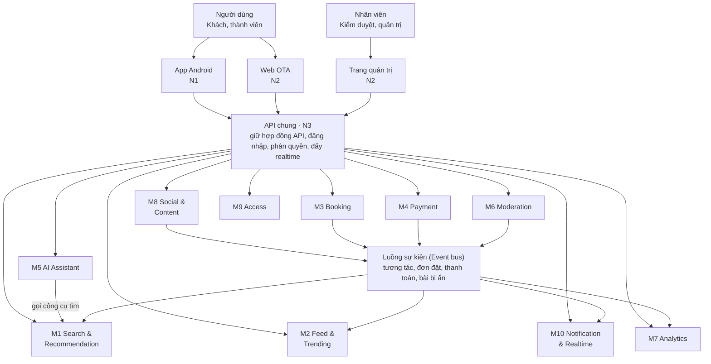

# Phân công nghiên cứu module – Tripflix

> Tổng hợp và cấu trúc lại từ hai tài liệu của nhóm: *"07 – Phân công nghiên cứu module"* và *"VSF – OTA"* (ghi chú của Duy kèm sơ đồ kiến trúc).
> Phần ghi **"(bổ sung)"** là đề xuất thêm khi cấu trúc lại, nhóm xem và sửa nếu cần. Mục 8 liệt kê các chỗ chưa thống nhất cần chốt.

---

## 1. Mục đích và cách làm

**Vấn đề** (theo ghi chú của Duy): tài liệu hiện tại chủ yếu mô tả lại đặc tả mentor đưa, và mỗi người nghiên cứu quá rộng.

**Cách làm mới**:
1. **Chia module** theo kiến trúc hệ thống.
2. **Từng người nghiên cứu** module của mình, viết theo khung báo cáo chung (mục 6).
3. **Đặt câu hỏi** theo từng vấn đề module gặp phải.
4. **Họp ghép**: tổng hợp, bàn với cả nhóm, chốt cách các module trao đổi dữ liệu.
5. **Hỏi mentor** những câu còn lại.

Danh sách module ban đầu do AI đề xuất; ai thấy cần điều chỉnh thì comment.

---

## 2. Kiến trúc và danh sách module

### 2.1. Sơ đồ (vẽ lại, đánh số thống nhất với bảng phân công)



### 2.2. Danh sách module

| Mã | Module | Phạm vi theo đặc tả (bổ sung) |
|---|---|---|
| M1 | Search & Recommendation | A3, A6 (tìm bằng lời), A7 (gợi ý), A9 (gợi ý phần còn thiếu), B2 (tìm bằng ảnh) |
| M2 | Feed & Trending | A1 (bảng tin xu hướng), phần tính điểm cho A15 |
| M3 | Booking | A4, A8 (đặt chỗ), A11 (đặt theo lộ trình), dữ liệu cho A5, A16 |
| M4 | Payment | Thanh toán giả lập, chống trừ tiền hai lần, hoàn tiền (A4, A8, A11), dữ liệu cho A16 |
| M5 | AI Assistant | A12, B1 (tóm tắt bài), B7 (theo dõi trợ lý) |
| M6 | Moderation | A14 (kiểm duyệt), riêng tư ảnh (mục 6) |
| M7 | Analytics | Màn hình A15, A16, B7; đo mục 9 |
| M8 | Social & Content | A2 (đăng bài), A10 (tương tác), B5 (chia sẻ dạng ảnh), bài đăng mô phỏng |
| M9 | Access | A13 (đăng nhập, phân quyền), quay lại đúng màn sau đăng nhập, chặn dưới 18 |
| M10 | Notification & Realtime | Đồng bộ app ↔ web (A5, A10), báo bài bị ẩn (A14), B3, B6 |

**Nền tảng** (việc chung, không thuộc module nào):

| Mã | Nền tảng | Nội dung |
|---|---|---|
| N1 | App Android | Chọn công nghệ; tối ưu máy yếu, mạng yếu |
| N2 | Web OTA và trang quản trị | Chọn công nghệ; khung trang |
| N3 | Backend | API Gateway, cơ sở dữ liệu, Event bus, quy ước API chung |
| N4 | Đo lường | Bản đề xuất cách đo theo mục 9 |

---

## 3. Bảng phân công

10 module chia cho 7 người: 4 người làm một module, 3 người ghép hai module cùng mảng. Việc nền tảng giao thêm cho người có module liên quan. Trước khi chốt, nhóm nên đổi chỗ theo sở trường từng người.

| Thành viên | Module chính | Nền tảng phụ trách thêm |
|---|---|---|
| Le Anh Duy | M1 Search & Recommendation | — |
| Nguyen Thanh Phong | M2 Feed & Trending | N1 App Android |
| Nguyen Le Phuc Thang | M3 Booking + M4 Payment | — |
| Le Nguyen Quoc Bao | M5 AI Assistant | — |
| Le Thi Thuy Trang (**Leader tuần 1**) | M6 Moderation + M7 Analytics | N4 Đo lường |
| Le Quang Thanh | M8 Social & Content | N2 Web OTA và quản trị; bài đăng mô phỏng |
| Hoang Duc Dung | M9 Access + M10 Notification & Realtime | N3 Backend |

**Lý do phân bổ**:
- Trang làm Leader tuần 1 nên nhận hai module nhẹ hơn, còn thời gian điều phối và gom bản đề xuất cách đo.
- Booking + Payment nặng nhất và chứa luồng A11 mentor chắc chắn sẽ thử, nên Thắng không nhận thêm việc nền tảng.
- Leader đổi sau mỗi buổi demo theo đặc tả; **module phụ trách giữ nguyên cả 4 tuần**.

---

## 4. Chi tiết từng người

Mỗi người có 4 loại việc: **nghiên cứu**, **câu hỏi mở** (mục 5 đặc tả) cần đưa ra đề xuất, **cách đo** (mục 9 đặc tả) cần đề xuất, và **tuần 1** (phần phải chạy được ở buổi demo thứ Sáu).

### 4.1. Le Anh Duy — M1 Search & Recommendation
| Loại việc | Nội dung |
|---|---|
| Nghiên cứu | Tìm theo nghĩa bằng embedding và vector index cho tiếng Việt · chuẩn hóa không dấu, viết tắt, tiếng lóng, trộn tiếng Anh, emoji · tách ngân sách, số người từ câu tìm ("4 đứa, dưới 2 củ một người") · gợi ý theo gu kèm lý do · gợi ý phần còn thiếu sau khi đặt · tìm bằng ảnh (B2) |
| Câu hỏi mở | Không có kết quả phù hợp thì nói gì, gợi ý nới điều kiện ra sao |
| Cách đo | Tìm trong bài đăng ra đúng thứ người dùng muốn, kể cả khi viết kiểu người trẻ (đề xuất bộ câu thử và cách chấm) |
| Tuần 1 | Tìm bằng lời và gợi ý trên web |

### 4.2. Nguyen Thanh Phong — M2 Feed & Trending + N1 App Android
| Loại việc | Nội dung |
|---|---|
| Nghiên cứu | Công thức điểm xu hướng có suy giảm theo thời gian · thu tín hiệu xem, thích, lưu, bỏ qua · cá nhân hóa bảng tin theo gu · phát hiện đẩy ảo · cuộn không lặp bài · **N1**: so sánh Kotlin, Flutter, React Native; tải ảnh và video nhẹ cho máy yếu, mạng yếu |
| Câu hỏi mở | "Đang được quan tâm" tính theo tín hiệu nào · bao lâu thì bài lên bảng tin, bao lâu thì hạ nhiệt · chặn một người dùng nhiều tài khoản để đẩy bài · người mới chưa có gu thì xem gì |
| Cách đo | Bảng tin tải nhanh, cuộn mượt trên máy yếu và mạng yếu · xu hướng phản ánh đúng và khó bị đẩy ảo |
| Tuần 1 | Bảng tin xu hướng trên app, mở là thấy kể cả khi chưa đăng nhập |

### 4.3. Nguyen Le Phuc Thang — M3 Booking + M4 Payment
| Loại việc | Nội dung |
|---|---|
| Nghiên cứu | Cấu trúc dữ liệu sản phẩm (khách sạn, vé bay, vé vui chơi, combo) trong bộ dữ liệu được cấp · giữ chỗ tạm thời · chống trừ tiền hai lần (idempotency key) · hai người tranh chỗ cuối (khóa dòng hoặc trừ tồn kho có điều kiện) · đặt cả lộ trình một lần và xử lý khi một mục thất bại · dời ngày theo lộ trình gốc · dấu hiệu đơn bất thường |
| Câu hỏi mở | Giữ chỗ bao lâu khi đang thanh toán · lộ trình có một mục lỗi thì hủy hết hay giữ phần đã đặt · người đăng xóa bài hoặc một mục ngừng bán thì người đã lưu bài thấy gì |
| Cách đo | Số thao tác và thời gian từ bài đăng tới thanh toán xong · danh sách tình huống thử chứng minh không trừ tiền hai lần, không bán chỗ cuối hai lần |
| Tuần 1 | Trang chi tiết sản phẩm với giá thật và tình trạng còn chỗ |

### 4.4. Le Nguyen Quoc Bao — M5 AI Assistant
| Loại việc | Nội dung |
|---|---|
| Nghiên cứu | So sánh các LLM về chất lượng tiếng Việt và chi phí · chỉ trả lời từ dữ liệu thật (RAG, gọi công cụ tra cứu, kiểm tra ID trước khi trả) · hỏi lại khi thiếu thông tin · từ chối ngoài phạm vi · giữ hội thoại khi đăng nhập giữa chừng · ghi log chi phí từng cuộc |
| Câu hỏi mở | Trợ lý dựa vào đâu để chọn gợi ý, làm sao chắc không bịa · nhớ gì, nhớ bao lâu, chưa đăng nhập thì sao, đang nói trên app mở web có tiếp tục được không · được dùng thông tin nào của người dùng · một cuộc trò chuyện tốn bao nhiêu, có giới hạn không |
| Cách đo | Trợ lý không bịa, mọi gợi ý đều có thật · số câu hỏi đã thử và các kiểu câu hỏi |
| Tuần 1 | Thử nghiệm cách làm và bộ câu hỏi thử |

### 4.5. Le Thi Thuy Trang — M6 Moderation + M7 Analytics + N4 Đo lường (Leader tuần 1)
| Loại việc | Nội dung |
|---|---|
| Nghiên cứu | Hàng chờ kiểm duyệt có ưu tiên · ẩn, hiện, xóa kèm lý do · nhật ký thao tác · kiểm duyệt tự động bằng API hoặc AI · xử lý ảnh có mặt người lạ và thông tin cá nhân · các màn hình quản trị cho A15, A16, B7 |
| Câu hỏi mở | Bài hoặc bình luận bị báo cáo thì ẩn ngay hay chờ người duyệt · có tự động kiểm duyệt không, AI Agent tham gia được không · người đăng sửa bài có phải duyệt lại không |
| Cách đo | **Gom cách đo của cả nhóm** thành bản đề xuất theo mục 9 để trình bày cuối tuần 1 · thời gian từ lúc ẩn bài tới lúc bài biến mất khỏi app, web và trợ lý |
| Tuần 1 | Khung trang quản trị; phối hợp với Dung phần đăng nhập và phân quyền |

### 4.6. Le Quang Thanh — M8 Social & Content + N2 Web OTA và quản trị
| Loại việc | Nội dung |
|---|---|
| Nghiên cứu | Đăng bài chữ, ảnh, video ngắn kèm lộ trình lấy từ "Chuyến đi của tôi" · tải ảnh và video khi mạng yếu · giữ bài và bình luận đang viết khi mất mạng · đếm lượt cảm xúc đúng khi nhiều người cùng bấm · link chia sẻ mở trên trình duyệt và mở thẳng app (deep link) · **N2**: chọn công nghệ cho web và trang quản trị · tạo bài đăng mô phỏng có đánh dấu rõ (bộ dữ liệu không có bài đăng) |
| Câu hỏi mở | Làm sao biết chắc người đăng đã đi thật · số lượt cảm xúc phải đúng ngay hay chấp nhận lệch vài giây · lộ trình đính kèm hiện gì của người đăng, cái gì là riêng tư (bàn với Thắng) |
| Cách đo | Lượt tương tác luôn đúng trên app và web kể cả khi nhiều người cùng thao tác |
| Tuần 1 | Bộ bài đăng mô phỏng cho bảng tin và tìm kiếm; khung trang web |

### 4.7. Hoang Duc Dung — M9 Access + M10 Notification & Realtime + N3 Backend
| Loại việc | Nội dung |
|---|---|
| Nghiên cứu | Đăng nhập bằng token · phân quyền theo vai trò (Khách, Thành viên, Dưới 18, Người đã đi, Kiểm duyệt, Quản trị) · đăng nhập xong quay lại đúng màn đang dở · đồng bộ thời gian thực bằng WebSocket hoặc SSE · thông báo đẩy qua FCM · **N3**: chọn công nghệ backend, cơ sở dữ liệu, cache, Event bus; soạn bản nháp quy ước API chung cho buổi họp ghép |
| Câu hỏi mở | Cùng một tài khoản mở trên app và web, sửa ở một nơi thì nơi kia thấy sau bao lâu |
| Cách đo | Mọi sản phẩm luôn thấy cùng dữ liệu; chênh lệch bao lâu |
| Tuần 1 | Đăng nhập và phân quyền cho trang quản trị; backend và cơ sở dữ liệu chạy được cho cả nhóm |

---

## 5. Ranh giới giữa các module

### 5.1. Các cặp phải trao đổi trước khi nộp báo cáo

| Cặp | Chủ đề |
|---|---|
| Thắng ↔ Thanh | Lộ trình đính kèm bài đăng lấy từ đơn đã đi; dấu "đã đi thật"; phần nào của lộ trình là riêng tư |
| Phong ↔ Duy ↔ Bảo | Cùng dùng tín hiệu gu, cùng cần tìm theo nghĩa → **dùng chung một mô hình embedding và một vector index** |
| Trang ↔ Phong, Duy, Bảo | Bài bị ẩn phải biến mất khỏi bảng tin, tìm kiếm và trợ lý |
| Dung ↔ tất cả | Quy ước API, định dạng sự kiện, cách kiểm tra quyền |

### 5.2. Gợi ý sự kiện chính trên Event bus (bổ sung, để làm đầu vào buổi họp ghép)

| Sự kiện | Module phát | Module nhận |
|---|---|---|
| `post.created`, `post.updated` | M8 | M6 (sàng lọc), M1 (lập chỉ mục), M2 |
| `post.hidden`, `comment.hidden` | M6 | M1, M2, M5, M10 (báo người đăng) |
| `interaction.created` (xem, thích, lưu, bỏ qua, bình luận) | M8 | M2 (xu hướng), M1 (gu), M7 |
| `booking.held`, `booking.confirmed`, `booking.failed`, `hold.expired` | M3 | M10, M7, M1 (gợi ý phần còn thiếu) |
| `payment.succeeded`, `payment.refunded` | M4 | M3, M7 |
| `user.logged_in` (gộp phiên ẩn danh) | M9 | M5 (giữ hội thoại), M1 (gu) |
| `trend.flagged` (nghi đẩy ảo) | M2 | M6, M7 |

---

## 6. Khung báo cáo chung

Mọi người nộp theo đúng 8 mục, **tối đa 2 trang**, để buổi họp ghép đọc nhanh và so được giữa các module. Người ghép hai module thì viết mỗi module một bản.

```markdown
# [Tên module] — [Người phụ trách]

1. Phạm vi: module lo những tính năng nào (mã A/B), không lo phần nào.
2. Dữ liệu: module giữ những bảng/đối tượng nào, các trường chính.
3. API cung cấp: endpoint nào cho app, web, admin hoặc module khác gọi.
4. Phụ thuộc: cần gọi API hay đọc dữ liệu nào của module khác.
5. Sự kiện: phát ra sự kiện nào, nhận sự kiện nào qua Event bus.
6. Cách làm đề xuất: ít nhất 2 phương án, so sánh ưu nhược, chọn cái nào và vì sao.
7. Câu hỏi mở và cách đo: đề xuất cho các câu được giao, kèm lý do.
8. Rủi ro và câu hỏi cho mentor.
```

**Mục 2 đến 5 quan trọng nhất**: đó là đầu vào để chốt cách các module trao đổi dữ liệu ngay tuần 1, như đặc tả mục 11 yêu cầu.

---

## 7. Quy trình tuần 1

### 7.1. Việc của mỗi người
- [ ] Đọc phần tính năng của mình trong đặc tả và tiêu chí nghiệm thu **trước** khi tìm công nghệ.
- [ ] Viết báo cáo theo khung ở mục 6.
- [ ] Trao đổi với các cặp ở mục 5.1.
- [ ] Ghi câu hỏi cho mentor và giả định vào tab **"Câu hỏi & Giả định"** trong file theo dõi tiến độ.
- [ ] Điền module vào cột **"Phụ trách chính"** và **"Phụ trách phụ"** ở tab **"Thành viên"**.

### 7.2. Kết quả sau buổi họp ghép
1. Công nghệ chung đã chốt (app, web, backend, cơ sở dữ liệu, Event bus).
2. Danh sách API và sự kiện giữa các module.
3. Bản đề xuất cách đo theo mục 9 (Trang gom).
4. Danh sách câu hỏi gửi mentor.

---

## 8. Trạng thái các điểm cần chốt

| # | Điểm | Trạng thái |
|---|---|---|
| 1 | Đánh số module trong sơ đồ gốc bị trùng (#4 dùng hai lần, #3 cho cả Web và Quản trị, thiếu Feed, Moderation, Analytics, Notification) | **Cần cập nhật hình** theo cách đánh số M1–M10, N1–N4 ở mục 2 |
| 2 | Có xác minh "đã đi thật" hay không | ✅ **Đã chốt: có.** Chỉ người đã đặt và đã đi mới đăng bài; vai trò "Người đã đi" là trạng thái của thành viên |
| 3 | Nút chính | ✅ **Đã chốt: "Đặt y chang" (A11)**, sao chép lộ trình và dời ngày. "Đi ngay" (lên phương án từ nơi người xem ở) chỉ là hướng phát triển nếu có thêm thời gian |
| 4 | Nguồn dịch vụ | ✅ **Đã chốt: dịch vụ Vinpearl** trong bộ dữ liệu được cấp; bài đăng mô phỏng có nhãn |
| 5 | Tên sản phẩm | ✅ **Đã chốt: Tripflix** |
| 6 | Công nghệ (app, web, backend) | ⏳ **Chưa chốt**: so sánh hai phương án ở `docs/03` mục 10.3; chốt ở buổi họp ghép và hỏi mentor |

Bản tổng hợp toàn dự án theo hướng đã chốt: [docs/03-y-tuong-trien-khai.md](../docs/03-y-tuong-trien-khai.md).
